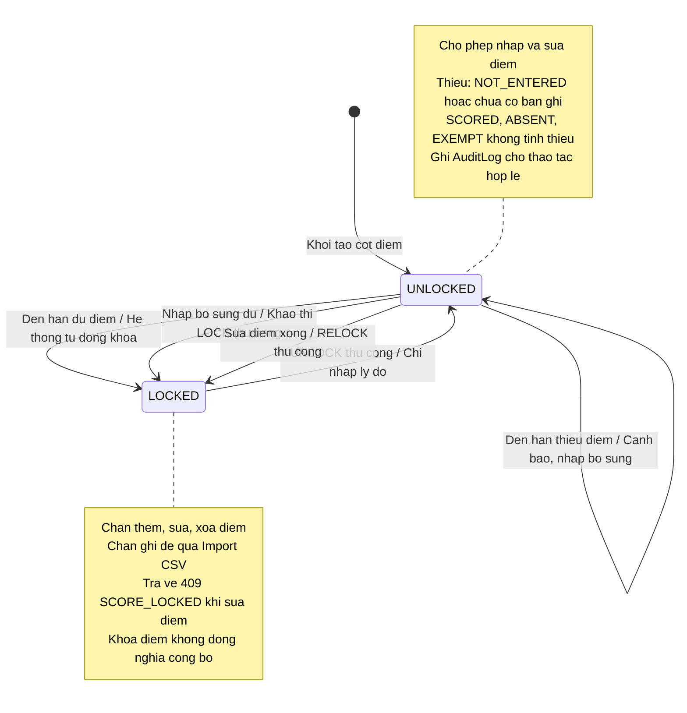
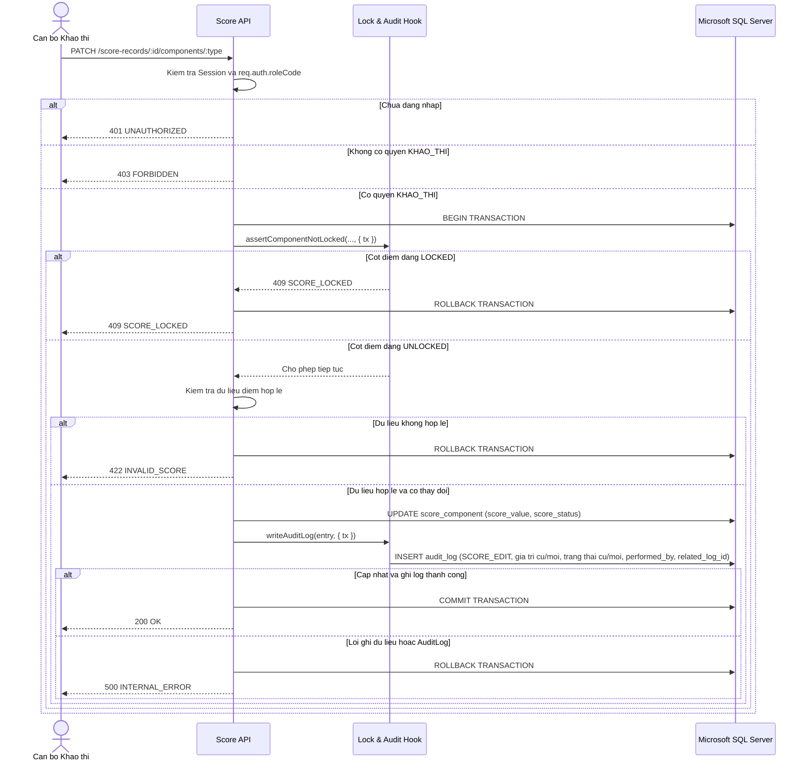
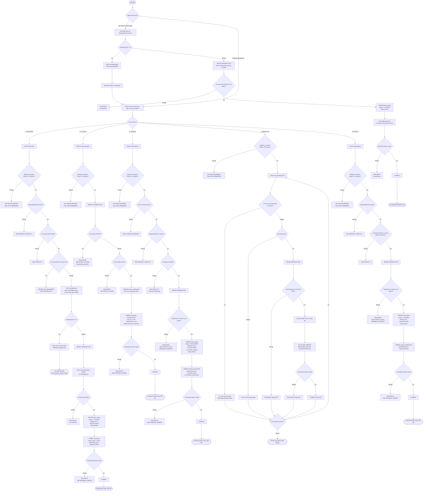

# THIET KE KHOA DIEM, MO KHOA VA AUDIT LOG

## 1. Muc tieu

### 1.1. Muc tieu thiet ke

Thiet ke co che khoa diem va Audit Log cho he thong quan ly ket qua hoc tap THPT:

- Khoa va mo khoa doc lap theo tung thanh phan diem: QT1, QT2, QT3, GK, CK.
- Khoa theo tung nien khoa, lop va mon hoc.
- Khi den thoi han khoa diem, he thong tu dong khoa tung cot neu da nhap day du diem. Neu con thieu diem, he thong hien thi canh bao va giu cot o trang thai UNLOCKED. Sau khi bo sung day du diem, can bo Khao thi thuc hien khoa thu cong cot do.
- Chan backend tuyet doi khong cho them, sua, xoa diem khi cot diem dang o trang thai khoa (LOCKED).
- Khi phat hien diem sai sau khi da khoa, can bo Khao thi thuc hien mo khoa (UNLOCK) thu cong va chi bat buoc nhap ly do (unlock_reason). He thong tu dong xac dinh nguoi thuc hien tu tai khoan dang dang nhap va ghi nhan vao AuditLog.
- Sau khi sua diem xong thi can bo khao thi phai thuc hien khoa lai (RELOCK) cot diem.
- Ghi Audit Log bat bien cho moi thao tac khoa, mo khoa, sua diem va khoa lai.
- Hoan thien bang AuditLog: `performed_by` va `requested_by` tham chieu `dbo.app_user(user_id)`; tai khoan thuc hien duoc xac dinh qua Session Middleware.
- Bao dam truy vet day du nguoi khoa, nguoi mo khoa, nguoi sua diem va thoi diem thuc hien bang `DATETIMEOFFSET(7)` cua Microsoft SQL Server.
- Ap dung Database Transaction bat buoc cho ca 4 thao tac LOCK, UNLOCK, RELOCK va SCORE_EDIT: cap nhat LockStatus/Score va ghi AuditLog phai thanh cong cung nhau; neu loi thi rollback toan bo.
- Tach biet ro rang giua trang thai Khoa diem va Cong bo diem: hai trang thai doc lap hoan toan, khong tu dong cong bo khi khoa diem. Quy tac tu dong khoa theo thoi han da duoc nhom thong nhat ve nghiep vu; viec lap trinh co che tu dong phai tuan thu dieu kien CR duoc phe duyet theo bang phan cong.
- Bo sung so do Activity Diagram the hien luong tu dong khoa khi den han va du diem, canh bao khi thieu diem, khoa thu cong sau khi bo sung du diem, mo khoa co ly do, sua diem va khoa lai thu cong; the hien transaction va cac truong hop tu choi thao tac (403, 400, 409).
- Cung cap day du dac ta thuc the, rang buoc va API Contract de phuc vu tong hop ERD he thong va Data Dictionary.

### 1.2. Công nghệ và quy ước

- **Frontend:** HTML5, CSS3, JavaScript.
- **Backend:** Node.js, Express.js.
- **Hệ quản trị cơ sở dữ liệu:** Microsoft SQL Server Express.
- **Công cụ quản lý cơ sở dữ liệu:** SQL Server Management Studio 22 (SSMS 22).
- **Ngôn ngữ truy vấn cơ sở dữ liệu:** SQL / T-SQL.
- **Thư viện kết nối Backend với SQL Server:** `mssql/msnodesqlv8` (theo danh sách công nghệ của nhóm).
- **API:** REST, JSON.
- **Base URL:** `http://localhost:3000/api/v1`.
- **Quy ước tên bảng và cột cơ sở dữ liệu:** `snake_case`.
- **Quy ước tên thuộc tính JSON:** `camelCase`.
- **Quy ước tên endpoint:** Chữ thường, `kebab-case`, danh từ số nhiều.
- **Quy ước kiểu dữ liệu:** Sử dụng kiểu dữ liệu Microsoft SQL Server, bảo đảm tương thích với thiết kế dữ liệu của các module liên quan.
- **Quy ước giao dịch:** Những thao tác cập nhật trạng thái khóa điểm, chỉnh sửa điểm và ghi AuditLog phải bảo đảm tính nhất quán của giao dịch. Nếu xảy ra lỗi, không được lưu thay đổi một phần.

### 1.3. Tai lieu tham chieu

- Bao cao khao sat va dac ta Use Case cua Nhom 5.
- UC08: Khoa diem.
- UC09: Mo khoa diem va ghi nhan Audit Log.
- UC13: Hoc sinh xem ket qua hoc tap cua chinh minh.
- docs/vt3-data-model.md (module quan ly hoc sinh va lop hoc).
- docs/vt4-score-design.md (module quan ly diem).
- docs/api-conventions.md (quy chuan API va kien truc).
- docs/figma-handoff.md (quy chuan thiet ke giao dien).

---

## 2. Cac thuc the

### 2.1. Danh sach thuc the thiet ke

1. **LockStatus**: Quan ly trang thai khoa theo nien khoa, lop, mon va thanh phan diem.
2. **AuditLog**: Luu vet lich su bat bien ve cac thao tac khoa, mo khoa, sua diem va import diem.

### 2.2. Cac thuc the lien quan trong he thong

Su dung thuc the quan ly tai khoan va nguoi dung (Module Xac thuc va phan quyen):
- **User** (bang `dbo.app_user`): Luu thong tin tai khoan voi `user_id BIGINT IDENTITY(1,1)` la khoa chinh, `username NVARCHAR(50)` va `role_id BIGINT` tham chieu `dbo.role`. Cac truong `performed_by`, `requested_by`, `locked_by`, `unlocked_by` tham chieu `dbo.app_user(user_id)`.

Su dung cac thuc the cua module quan ly hoc sinh va lop hoc:
- **AcademicYear**: Nien khoa.
- **Class**: Lop hoc.
- **Subject**: Mon hoc.
- **Student**: Hoc sinh.
- **Enrollment**: Lich su phan lop cua hoc sinh.

Su dung cac thuc the cua module quan ly diem:
- **ScoreRecord**: Ban ghi diem theo hoc sinh/enrollment va mon hoc.
- **ScoreComponent**: Thanh phan diem cu the (QT1, QT2, QT3, GK, CK).

### 2.3. Quan he du lieu de xuat

- `AcademicYear`, `Class`, `Subject` lien ket voi `LockStatus` de xac dinh pham vi khoa theo bo 4 thanh phan.
- Moi `LockStatus` dai dien cho 1 thanh phan diem cua 1 mon hoc tai 1 lop trong 1 nien khoa.
- `User` lien ket voi `LockStatus`:
  + `locked_by` tham chieu `app_user(user_id)`: Nguoi thuc hien khoa / khoa lai.
  + `unlocked_by` tham chieu `app_user(user_id)`: Nguoi thuc hien mo khoa.
  + `requested_by` tham chieu `app_user(user_id)`: Nguoi yeu cau mo khoa de giai trinh.
- `User` lien ket voi `AuditLog`:
  + `performed_by` tham chieu `app_user(user_id)`: Tai khoan thuc hien thao tac (bat buoc NOT NULL).
  + `requested_by` tham chieu `app_user(user_id)`: Tai khoan nguoi yeu cau thao tac (cho phep NULL).
- `LockStatus` lien ket voi `AuditLog` de theo doi toan bo lich su thay doi trang thai khoa cua cot diem.
- `ScoreRecord` va `ScoreComponent` lien ket voi `AuditLog` de luu chi tiet diem truoc va sau khi sua.
- `Student` lien ket voi `AuditLog` de biet hoc sinh nao duoc sua diem.
- `AuditLog` co quan he tu tham chieu (`related_log_id` tro ve `audit_log_id` cua ban ghi `UNLOCK`) de lien ket chat che tung lan sua diem voi phien mo khoa co ly do hop le truoc do.

---

## 3. Thiet ke thuoc tinh va rang buoc

### 3.1. LockStatus

Muc dich: Luu trang thai khoa hien tai cua tung thanh phan diem theo nien khoa, lop va mon hoc.

| Thuoc tinh | Kieu du lieu Microsoft SQL Server | Rang buoc de xuat | Mo ta |
|---|---|---|---|
| `lock_status_id` | `BIGINT IDENTITY(1,1)` | PRIMARY KEY | Ma trang thai khoa |
| `academic_year_id` | `BIGINT` | NOT NULL, FOREIGN KEY | Tham chieu academic_year(academic_year_id) |
| `class_id` | `BIGINT` | NOT NULL, FOREIGN KEY | Tham chieu class(class_id) |
| `subject_id` | `BIGINT` | NOT NULL, FOREIGN KEY | Tham chieu subject(subject_id) |
| `component` | `VARCHAR(10)` | NOT NULL | QT1, QT2, QT3, GK, CK |
| `status` | `VARCHAR(20)` | NOT NULL, DEFAULT 'UNLOCKED' | UNLOCKED hoac LOCKED |
| `locked_by` | `BIGINT` | Cho phep NULL, FOREIGN KEY | Tham chieu app_user(user_id) - Nguoi khoa |
| `locked_at` | `DATETIMEOFFSET(7)` | Cho phep NULL | Thoi diem thuc hien khoa |
| `unlocked_by` | `BIGINT` | Cho phep NULL, FOREIGN KEY | Tham chieu app_user(user_id) - Nguoi mo khoa |
| `unlocked_at` | `DATETIMEOFFSET(7)` | Cho phep NULL | Thoi diem thuc hien mo khoa |
| `requested_by` | `BIGINT` | Cho phep NULL, FOREIGN KEY | Tham chieu app_user(user_id) - Nguoi yeu cau mo khoa |
| `requested_by_name` | `NVARCHAR(150)` | Cho phep NULL | Ho ten/chuc vu nguoi yeu cau de giai trinh |
| `unlock_reason` | `NVARCHAR(MAX)` | Cho phep NULL | Ly do mo khoa bat buoc de giai trinh |
| `version` | `INT` | NOT NULL, DEFAULT 1 | Optimistic Locking tranh xung dot dong thoi |
| `created_at` | `DATETIMEOFFSET(7)` | NOT NULL, DEFAULT `SYSDATETIMEOFFSET()` | Thoi diem tao ban ghi |
| `updated_at` | `DATETIMEOFFSET(7)` | NOT NULL, DEFAULT `SYSDATETIMEOFFSET()` | Thoi diem cap nhat gan nhat |

**Rang buoc de xuat cho LockStatus:**

- `lock_status_id` la khoa chinh.
- `UNIQUE (academic_year_id, class_id, subject_id, component)`: Moi thanh phan diem cua mot mon hoc tai mot lop trong mot nien khoa chi co mot trang thai khoa.
- `component IN ('QT1', 'QT2', 'QT3', 'GK', 'CK')`.
- `status IN ('UNLOCKED', 'LOCKED')`.
- `version >= 1`.
- `academic_year_id` tham chieu `academic_year(academic_year_id)`.
- `class_id` tham chieu `class(class_id)`.
- `subject_id` tham chieu `subject(subject_id)`.
- `FOREIGN KEY (class_id, academic_year_id) REFERENCES class(class_id, academic_year_id)`: Bao dam lop hoc thuoc dung nien khoa; su dung khoa duy nhat kep da duoc de xuat trong thiet ke du lieu cua Ngoc.
- `locked_by` tham chieu `app_user(user_id)`.
- `unlocked_by` tham chieu `app_user(user_id)`.
- `requested_by` tham chieu `app_user(user_id)` (cho phep NULL).

**Luu y ky thuat:**

- Mac dinh khi bat dau nhap diem, trang thai cot diem la `UNLOCKED`.
- Truong `version` dung de phat hien xung dot khi nhieu can bo Khao thi thao tac dong thoi.
- Khi mo khoa (UNLOCK), can bo Khao thi chi bat buoc nhap ly do mo khoa. He thong tu dong lay req.auth.userId tu Session dang nhap de ghi nhan nguoi thuc hien vao unlocked_by va AuditLog. Khong yeu cau nhap requested_by hoac requested_by_name.
- Khi khoa lai (RELOCK), cap nhat `status = 'LOCKED'`, `locked_by`, `locked_at` va tang `version`.

### 3.2. AuditLog

Muc dich: Luu Audit Log bat bien (Append-Only) cho moi thao tac khoa, mo khoa, sua diem va import diem phuc vu cong tac thanh tra, giai trinh.

| Thuoc tinh | Kieu du lieu Microsoft SQL Server | Rang buoc de xuat | Mo ta |
|---|---|---|---|
| `audit_log_id` | `BIGINT IDENTITY(1,1)` | PRIMARY KEY | Ma ban ghi Audit Log |
| `action_type` | `VARCHAR(50)` | NOT NULL | LOCK, UNLOCK, RELOCK, SCORE_EDIT, SCORE_IMPORT |
| `performed_by` | `BIGINT` | NOT NULL, FOREIGN KEY | Tham chieu app_user(user_id) - Nguoi thuc hien |
| `requested_by` | `BIGINT` | Cho phep NULL, FOREIGN KEY | Tham chieu app_user(user_id) - Nguoi yeu cau |
| `requested_by_name` | `NVARCHAR(150)` | Cho phep NULL | Ho ten/ghi chu ve nguoi yeu cau |
| `lock_status_id` | `BIGINT` | Cho phep NULL, FOREIGN KEY | Tham chieu lock_status(lock_status_id) |
| `academic_year_id` | `BIGINT` | NOT NULL, FOREIGN KEY | Tham chieu academic_year(academic_year_id) |
| `class_id` | `BIGINT` | NOT NULL, FOREIGN KEY | Tham chieu class(class_id) |
| `subject_id` | `BIGINT` | NOT NULL, FOREIGN KEY | Tham chieu subject(subject_id) |
| `component` | `VARCHAR(10)` | Cho phep NULL | QT1, QT2, QT3, GK, CK |
| `student_id` | `BIGINT` | Cho phep NULL, FOREIGN KEY | Tham chieu student(student_id) |
| `score_record_id` | `BIGINT` | Cho phep NULL, FOREIGN KEY | Tham chieu score_record(score_record_id) |
| `score_component_id` | `BIGINT` | Cho phep NULL, FOREIGN KEY | Tham chieu score_component(score_component_id) |
| `old_value` | `DECIMAL(4,2)` | Cho phep NULL | Gia tri diem truoc khi sua |
| `new_value` | `DECIMAL(4,2)` | Cho phep NULL | Gia tri diem sau khi sua |
| `old_score_status` | `VARCHAR(15)` | Cho phep NULL | Trang thai diem truoc khi sua |
| `new_score_status` | `VARCHAR(15)` | Cho phep NULL | Trang thai diem sau khi sua |
| `reason` | `NVARCHAR(MAX)` | Cho phep NULL | Ly do mo khoa hoac sua diem |
| `related_log_id` | `BIGINT` | Cho phep NULL, FOREIGN KEY | Tham chieu audit_log(audit_log_id) |
| `result` | `VARCHAR(20)` | NOT NULL, DEFAULT 'SUCCESS' | SUCCESS, REJECTED, FAILED |
| `created_at` | `DATETIMEOFFSET(7)` | NOT NULL, DEFAULT `SYSDATETIMEOFFSET()` | Thoi diem ghi Audit Log |

**Rang buoc de xuat cho AuditLog:**

- `audit_log_id` la khoa chinh.
- `action_type IN ('LOCK', 'UNLOCK', 'RELOCK', 'SCORE_EDIT', 'SCORE_IMPORT')`.
- `result IN ('SUCCESS', 'REJECTED', 'FAILED')`.
- `performed_by` bat buoc NOT NULL, tham chieu `app_user(user_id)`.
- `requested_by` cho phep NULL, tham chieu `app_user(user_id)`.
- Khi `action_type = 'UNLOCK'`, bat buoc co `reason` khong rong va `requested_by` hoac `requested_by_name` hop le.
- Cac truong khoa ngoai phai tham chieu ban ghi ton tai trong cac bang lien quan.
- `related_log_id` tham chieu `audit_log(audit_log_id)` de lien ket lan sua diem voi lan mo khoa tuong ung.
- AuditLog tuan thu nguyen tac Append-Only: chi ghi them, khong cho phep sua hoac xoa qua API.
- `old_score_status` va `new_score_status` chi nhan mot trong bon gia tri: `NOT_ENTERED`, `SCORED`, `ABSENT`, `EXEMPT` hoac `NULL`.
- Doi voi `SCORE_EDIT` va `SCORE_IMPORT` co thay doi diem, ghi nhan trang thai diem truoc va sau khi thay doi. Cac thao tac `LOCK`, `UNLOCK` va `RELOCK` co the de hai truong nay bang `NULL`.

### 3.3. Co che xac dinh va truy vet tai khoan qua Session Middleware

De bao dam truy vet day du, chinh xac nguoi thuc hien va thoi diem thao tac:

1. **Xac dinh tai khoan tu Middleware xac thuc:**
   - Backend khong tin tuong cac tham so dinh danh nguoi thuc hien do client truyen qua Request Body hoac Query.
   - Auth Middleware kiem tra Session hop le thong qua cookie va cung cap `req.auth.userId`, `req.auth.username`, `req.auth.roleCode`, `req.auth.studentId` (neu co).
   - Backend xac dinh `performed_by = req.auth.userId`, tham chieu `dbo.app_user(user_id)`. Khong lay ID nguoi thuc hien do client tu truyen.

2. **Truy vet cac thao tac va thoi diem (DATETIMEOFFSET(7)):**
   - **Nguoi khoa diem:** Luu `locked_by`, `locked_at` trong LockStatus; ghi AuditLog voi `action_type = 'LOCK'`, `performed_by` va `created_at = SYSDATETIMEOFFSET()`.
   - **Nguoi mo khoa diem:** Luu `unlocked_by = req.auth.userId`, `unlocked_at` va `unlock_reason` trong LockStatus. Ghi AuditLog voi `action_type = 'UNLOCK'`, `performed_by = req.auth.userId`, ly do mo khoa va thoi diem thuc hien. Tai khoan nguoi thuc hien duoc xac dinh tu Session, khong yeu cau nhap thu cong.
   - **Nguoi sua diem:** Ghi AuditLog voi `action_type = 'SCORE_EDIT'`, `performed_by`, `old_value`, `new_value`, `old_score_status`, `new_score_status`, `reason`, `related_log_id` (neu co) va `created_at`. Viec cap nhat diem va ghi log phai nam trong cung database transaction.
   - **Nguoi khoa lai:** Cap nhat `locked_by`, `locked_at` trong LockStatus; ghi AuditLog voi `action_type = 'RELOCK'`, `performed_by` va `created_at = SYSDATETIMEOFFSET()`.

#### 3.3.1. Co che ghi nhan nguoi thuc hien mo khoa

Khi phat hien diem sai sau khi cot diem da duoc khoa, can bo Khao thi co quyen thuc hien UNLOCK thu cong.

**Thong tin nhap khi mo khoa:**
- Nguoi dung chi bat buoc nhap ly do mo khoa (`reason`).
- Ly do khong duoc de trong hoac chi chua khoang trang.
- Khong yeu cau nguoi dung nhap ten, ma tai khoan hoac thong tin nguoi thuc hien.

**Xac dinh nguoi thuc hien:**
- Backend xac thuc Session dang nhap.
- Lay `req.auth.userId` de xac dinh tai khoan thuc hien thao tac.
- Chi tai khoan co vai tro `KHAO_THI` moi duoc phep mo khoa.
- Khong tin tuong thong tin dinh danh nguoi thuc hien do client tu truyen.

**Luu du lieu trong LockStatus:**
- `status = 'UNLOCKED'`.
- `unlocked_by = req.auth.userId`.
- `unlocked_at = SYSDATETIMEOFFSET()`.
- `unlock_reason = body.reason`.
- Tang `version` de kiem soat xung dot.

**Ghi nhan trong AuditLog:**
- `action_type = 'UNLOCK'`.
- `performed_by = req.auth.userId`.
- `reason = body.reason`.
- `created_at = SYSDATETIMEOFFSET()`.
- `result = 'SUCCESS'`.

**Tinh tuong thich du lieu:**
- Cac truong `requested_by` va `requested_by_name` hien co van duoc giu trong thiet ke de tranh anh huong du lieu cu.
- Hai truong nay cho phep NULL va khong bat buoc trong luong UNLOCK da thong nhat.
- Khong su dung hai truong nay de thay the tai khoan nguoi thuc hien.

**Tinh toan ven:**
- Thao tac UNLOCK va ghi AuditLog phai nam trong cung Database Transaction.
- Neu cap nhat trang thai hoac ghi AuditLog that bai, he thong rollback toan bo.

### 3.4. Quy tac toan ven giao dich (Transaction Integrity)

Cac thao tac LOCK, UNLOCK, RELOCK va SCORE_EDIT/SCORE_IMPORT phai bao dam cap nhat du lieu va ghi AuditLog trong cung database transaction. Su dung co che transaction cua Microsoft SQL Server; neu mot buoc that bai thi rollback toan bo, khong luu thay doi mot phan.

**1. Khoa diem (LOCK):**
- Kiem tra trang thai khoa va `expectedVersion`.
- Cap nhat `status = 'LOCKED'`, `locked_by`, `locked_at` va tang `version`.
- Ghi AuditLog voi `action_type = 'LOCK'`.

**2. Mo khoa (UNLOCK):**
- Kiem tra Session, quyen `KHAO_THI`, cot dang `LOCKED`, `expectedVersion` va ly do mo khoa hop le.
- Cap nhat `status = 'UNLOCKED'`, `unlocked_by = req.auth.userId`, `unlocked_at`, `unlock_reason` va tang `version`.
- Ghi AuditLog voi `action_type = 'UNLOCK'`, `performed_by = req.auth.userId`, ly do va thoi diem thuc hien.
- Cap nhat LockStatus va ghi AuditLog trong cung transaction; neu co loi thi rollback toan bo.

**3. Khoa lai (RELOCK):**
- Kiem tra cot dang `UNLOCKED`, `expectedVersion` va lan mo khoa hop le truoc do.
- Cap nhat `status = 'LOCKED'`, `locked_by`, `locked_at` va tang `version`.
- Ghi AuditLog voi `action_type = 'RELOCK'`.

**4. Sua diem va import diem (SCORE_EDIT/SCORE_IMPORT):**
- Kiem tra quyen, trang thai khoa va tinh hop le cua du lieu diem truoc khi ghi.
- Tu choi cap nhat neu cot diem dang `LOCKED` (`409 SCORE_LOCKED`).
- Cap nhat `score_value`, `score_status` va ghi AuditLog trong cung transaction.
- AuditLog luu `old_value`, `new_value`, `old_score_status`, `new_score_status`, nguoi thuc hien, ly do va lien ket lan mo khoa tuong ung (neu co).
- Khi ghi AuditLog that bai, rollback toan bo thay doi diem.

**Nguyen tac chung:**
- Moi thao tac thay doi du lieu phai bao dam tinh nhat quan transaction.
- Kiem tra trang thai khoa va phien ban trong transaction de han che xung dot dong thoi.
- Thoi diem truy vet su dung `DATETIMEOFFSET(7)` va `SYSDATETIMEOFFSET()` theo thiet ke SQL Server.
- Khong xac nhan thao tac thanh cong neu cap nhat du lieu hoac ghi AuditLog that bai.

---

## 4. Quy tac nghiep vu (Business Rules)

### 4.1. Quy tac khoa diem

- **BR-L01**: Moi cot diem co trang thai khoa hoan toan doc lap theo bo 4 thanh phan: Nien khoa (`academic_year_id`), Lop (`class_id`), Mon hoc (`subject_id`) va Thanh phan diem (`component`: QT1, QT2, QT3, GK, CK).
- **BR-L02**: Thao tac khoa hoac mo khoa mot cot diem khong anh huong den bat ky cot diem nao khac trong cung lop hay khac lop.
- **BR-L03**: Chi tai khoan co vai tro `KHAO_THI` moi duoc phep thuc hien cac thao tac khoa (LOCK), mo khoa (UNLOCK) va khoa lai (RELOCK) thu cong. Co che tu dong khoa theo thoi han la nghiep vu do he thong thuc hien, khong phai thao tac thu cong cua nguoi dung. Khi trien khai tu dong khoa, phai bao dam ghi nhan AuditLog va tuan thu CR da duoc phe duyet.
- **BR-L04**: Mac dinh khi bat dau mot nien khoa va mo nhap diem, moi cot diem o trang thai `UNLOCKED`.
- **BR-L05**: He thong quan ly trang thai khoa doc lap theo tung cot diem QT1, QT2, QT3, GK va CK. Khi den thoi han khoa diem, he thong kiem tra muc do day du du lieu cua tung cot.

  + **Truong hop 1 - Den han va da du diem (`missingCount = 0`):**
    * He thong tu dong khoa cot diem theo thoi han da quy dinh.
    * Trang thai cot diem chuyen tu `UNLOCKED` sang `LOCKED`.
    * Qua trinh khoa phai bao dam tinh nhat quan giua LockStatus va AuditLog.

  + **Truong hop 2 - Den han nhung con thieu diem (`missingCount > 0`):**
    * He thong hien thi canh bao so luong hoc sinh chua co diem.
    * Cot diem tiep tuc giu trang thai `UNLOCKED`.
    * Khong tu dong khoa cot diem khi du lieu chua day du.
    * Can bo Khao thi tiep tuc nhap bo sung cac diem con thieu.

  + **Truong hop 3 - Da bo sung day du diem sau canh bao:**
    * Can bo Khao thi thuc hien khoa thu cong cot diem do.
    * Backend kiem tra lai `missingCount = 0` truoc khi cho phep khoa.
    * Neu du lieu van con thieu, he thong tiep tuc canh bao va khong cho phep khoa.
    * Neu du lieu da day du, he thong cap nhat trang thai `LOCKED` va ghi AuditLog trong cung transaction.

  + **Quy tac xac dinh diem thieu:**
    * `NOT_ENTERED` duoc tinh la chua nhap diem.
    * Chua ton tai ban ghi ScoreComponent duoc tinh la chua nhap diem.
    * `SCORED`, `ABSENT` va `EXEMPT` khong duoc tinh la chua nhap diem.
    * Khong cho phep bo qua dieu kien day du diem chi bang co `confirmed: true`.

  + Viec khoa diem khong dong nghia voi cong bo diem cho hoc sinh.

### 4.2. Quy tac mo khoa va sua diem

- **BR-L06**: Khi phat hien diem sai sau khi cot diem da duoc khoa, can bo Khao thi co quyen thuc hien mo khoa (UNLOCK) thu cong de chinh sua. Khi mo khoa, nguoi dung chi bat buoc nhap ly do (`reason`). Ly do khong duoc de trong hoac chi chua khoang trang.
- **BR-L07**: He thong tu dong xac dinh tai khoan thuc hien UNLOCK thong qua Session dang nhap (`req.auth.userId`), khong yeu cau nguoi dung nhap thu cong ten, ma tai khoan hoac thong tin nguoi yeu cau. Backend ghi `unlocked_by` trong LockStatus, `performed_by` trong AuditLog, kem ly do va thoi diem mo khoa. Hai truong `requested_by` va `requested_by_name` duoc giu de tuong thich du lieu cu nhung khong bat buoc trong luong nghiep vu hien tai.
- **BR-L08**: Sau khi sua diem hoan tat trong phien mo khoa, can bo khao thi phai chu dong thuc hien thao tac khoa lai (`RELOCK`) de dong bang cot diem tro lai.
- **BR-L09**: Moi lan sua diem trong phien mo khoa phai ghi nhan `old_value`, `new_value`, `old_score_status`, `new_score_status`, `performed_by`, ly do sua va `related_log_id` lien ket voi ban ghi UNLOCK tuong ung.

### 4.3. Quy tac chan sua khi cot da khoa

- **BR-L10**: Backend phai chan tuyet doi moi thao tac them moi, cap nhat hoac xoa diem khi cot diem dang o trang thai `LOCKED`.
- **BR-L11**: Khi bi chan do cot dang khoa, he thong tra ve ma loi nghiep vu `SCORE_LOCKED` kem ma HTTP `409 Conflict`.
- **BR-L12**: Khi import diem tu CSV, he thong kiem tra trang thai khoa cua tung thanh phan diem can cap nhat. Neu mot dong CSV co bat ky thanh phan diem can cap nhat nao dang `LOCKED`, he thong tu choi toan bo dong, khong cap nhat mot phan va khong ghi AuditLog cho dong bi tu choi. Cac dong hop le khac van duoc xu ly binh thuong.

### 4.4. Quy tac Audit Log

- **BR-A01**: AuditLog la du lieu bat bien (Append-Only), he thong khong cung cap bat ky API nao cho phep sua, cap nhat hoac xoa ban ghi Audit Log.
- **BR-A02**: Moi thao tac LOCK, UNLOCK, RELOCK va SCORE_EDIT thanh cong phai duoc ghi nhan trong AuditLog. Doi voi SCORE_IMPORT, moi thanh phan diem thuc su thay doi thanh cong phai co mot ban ghi AuditLog rieng. Khong ghi log cho du lieu khong thay doi va khong tao ban ghi tong hop cho ca lan import.
- **BR-A03**: AuditLog phai bao toan su khac biet giua diem 0 va NULL. Doi voi SCORE_EDIT va SCORE_IMPORT co thay doi diem, ghi nhan `old_value`, `new_value`, `old_score_status` va `new_score_status` de truy vet gia tri va trang thai diem truoc, sau khi thay doi.
- **BR-A04**: Chi tai khoan co vai tro `KHAO_THI` moi co quyen xem danh sach, tra cuu va loc du lieu AuditLog.
- **BR-A05**: AuditLog phai ghi nhan tai khoan thuc hien (`performed_by`), thoi diem thao tac (`created_at` DATETIMEOFFSET(7)) va ly do doi voi thao tac UNLOCK. Tai khoan thuc hien thao tac thu cong duoc xac dinh tu Session dang nhap. Khong yeu cau nguoi dung nhap them thong tin nguoi thuc hien. Cac truong `requested_by` va `requested_by_name` co the giu de tuong thich du lieu cu va khong bat buoc trong luong UNLOCK hien tai.
- **BR-A06**: Cac thao tac LOCK, UNLOCK va RELOCK bat buoc phai thuc thi cung thao tac ghi AuditLog trong mot Database Transaction duy nhat. Neu ghi AuditLog loi hoac gap su co co so du lieu, toan bo transaction phai duoc rollback ngay lap tuc de bao dam LockStatus khong bi thay doi don le.

### 4.5. Quy tac phan quyen

- **BR-P01**: He thong thong nhat 2 vai tro co ban: `KHAO_THI` va `HOC_SINH`.
- **BR-P02**: `HOC_SINH` khong duoc phep goi cac API quan ly khoa diem va khong duoc phep xem AuditLog.
- **BR-P03**: Hoc sinh dang nhap va chi duoc xem ket qua hoc tap cua chinh minh theo nien khoa va mon hoc. Trang thai khoa diem khong quyet dinh viec cong bo diem. Co che cong bo diem theo lich chua duoc chot trong pham vi trien khai hien tai.

### 4.6. Quy tac giua khoa diem va cong bo diem (Lock vs Publish)

- **BR-LP01**: **Doc lap hoan toan giua Khoa diem va Cong bo diem**:
  + Trang thai Khoa diem (`LockStatus`: UNLOCKED / LOCKED) va trang thai Cong bo diem la **hai trang thai doc lap hoan toan**.
  + *Khoa diem*: Nham kiem soat toan ven du lieu noi bo cua phong Khao thi, ngan chan sua doi diem sau han chot nhap diem.
  + *Cong bo diem*: Nham cho phep hoc sinh xem ket qua hoc tap cua chinh minh theo quy dinh.
- **BR-LP02**: **Khong tu dong cong bo khi khoa diem**:
  + He thong **khong tu dong cong bo khi khoa diem** (`Lock != Publish`).
  + Khi can bo khao thi thuc hien khoa cot diem, cot diem do chi bi dong bang thao tac nhap/sua noi bo.
- **BR-LP03**: **Quy tac tu dong khoa theo thoi han (Auto-lock)**:
  + Nhom da thong nhat quy tac nghiep vu tu dong khoa cot diem khi den thoi han va du lieu diem da day du.
  + Neu den thoi han nhung cot diem con thieu du lieu, he thong canh bao va giu trang thai `UNLOCKED`, khong tu dong khoa.
  + Sau khi can bo Khao thi nhap bo sung day du diem, cot diem duoc khoa thu cong.
  + Neu phat hien diem sai sau khi khoa, can bo Khao thi thuc hien UNLOCK thu cong, nhap ly do, sua diem va RELOCK thu cong.
  + Quy tac tu dong khoa da duoc thong nhat ve nghiep vu, nhung viec lap trinh co che tu dong phai tuan thu dieu kien CR duoc phe duyet theo bang phan cong.
  + Tu dong khoa diem va tu dong cong bo diem la hai nghiep vu doc lap. Khoa diem khong tu dong lam thay doi trang thai cong bo diem.

### 4.7. Xu ly khi hoc sinh chuyen lop

- **BR-T01**: Khi hoc sinh chuyen lop giua nien khoa, diem so va lich su diem tai lop cu duoc bao toan nguyen ven va giu nguyen trang thai khoa cua lop cu.
- **BR-T02**: Thao tac chuyen lop khong duoc phep tu dong mo khoa hoac xoa bo trang thai khoa cua lop cu.
- **BR-T03**: Cac cot diem phat sinh moi cua hoc sinh tai lop moi se hoan toan tuan theo trang thai khoa rieng cua lop moi.

---

## 5. Hop dong API (API Contract)

### 5.1. Quy uoc chung

Base URL:
```
http://localhost:3000/api/v1
```

Quy uoc ky thuat:
- RESTful JSON API.
- Backend su dung Session thong qua cookie de xac thuc nguoi dung, khong su dung JWT/Bearer Token.
- Cac API quan ly khoa diem va xem AuditLog yeu cau phien dang nhap hop le va `req.auth.roleCode = 'KHAO_THI'`.
- Middleware cung cap thong tin tai khoan qua `req.auth.userId`, `req.auth.username` va `req.auth.roleCode`.
- Endpoint danh tu so nhieu, chu thuong kebab-case; JSON property su dung camelCase.

### 5.2. Danh sach API

| Method | Endpoint | Vai tro | Chuc nang |
|---|---|---|---|
| GET | `/locks` | KHAO_THI | Lay ma tran trang thai khoa 5 cot diem theo lop va mon |
| POST | `/locks/lock` | KHAO_THI | Khoa thu cong cot diem sau khi da nhap day du diem; neu con thieu thi canh bao va khong khoa |
| POST | `/locks/unlock` | KHAO_THI | Mo khoa thu cong cot diem, chi nhap ly do; tai khoan thuc hien duoc lay tu Session |
| POST | `/locks/relock` | KHAO_THI | Khoa lai cot diem sau khi sua xong |
| GET | `/audit-logs` | KHAO_THI | Xem va tra cuu, loc danh sach Audit Log |

### 5.3. Chi tiet cac API

#### 1. API lay trang thai khoa: `GET /locks`

Query parameters:
- `academicYearId` (BIGINT, bat buoc): Ma nien khoa.
- `classId` (BIGINT, bat buoc): Ma lop hoc.
- `subjectId` (BIGINT, bat buoc): Ma mon hoc.

Phan hoi thanh cong (HTTP 200 OK):
```json
{
  "success": true,
  "data": {
    "academicYearId": 1,
    "classId": 10,
    "subjectId": 2,
    "components": [
      {
        "component": "QT1",
        "status": "LOCKED",
        "lockedBy": 1,
        "lockedAt": "2026-10-25T08:30:00.000Z",
        "version": 2
      },
      {
        "component": "QT2",
        "status": "UNLOCKED",
        "lockedBy": null,
        "lockedAt": null,
        "version": 1
      },
      {
        "component": "QT3",
        "status": "UNLOCKED",
        "lockedBy": null,
        "lockedAt": null,
        "version": 1
      },
      {
        "component": "GK",
        "status": "UNLOCKED",
        "lockedBy": null,
        "lockedAt": null,
        "version": 1
      },
      {
        "component": "CK",
        "status": "UNLOCKED",
        "lockedBy": null,
        "lockedAt": null,
        "version": 1
      }
    ]
  }
}
```

#### 2. API khoa cot diem: `POST /locks/lock`

Body gui len:
```json
{
  "academicYearId": 1,
  "classId": 10,
  "subjectId": 2,
  "component": "QT1",
  "expectedVersion": 1
}
```

Xu ly nghiep vu tai Backend:
1. Kiem tra Session hop le va `req.auth.roleCode = 'KHAO_THI'` (neu khong co quyen: tra ve `403 FORBIDDEN`).
2. Kiem tra ban ghi `LockStatus` hien tai. Neu `version != expectedVersion` thi tra ve `409 VERSION_CONFLICT`.
3. Neu `status` da la `LOCKED` thi tra ve `409 CONFLICT`.

4. Kiem tra du lieu diem cua tung hoc sinh tai cot `component` dang xet de xac dinh `missingCount`:
   - `score_status = 'NOT_ENTERED'` hoac chua co ban ghi ScoreComponent: duoc tinh la thieu diem.
   - `SCORED`, `ABSENT` va `EXEMPT`: khong duoc tinh la thieu diem.
   - Neu `missingCount > 0`:
     + Backend KHONG thuc hien khoa cot diem.
     + He thong hien thi canh bao so hoc sinh chua co diem.
     + Cot diem giu nguyen trang thai `UNLOCKED`.
     + Can bo Khao thi can nhap bo sung day du diem, sau do thuc hien khoa thu cong.
     + Khong cho phep khoa khi con thieu diem, ke ca khi client gui `confirmed: true`.

   Phan hoi khi con thieu diem (HTTP 200, chua khoa):
   ```json
   {
     "success": false,
     "data": {
       "hasMissingScores": true,
       "missingCount": 3,
       "message": "Lop con 3 hoc sinh chua co diem. Can nhap bo sung day du truoc khi khoa."
     }
   }
   ```

5. Chi khi `missingCount == 0`, Backend moi cho phep khoa thu cong:
   - Bat dau mot **Database Transaction**:
     + `BEGIN TRANSACTION;`
   - Kiem tra lai trang thai khoa, `expectedVersion` va dieu kien day du diem trong transaction.
   - Cap nhat `LockStatus`:
     + `status = 'LOCKED'`
     + `locked_by = req.auth.userId` (User ID tu Session da xac thuc)
     + `locked_at = SYSDATETIMEOFFSET()`
     + `version = version + 1`
   - Ghi 1 ban ghi vao `AuditLog`:
     + `action_type = 'LOCK'`
     + `performed_by = req.auth.userId`
     + `result = 'SUCCESS'`
     + `created_at = SYSDATETIMEOFFSET()`
   - Neu co bat ky loi nao (loi cap nhat DB hoac ghi AuditLog):
     + `ROLLBACK TRANSACTION;` toan bo.
     + Khong thay doi trang thai khoa.
     + Tra ve `500 INTERNAL_ERROR` neu la loi he thong.
   - Neu thanh cong:
     + `COMMIT TRANSACTION;`
     + Tra ve HTTP 200 OK.

Phan hoi thanh cong (HTTP 200 OK):
```json
{
  "success": true,
  "data": {
    "lockStatusId": 101,
    "status": "LOCKED",
    "component": "QT1",
    "version": 2,
    "lockedBy": 1,
    "lockedAt": "2026-10-30T10:00:00.000Z",
    "warning": {
      "hasMissingScores": false,
      "missingCount": 0
    }
  }
}
```

#### 3. API mo khoa cot diem: `POST /locks/unlock`

Body gui len:
```json
{
  "academicYearId": 1,
  "classId": 10,
  "subjectId": 2,
  "component": "QT1",
  "expectedVersion": 2,
  "reason": "Sua diem bai kiem tra so 1 cua hoc sinh Nguyen Van C do cham sot cau hoi so 4"
}
```

**Ghi chu Body:**
- Can bo Khao thi chi can nhap ly do mo khoa (`reason`).
- Cac truong `academicYearId`, `classId`, `subjectId`, `component` va `expectedVersion` do giao dien cung cap de xac dinh dung cot diem va phien ban.
- Khong yeu cau nhap `requestedBy`, `requestedByName` hoac tai khoan nguoi thuc hien.
- Backend tu dong lay `req.auth.userId` tu Session dang nhap de ghi nhan nguoi thuc hien.

Xu ly nghiep vu tai Backend:

1. Kiem tra Session va quyen:
   - Session khong hop le: tra ve `401 UNAUTHORIZED`.
   - Tai khoan khong co vai tro `KHAO_THI`: tra ve `403 FORBIDDEN`.

2. Kiem tra ly do mo khoa:
   - `reason` bat buoc phai la chuoi khong rong.
   - Khong chap nhan ly do chi chua khoang trang.
   - Neu khong hop le: tra ve `400 VALIDATION_ERROR`.
   - Khong kiem tra bat buoc `requestedBy` hoac `requestedByName`.

3. Kiem tra `expectedVersion`:
   - Neu phien ban khong khop: tra ve `409 VERSION_CONFLICT`.
   - Khong thay doi trang thai khoa hoac ghi AuditLog cho yeu cau bi tu choi.

4. Kiem tra trang thai cot diem:
   - Chi cho phep UNLOCK khi cot dang `LOCKED`.
   - Neu cot da `UNLOCKED`: tra ve `409 CONFLICT`.
   - Khong thuc hien mo khoa lap.

5. Thuc hien trong mot **Database Transaction**:
   - `BEGIN TRANSACTION;`
   - Kiem tra lai trang thai va version trong transaction de tranh xung dot dong thoi.
   - Cap nhat `LockStatus`:
     + `status = 'UNLOCKED'`
     + `unlocked_by = req.auth.userId`
     + `unlocked_at = SYSDATETIMEOFFSET()`
     + `unlock_reason = body.reason`
     + `version = version + 1`
   - Hai truong `requested_by` va `requested_by_name` khong bat buoc cung cap; giu `NULL` neu khong co thong tin.
   - Ghi ban ghi vao `AuditLog`:
     + `action_type = 'UNLOCK'`
     + `performed_by = req.auth.userId`
     + `reason = body.reason`
     + `result = 'SUCCESS'`
     + `created_at = SYSDATETIMEOFFSET()`
   - Neu cap nhat LockStatus hoac ghi AuditLog that bai:
     + `ROLLBACK TRANSACTION;` toan bo.
     + Cot diem giu nguyen trang thai `LOCKED`.
     + Tra ve `500 INTERNAL_ERROR` neu la loi he thong.
   - Neu thanh cong:
     + `COMMIT TRANSACTION;`
     + Tra ve HTTP 200 OK.

Phan hoi thanh cong (HTTP 200 OK):
```json
{
  "success": true,
  "data": {
    "lockStatusId": 101,
    "status": "UNLOCKED",
    "component": "QT1",
    "version": 3,
    "unlockedBy": 1,
    "unlockedAt": "2026-10-30T10:15:00.000Z",
    "reason": "Sua diem bai kiem tra so 1 cua hoc sinh Nguyen Van C do cham sot cau hoi so 4",
    "auditLogId": 501
  }
}
```
Sau khi UNLOCK thanh cong:
- Can bo Khao thi duoc phep chinh sua diem trong cot da mo khoa.
- Moi thay doi diem hop le phai duoc ghi AuditLog.
- Sau khi sua diem xong, can bo Khao thi thuc hien RELOCK thu cong.
- RELOCK phai ghi nhan tai khoan thuc hien va AuditLog trong cung transaction.

#### 4. API khoa lai cot diem: `POST /locks/relock`

Body gui len:
```json
{
  "academicYearId": 1,
  "classId": 10,
  "subjectId": 2,
  "component": "QT1",
  "expectedVersion": 3
}
```

Xu ly nghiep vu tai Backend:
1. Kiem tra Session hop le va `req.auth.roleCode = 'KHAO_THI'` (neu khong co quyen: tra ve `403 FORBIDDEN`).
2. Kiem tra `expectedVersion` (neu sai: tra ve `409 VERSION_CONFLICT`).
3. Kiem tra trang thai hien tai phai la `UNLOCKED` (neu da `LOCKED`: tra ve `409 CONFLICT`).
4. Thuc thi trong mot **Database Transaction**:
   - `BEGIN TRANSACTION;`
   - Cap nhat `LockStatus`:
     + `status = 'LOCKED'`
     + `locked_by = req.auth.userId`
     + `locked_at = SYSDATETIMEOFFSET()`
     + `version = version + 1`
   - Ghi 1 ban ghi `RELOCK` vao `AuditLog`:
     + `action_type = 'RELOCK'`
     + `performed_by = req.auth.userId`
     + `result = 'SUCCESS'`
     + `created_at = SYSDATETIMEOFFSET()`
   - Neu co loi ghi log hoac cap nhat DB: `ROLLBACK TRANSACTION;` toan bo, tra ve `500 INTERNAL_ERROR`.
   - Neu thanh cong: `COMMIT TRANSACTION;`, tra ve HTTP 200 OK.

Phan hoi thanh cong (HTTP 200 OK):
```json
{
  "success": true,
  "data": {
    "lockStatusId": 101,
    "status": "LOCKED",
    "component": "QT1",
    "version": 4,
    "lockedBy": 1,
    "lockedAt": "2026-10-30T10:30:00.000Z"
  }
}
```

#### 5. API xem danh sach AuditLog: `GET /audit-logs`

Query parameters:
- `page` (INTEGER, mac dinh 1): So trang.
- `limit` (INTEGER, mac dinh 20): So ban ghi moi trang.
- `academicYearId` (BIGINT, tuy chon): Loc theo nien khoa.
- `classId` (BIGINT, tuy chon): Loc theo lop.
- `subjectId` (BIGINT, tuy chon): Loc theo mon hoc.
- `component` (VARCHAR, tuy chon): QT1, QT2, QT3, GK, CK.
- `studentId` (BIGINT, tuy chon): Loc theo hoc sinh.
- `performedBy` (BIGINT, tuy chon): Loc theo ID nguoi thuc hien tu bang User.
- `actionType` (VARCHAR, tuy chon): LOCK, UNLOCK, RELOCK, SCORE_EDIT, SCORE_IMPORT.
- `from`, `to` (ISO 8601, tuy chon): Khoang thoi gian loc AuditLog, tuong thich voi kieu `DATETIMEOFFSET(7)` trong Microsoft SQL Server.

Phan hoi thanh cong (HTTP 200 OK):
```json
{
  "success": true,
  "data": {
    "items": [
      {
        "auditLogId": 502,
        "actionType": "SCORE_EDIT",
        "performedBy": 1,
        "academicYearId": 1,
        "classId": 10,
        "subjectId": 2,
        "component": "QT1",
        "studentId": 15,
        "scoreRecordId": 305,
        "scoreComponentId": 912,
        "oldValue": 6.0,
        "newValue": 8.0,
        "oldScoreStatus": "SCORED",
        "newScoreStatus": "SCORED",
        "reason": "Cham bo sung cau 4 theo phieu phuc khao",
        "relatedLogId": 501,
        "result": "SUCCESS",
        "createdAt": "2026-10-30T10:20:00.000Z"
      },
      {
        "auditLogId": 501,
        "actionType": "UNLOCK",
        "performedBy": 1,
        "requestedBy": null,
        "requestedByName": null,
        "academicYearId": 1,
        "classId": 10,
        "subjectId": 2,
        "component": "QT1",
        "reason": "Sua diem bai kiem tra so 1 cua hoc sinh Nguyen Van C do cham sot cau hoi so 4",
        "relatedLogId": null,
        "result": "SUCCESS",
        "createdAt": "2026-10-30T10:15:00.000Z"
      }
    ],
    "pagination": {
      "page": 1,
      "limit": 20,
      "totalItems": 2,
      "totalPages": 1
    }
  }
}
```

### 5.4. Hook noi bo kiem tra khoa va ghi log cho module quan ly diem

Module quan ly diem khi thuc hien cap nhat diem (API PATCH hoac Import CSV) se goi 2 ham hook noi bo:

```javascript
/**
 * 1. Kiem tra xem thanh phan diem co bi khoa hay khong.
 * Nem loi HTTP 409 SCORE_LOCKED neu cot dang o trang thai LOCKED.
 */
await assertComponentNotLocked({
  academicYearId,
  classId,
  subjectId,
  component
}, { tx });

/**
 * 2. Ghi Audit Log trong cung Database Transaction voi thao tac cap nhat diem.
 * Neu ghi log loi, transaction se bi rollback toan bo.
 */

await writeAuditLog({
  actionType: 'SCORE_EDIT',
  performedBy: req.auth.userId, // User ID tu Session da xac thuc
  requestedBy: null,
  academicYearId,
  classId,
  subjectId,
  component,
  studentId,
  scoreRecordId,
  scoreComponentId,
  oldValue,
  newValue,
  oldScoreStatus,
  newScoreStatus,
  reason,
  relatedLogId,
  result: 'SUCCESS'
}, { tx });
```
**Quy tac tich hop Import CSV:**
- Kiem tra trang thai khoa cua tung thanh phan diem can cap nhat.
- Neu mot dong CSV co thanh phan can cap nhat dang `LOCKED`, tu choi toan bo dong, khong cap nhat mot phan va khong ghi AuditLog cho dong do.
- Cac dong hop le khac duoc xu ly binh thuong.
- Moi thanh phan diem thuc su thay doi thanh cong duoc ghi mot AuditLog voi `action_type = 'SCORE_IMPORT'`, bao gom gia tri va trang thai diem truoc, sau.
- Khong ghi AuditLog cho du lieu khong thay doi va khong tao ban ghi tong hop cho ca lan import.
- Viec cap nhat diem va ghi AuditLog tuong ung phai nam trong cung database transaction.

### 5.5. Quy uoc ma loi he thong

| HTTP Code | Error Code | Y nghia nghiep vu |
|---|---|---|
| 400 | VALIDATION_ERROR | Du lieu dau vao sai dinh dang hoac thieu ly do mo khoa; khong yeu cau nhap thong tin nguoi thuc hien |
| 401 | UNAUTHORIZED | Chua dang nhap hoac Session khong hop le / het han |
| 403 | FORBIDDEN | Khong co quyen truy cap (khong phai vai tro KHAO_THI) |
| 404 | NOT_FOUND | Khong tim thay thong tin nien khoa, lop, mon hoc hoac cot diem |
| 409 | CONFLICT | Trang thai cot diem khong phu hop voi thao tac (VD: mo khoa cot dang UNLOCKED hoac khoa lai cot da LOCKED) |
| 409 | RELOCK_REQUIRED | Cot diem da tung duoc mo khoa; khong cho phep su dung LOCK thong thuong de khoa lai. Phai su dung thao tac RELOCK. |
| 409 | LOCK_TIMEOUT | Khong lay duoc khoa giao dich khi cap nhat diem; thao tac bi tu choi de tranh xung dot du lieu. |
| 409 | SCORE_LOCKED | Cot diem dang bi khoa (LOCKED), backend chan tuyet doi thao tac sua diem |
| 409 | VERSION_CONFLICT | Xung dot phien ban du lieu do co nguoi khac da thao tac dong thoi |
| 422 | INVALID_SCORE | Gia tri diem khong hop le (ngoai mien 0-10 hoac cot QT co so thap phan) |
| 500 | INTERNAL_ERROR | Loi noi bo he thong hoac loi ghi transaction database |

---

## 6. So do luong (Diagrams)

### 6.1. Vong doi trang thai khoa (State Diagram)



### 6.2. Luong sua diem va ghi log trong Transaction (Sequence Diagram)



### 6.3. So do hoat dong tong the (Activity Diagram)

So do hoat dong mo ta cac thao tac khoa diem, chan sua khi cot da khoa, mo khoa co ly do, sua/import diem va khoa lai. He thong su dung Session de xac thuc, SQL Server Transaction de bao dam cap nhat du lieu va ghi AuditLog thanh cong cung nhau. Cac nhanh loi va tu choi thao tac duoc the hien theo quy tac nghiep vu va API Contract.


---

## 7. Tong hop du lieu (ERD & Data Dictionary)

Muc nay tong hop cau truc du lieu cua hai thuc the `lock_status` va `audit_log` tren Microsoft SQL Server, lam can cu tich hop voi cac module lien quan va tong hop ERD he thong. Cac bang va khoa ngoai duoc doi chieu voi thiet ke du lieu cua Ngoc, thiet ke diem cua Chau va cau truc tai khoan do Giang xac nhan.

### 7.1. Bang `lock_status`

Muc dich: Luu trang thai khoa hien tai cua tung thanh phan diem theo nien khoa, lop va mon hoc.

| Cot | Kieu DL SQL Server | Rang buoc | Tham chieu (FK) | Ghi chu |
|---|---|---|---|---|
| `lock_status_id` | `BIGINT IDENTITY(1,1)` | PRIMARY KEY | - | Ma trang thai khoa |
| `academic_year_id` | `BIGINT` | NOT NULL | `academic_year(academic_year_id)` | Nien khoa |
| `class_id` | `BIGINT` | NOT NULL | `class(class_id)` | Lop hoc |
| `subject_id` | `BIGINT` | NOT NULL | `subject(subject_id)` | Mon hoc |
| `component` | `VARCHAR(10)` | NOT NULL | - | QT1, QT2, QT3, GK, CK |
| `status` | `VARCHAR(20)` | NOT NULL, DEFAULT 'UNLOCKED' | - | UNLOCKED hoac LOCKED |
| `locked_by` | `BIGINT` | NULL | `dbo.app_user(user_id)` | Tai khoan khoa hoac khoa lai |
| `locked_at` | `DATETIMEOFFSET(7)` | NULL | - | Thoi diem khoa |
| `unlocked_by` | `BIGINT` | NULL | `dbo.app_user(user_id)` | Tai khoan mo khoa |
| `unlocked_at` | `DATETIMEOFFSET(7)` | NULL | - | Thoi diem mo khoa |
| `requested_by` | `BIGINT` | NULL | `dbo.app_user(user_id)` | Truong du lieu tuong thich, khong bat buoc nhap khi UNLOCK |
| `requested_by_name` | `NVARCHAR(150)` | NULL | - | Truong du lieu tuong thich, khong bat buoc nhap khi UNLOCK |
| `unlock_reason` | `NVARCHAR(MAX)` | NULL | - | Ly do mo khoa |
| `version` | `INT` | NOT NULL, DEFAULT 1 | - | Phien ban chong xung dot |
| `created_at` | `DATETIMEOFFSET(7)` | NOT NULL, DEFAULT `SYSDATETIMEOFFSET()` | - | Thoi diem tao |
| `updated_at` | `DATETIMEOFFSET(7)` | NOT NULL, DEFAULT `SYSDATETIMEOFFSET()` | - | Thoi diem cap nhat |

**Rang buoc du lieu:**

- PRIMARY KEY: `lock_status_id`.
- UNIQUE: `(academic_year_id, class_id, subject_id, component)`.
- CHECK: `component IN ('QT1', 'QT2', 'QT3', 'GK', 'CK')`.
- CHECK: `status IN ('UNLOCKED', 'LOCKED')`.
- CHECK: `version >= 1`.
- FOREIGN KEY: `academic_year_id` tham chieu `academic_year(academic_year_id)`.
- FOREIGN KEY: `class_id` tham chieu `class(class_id)`.
- FOREIGN KEY: `subject_id` tham chieu `subject(subject_id)`.
- FOREIGN KEY: `locked_by`, `unlocked_by`, `requested_by` tham chieu `dbo.app_user(user_id)`.
- Rang buoc kep `(class_id, academic_year_id)` tham chieu `class(class_id, academic_year_id)` duoc de xuat de bao dam lop thuoc dung nien khoa. Viec tao khoa ngoai nay phu thuoc vao khoa UNIQUE tuong ung trong bang `class`.

**Quy tac cap nhat:**

- Moi bo `(academic_year_id, class_id, subject_id, component)` co mot trang thai khoa duy nhat.
- Trang thai mac dinh la `UNLOCKED`.
- Khi LOCK hoac RELOCK, cap nhat `status = 'LOCKED'`, `locked_by`, `locked_at` va tang `version`.
- Khi UNLOCK, cap nhat `status = 'UNLOCKED'`, `unlocked_by = req.auth.userId`, `unlocked_at`, `unlock_reason` va tang `version`. Nguoi dung chi bat buoc nhap ly do mo khoa.
- `locked_by` va `unlocked_by` lay tai khoan dang nhap tu `req.auth.userId`, khong lay ID nguoi thuc hien do client tu truyen.
- Viec cap nhat `lock_status` va ghi AuditLog tuong ung phai nam trong cung transaction.

### 7.2. Bang `audit_log`

Muc dich: Luu lich su thao tac khoa, mo khoa, khoa lai, sua diem va import diem de truy vet nguoi thuc hien, thoi diem va thay doi du lieu.

| Cot | Kieu DL SQL Server | Rang buoc | Tham chieu (FK) | Ghi chu |
|---|---|---|---|---|
| `audit_log_id` | `BIGINT IDENTITY(1,1)` | PRIMARY KEY | - | Ma AuditLog |
| `action_type` | `VARCHAR(50)` | NOT NULL | - | LOCK, UNLOCK, RELOCK, SCORE_EDIT, SCORE_IMPORT |
| `performed_by` | `BIGINT` | NOT NULL | `dbo.app_user(user_id)` | Tai khoan thuc hien |
| `requested_by` | `BIGINT` | NULL | `dbo.app_user(user_id)` | Truong du lieu tuong thich, khong bat buoc trong luong UNLOCK |
| `requested_by_name` | `NVARCHAR(150)` | NULL | - | Truong du lieu tuong thich, khong bat buoc trong luong UNLOCK |
| `lock_status_id` | `BIGINT` | NULL | `lock_status(lock_status_id)` | Ban ghi khoa lien quan |
| `academic_year_id` | `BIGINT` | NOT NULL | `academic_year(academic_year_id)` | Nien khoa |
| `class_id` | `BIGINT` | NOT NULL | `class(class_id)` | Lop hoc |
| `subject_id` | `BIGINT` | NOT NULL | `subject(subject_id)` | Mon hoc |
| `component` | `VARCHAR(10)` | NULL | - | Thanh phan diem |
| `student_id` | `BIGINT` | NULL | `student(student_id)` | Hoc sinh lien quan |
| `score_record_id` | `BIGINT` | NULL | `score_record(score_record_id)` | Ban ghi diem |
| `score_component_id` | `BIGINT` | NULL | `score_component(score_component_id)` | Thanh phan diem |
| `old_value` | `DECIMAL(4,2)` | NULL | - | Gia tri diem truoc thay doi |
| `new_value` | `DECIMAL(4,2)` | NULL | - | Gia tri diem sau thay doi |
| `old_score_status` | `VARCHAR(15)` | NULL | - | Trang thai diem truoc thay doi |
| `new_score_status` | `VARCHAR(15)` | NULL | - | Trang thai diem sau thay doi |
| `reason` | `NVARCHAR(MAX)` | NULL | - | Ly do mo khoa hoac sua diem |
| `related_log_id` | `BIGINT` | NULL | `audit_log(audit_log_id)` | Lien ket log UNLOCK tuong ung |
| `result` | `VARCHAR(20)` | NOT NULL, DEFAULT 'SUCCESS' | - | SUCCESS, REJECTED, FAILED |
| `created_at` | `DATETIMEOFFSET(7)` | NOT NULL, DEFAULT `SYSDATETIMEOFFSET()` | - | Thoi diem ghi log |

**Rang buoc du lieu:**

- PRIMARY KEY: `audit_log_id`.
- CHECK: `action_type IN ('LOCK', 'UNLOCK', 'RELOCK', 'SCORE_EDIT', 'SCORE_IMPORT')`.
- CHECK: `result IN ('SUCCESS', 'REJECTED', 'FAILED')`.
- CHECK: `component IN ('QT1', 'QT2', 'QT3', 'GK', 'CK')` khi khong NULL.
- CHECK: `old_score_status` va `new_score_status`, khi khong NULL, phai thuoc `NOT_ENTERED`, `SCORED`, `ABSENT`, `EXEMPT`.
- `performed_by` bat buoc tham chieu tai khoan hop le trong `dbo.app_user`.
- `requested_by` va `requested_by_name` cho phep NULL, khong bat buoc cung cap khi UNLOCK. He thong tu dong xac dinh nguoi thuc hien tu Session dang nhap va ghi vao `performed_by`.
- Khi `action_type = 'UNLOCK'`, bat buoc co `reason` khong rong va `performed_by` hop le. Tai khoan thuc hien duoc xac dinh tu Session dang nhap, khong yeu cau nhap `requested_by` hoac `requested_by_name`.
- `related_log_id` lien ket voi ban ghi UNLOCK tuong ung khi sua diem trong phien mo khoa.
- Cac khoa ngoai phai tham chieu ban ghi ton tai trong cac bang lien quan.

**Quy tac ghi AuditLog:**

- AuditLog la du lieu Append-Only; he thong khong cung cap API cap nhat hoac xoa ban ghi log.
- Doi voi thao tac do nguoi dung thuc hien, `performed_by` duoc lay tu Session. Doi voi co che tu dong khoa theo thoi han khi duoc trien khai, phai co tai khoan he thong hop le de ghi nhan tac nhan thuc hien vao AuditLog, bao dam `performed_by` khong NULL va co the truy vet.
- Gia tri diem `0` va `NULL` phai duoc phan biet.
- Voi SCORE_EDIT, ghi gia tri va trang thai diem truoc, sau khi thay doi.
- Voi SCORE_IMPORT, moi thanh phan diem thuc su thay doi thanh cong duoc ghi mot ban ghi AuditLog rieng.
- Khong ghi AuditLog cho du lieu import khong thay doi.
- Neu mot dong CSV co thanh phan can cap nhat dang `LOCKED`, tu choi toan bo dong va khong ghi AuditLog cho dong do.
- Khong tao AuditLog tong hop cho ca lan import.
- Cap nhat diem va ghi AuditLog tuong ung phai thanh cong trong cung database transaction; neu loi thi rollback.
- Cac thao tac LOCK, UNLOCK va RELOCK phai cap nhat LockStatus va ghi AuditLog trong cung transaction.

### 7.3. Danh muc trang thai cac quy tac dong bo lien module

| Noi dung | Trang thai | Module / Pham vi lien quan |
|---|---|---|
| Khoa doc lap theo nien khoa, lop, mon va thanh phan diem | DA THONG NHAT | Khoa diem, Quan ly diem, Database |
| Den han va du diem thi tu dong khoa; thieu diem thi canh bao, giu UNLOCKED; nhap du roi khoa thu cong | DA THONG NHAT NGHIEP VU | Khoa diem, Giao dien, Quan ly diem |
| `missingCount` dem `NOT_ENTERED` va truong hop chua co ban ghi; khong dem `SCORED`, `ABSENT`, `EXEMPT` | DA DAC TA | Khoa diem, Quan ly diem |
| UNLOCK thu cong chi bat buoc nhap ly do; tai khoan thuc hien lay tu Session | DA THONG NHAT NGHIEP VU | Khoa diem, Giao dien, AuditLog |
| Chan sua diem khi thanh phan dang LOCKED | DA THONG NHAT | Khoa diem, Quan ly diem |
| CSV co thanh phan can cap nhat dang LOCKED thi tu choi toan bo dong | DA DAC TA | Khoa diem, Import CSV |
| SCORE_IMPORT ghi log rieng cho tung thanh phan thuc su thay doi thanh cong | DA THONG NHAT | AuditLog, Import CSV |
| Khong ghi log cho du lieu import khong doi va dong bi tu choi | DA THONG NHAT | AuditLog, Import CSV |
| AuditLog ghi gia tri va trang thai diem cu/moi | DA THONG NHAT | AuditLog, Quan ly diem |
| Session qua cookie, su dung `req.auth.userId` va `req.auth.roleCode` | DA XAC NHAN BACKEND | Xac thuc, Khoa diem, AuditLog |
| Su dung Microsoft SQL Server va `DATETIMEOFFSET(7)` | DA XAC NHAN CONG NGHE | Database, Khoa diem |
| Transaction bao dam cap nhat du lieu va ghi AuditLog cung thanh cong | DA THONG NHAT | Khoa diem, Quan ly diem, Database |
| Khoa diem va cong bo diem doc lap, khoa khong tu cong bo | DA THONG NHAT | Khoa diem, Quan ly diem |
| Hoc sinh chi xem ket qua hoc tap cua chinh minh | DA THONG NHAT | Xac thuc, Phan quyen |
| Khoa ngoai kep `(class_id, academic_year_id)` | DE XUAT, CAN DOI CHIEU SCHEMA | Du lieu lop, Database |
| Quy tac tu dong khoa theo thoi han khi du diem | DA THONG NHAT NGHIEP VU; CHUA XAC NHAN TRIEN KHAI CODE | Khoa diem, Kien truc he thong |
| Trien khai chuc nang tu dong khoa theo thoi han | CHI THUC HIEN KHI CO CR DUOC DUYET | Khoa diem, Kien truc he thong |
| Co che cong bo diem theo lich | CHUA CHOT PHAM VI | Kien truc he thong |

