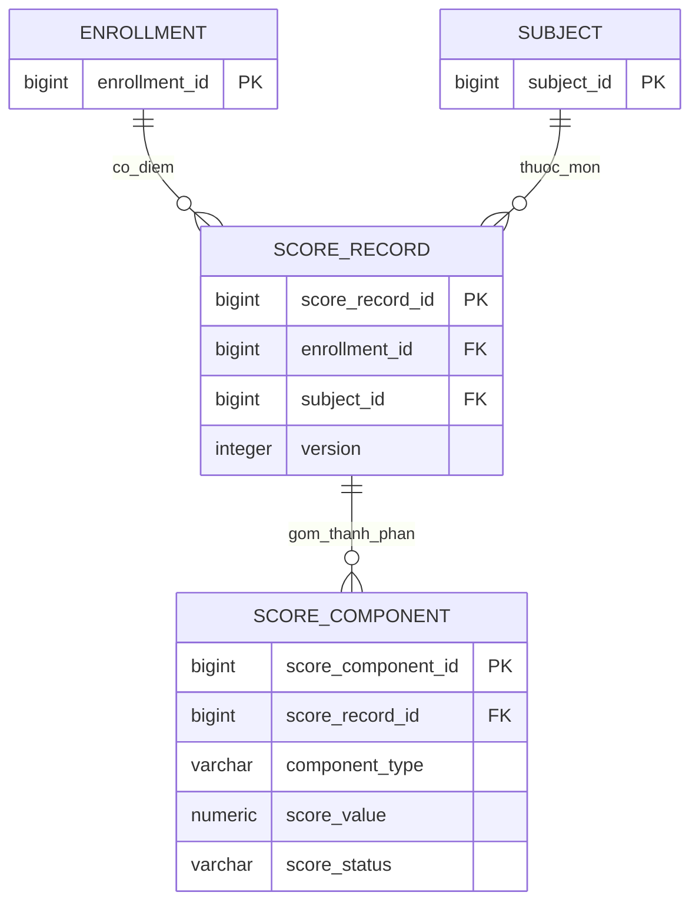
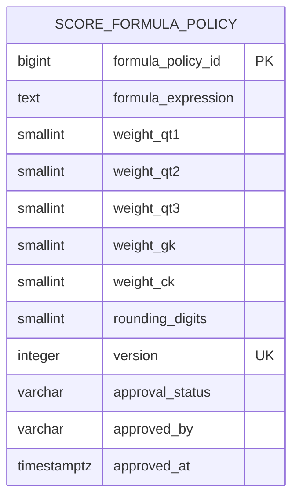

# TONG HOP ERD HE THONG QUAN LY KET QUA HOC TAP THPT

## 1. Muc tieu

Tong hop mo hinh du lieu cho He thong quan ly ket qua hoc tap hoc sinh THPT, dua tren tai lieu thiet ke cua cac thanh vien trong nhom.

ERD duoc su dung lam co so cho Data Dictionary, database schema va migrations PostgreSQL.

## 2. Danh sach thuc the

### 2.1. Nhom tai khoan va phan quyen

1. User - Tai khoan dang nhap.
2. Role - Vai tro va phan quyen.

Nguoi thiet ke: Giang.

### 2.2. Nhom quan ly hoc sinh

3. AcademicYear - Nien khoa.
4. Grade - Khoi lop.
5. Class - Lop hoc.
6. Student - Ho so hoc sinh.
7. Enrollment - Lich su phan lop.
8. Subject - Mon hoc.

Nguoi thiet ke: Ngoc.

### 2.3. Nhom quan ly diem

9. ScoreRecord - Ban ghi diem.
10. ScoreComponent - Thanh phan diem.

Nguoi thiet ke: Chau.

### 2.4. Nhom khoa diem va nhat ky

11. LockStatus - Trang thai khoa diem.
12. AuditLog - Nhat ky thao tac.

Nguoi thiet ke: Uyen.

### 2.5. Thuc the cau hinh bo sung

13. ScoreFormulaPolicy - Luu cong thuc, he so, quy tac lam tron va trang thai phe duyet cua giang vien.

Thuc the nay duoc de xuat trong thiet ke quan ly diem cua Chau.

## 3. Nguyen tac thiet ke

- Moi thuc the co khoa chinh de dinh danh.
- Cac quan he duoc bieu dien bang khoa ngoai.
- Student va Class lien ket thong qua Enrollment.
- Bao toan lich su phan lop va ket qua hoc tap.
- Diem 0 la gia tri hop le, khac NULL.
- Moi thanh phan diem duoc khoa doc lap.
- Khoa diem khong dong nghia voi cong bo diem.
- Cac thao tac mo khoa va sua diem phai duoc ghi nhat ky.
- Cac rang buoc chua chot duoc ghi nhan rieng, khong mac dinh la schema chinh thuc.


## 4. So do ERD theo tung nhom thuc the

### 4.1. Nhom tai khoan va quan ly hoc sinh

```mermaid
erDiagram
    ROLE ||--o{ USER : phan_quyen
    STUDENT o|--o| USER : tai_khoan
    ACADEMIC_YEAR ||--o{ CLASS : quan_ly
    GRADE ||--o{ CLASS : phan_khoi
    STUDENT ||--o{ ENROLLMENT : phan_lop
    CLASS ||--o{ ENROLLMENT : tiep_nhan
    ACADEMIC_YEAR ||--o{ ENROLLMENT : thuoc_nien_khoa

    ROLE {
        bigint role_id PK
        varchar code UK
        varchar name
    }

    USER {
        bigint user_id PK
        varchar username UK
        text password_hash
        bigint role_id FK
        bigint student_id FK
        boolean is_active
    }

    ACADEMIC_YEAR {
        bigint academic_year_id PK
        varchar code UK
        smallint start_year
        smallint end_year
        varchar status
    }

    GRADE {
        smallint grade_id PK
        smallint grade_number UK
    }

    CLASS {
        bigint class_id PK
        bigint academic_year_id FK
        smallint grade_id FK
        varchar code
        varchar name
        varchar status
    }

    STUDENT {
        bigint student_id PK
        varchar student_code UK
        varchar full_name
        date date_of_birth
        varchar status
    }

    ENROLLMENT {
        bigint enrollment_id PK
        bigint student_id FK
        bigint class_id FK
        bigint academic_year_id FK
        date start_date
        date end_date
        varchar exit_reason
    }

    SUBJECT {
        bigint subject_id PK
        varchar code UK
        varchar name
        varchar status
    }
```


### 4.2. Nhom quan ly diem

So do mo ta moi quan he giua Enrollment, Subject, ScoreRecord va ScoreComponent.



#### 4.2.1. Quy tac lien ket

- Moi ScoreRecord thuoc mot Enrollment va mot Subject.
- Mot Enrollment co the co nhieu ScoreRecord theo cac mon hoc.
- Moi ScoreRecord co toi da 5 ScoreComponent: QT1, QT2, QT3, GK, CK.
- Moi loai thanh phan diem chi duoc xuat hien mot lan trong cung ScoreRecord.
- ScoreRecord co rang buoc UNIQUE (enrollment_id, subject_id).
- ScoreComponent co rang buoc UNIQUE (score_record_id, component_type).
- Diem 0 la gia tri hop le, khac NULL.
- ScoreComponent su dung score_status de phan biet NOT_ENTERED, SCORED, ABSENT va EXEMPT.
- Diem QT1, QT2, QT3 chi nhan so nguyen tu 0 den 10.
- Diem GK va CK nhan gia tri tu 0 den 10 theo buoc 0.25.
- Khong tinh diem tong ket khi thieu diem bat buoc.
- Bao toan ScoreRecord va ScoreComponent khi hoc sinh chuyen lop.


### 4.3. Nhom khoa diem va nhat ky

So do mo ta quan he giua LockStatus, AuditLog va cac thuc the lien quan trong he thong.

```mermaid
erDiagram
    ACADEMIC_YEAR ||--o{ LOCK_STATUS : quan_ly
    CLASS ||--o{ LOCK_STATUS : co_trang_thai_khoa
    SUBJECT ||--o{ LOCK_STATUS : thuoc_mon

    USER o|--o{ LOCK_STATUS : nguoi_khoa
    USER o|--o{ LOCK_STATUS : nguoi_mo_khoa
    USER o|--o{ LOCK_STATUS : nguoi_yeu_cau

    
    USER ||--o{ AUDIT_LOG : thuc_hien
    USER o|--o{ AUDIT_LOG : yeu_cau
    LOCK_STATUS o|--o{ AUDIT_LOG : ghi_lich_su

    STUDENT o|--o{ AUDIT_LOG : lien_quan
    SCORE_RECORD o|--o{ AUDIT_LOG : ghi_nhan
    SCORE_COMPONENT o|--o{ AUDIT_LOG : thay_doi
    AUDIT_LOG o|--o{ AUDIT_LOG : lien_ket_log

    LOCK_STATUS {
        bigint lock_status_id PK
        bigint academic_year_id FK
        bigint class_id FK
        bigint subject_id FK
        varchar component
        varchar status
        bigint locked_by FK
        timestamptz locked_at
        bigint unlocked_by FK
        timestamptz unlocked_at
        bigint requested_by FK
        varchar requested_by_name
        text unlock_reason
        integer version
        timestamptz created_at
        timestamptz updated_at
    }

    AUDIT_LOG {
        bigint audit_log_id PK
        varchar action_type
        bigint performed_by FK
        bigint requested_by FK
        varchar requested_by_name
        bigint lock_status_id FK
        bigint academic_year_id FK
        bigint class_id FK
        bigint subject_id FK
        varchar component
        bigint student_id FK
        bigint score_record_id FK
        bigint score_component_id FK
        numeric old_value
        numeric new_value
        text reason
        bigint related_log_id FK
        varchar result
        timestamptz created_at
    }
```

#### 4.3.1. Quy tac khoa diem

- LockStatus quan ly trang thai khoa theo nien khoa, lop, mon hoc va thanh phan diem.
- Khoa doc lap tung cot QT1, QT2, QT3, GK, CK.
- Rang buoc UNIQUE (academic_year_id, class_id, subject_id, component).
- Trang thai khoa gom UNLOCKED va LOCKED.
- Chi tai khoan KHAO_THI duoc khoa, mo khoa va khoa lai diem.
- Cho phep khoa khi thieu diem nhung phai hien thi canh bao.
- Khong cho phep them, sua hoac xoa diem khi cot dang LOCKED.
- Mo khoa phai co thong tin nguoi yeu cau va ly do.
- Sau khi sua diem, can bo Khao thi phai thuc hien khoa lai.
- Khoa diem khong dong nghia voi cong bo diem.
- Hoc sinh dang nhap va chi duoc xem ket qua hoc tap cua chinh minh theo nien khoa va mon hoc.
- Chua ap dung co che tu dong khoa diem.

#### 4.3.2. Quy tac AuditLog

- AuditLog ghi nhan cac thao tac LOCK, UNLOCK, RELOCK, SCORE_EDIT va SCORE_IMPORT.
- performed_by tham chieu User de xac dinh nguoi thuc hien.
- Ghi nhan nguoi yeu cau, ly do va thoi diem thao tac khi can thiet.
- Diem 0 va NULL phai duoc phan biet trong lich su thay doi.
- AuditLog luu gia tri diem cu va moi khi sua diem.
- related_log_id lien ket thao tac sua diem voi lan mo khoa tuong ung.
- AuditLog la du lieu bat bien, chi cho phep ghi them.
- Cap nhat diem va ghi AuditLog phai duoc thuc hien nhat quan trong cung transaction.
- Cap nhat trang thai khoa va ghi AuditLog cung phai bao dam tinh nhat quan.

#### 4.3.3. Nguon thiet ke

Noi dung duoc tong hop tu thiet ke LockStatus va AuditLog cua Uyen.

Cac khoa ngoai va rang buoc duoc doi chieu khi hoan thien ERD tong the va Data Dictionary.


### 4.4. Nhom cau hinh cong thuc tinh diem

ScoreFormulaPolicy luu tap trung cong thuc tinh diem tong ket, he so, quy tac lam tron va trang thai phe duyet cua giang vien.



#### 4.4.1. Quy tac tinh diem tong ket

- QT1, QT2, QT3 co he so 1.
- GK co he so 2.
- CK co he so 3.
- Tong he so bang 8.
- Cong thuc DTK = (QT1 + QT2 + QT3 + 2 * GK + 3 * CK) / 8.
- DTK duoc lam tron 2 chu so thap phan.
- Diem 0 la gia tri hop le va khac NULL.
- Khong tinh DTK khi thieu mot trong 5 thanh phan diem bat buoc.
- Khong tinh DTK khi co thanh phan ABSENT hoac EXEMPT theo quy tac hien tai.

#### 4.4.2. Quy tac phe duyet cong thuc

- Trang thai phe duyet gom PENDING, APPROVED va REJECTED.
- PENDING: Chua co thong tin phe duyet.
- APPROVED: Cong thuc da duoc phe duyet.
- REJECTED: Cong thuc khong duoc phe duyet.
- Khi APPROVED, approved_by va approved_at bat buoc co gia tri.
- Khi PENDING hoac REJECTED, approved_by va approved_at la NULL theo thiet ke hien tai.
- Moi phien ban cong thuc co version rieng va khong duoc trung.
- Khong mac dinh cong thuc da duoc giang vien phe duyet neu chua co thong tin xac nhan thuc te.
- Khong luu lap lai cong thuc va trang thai phe duyet trong ScoreComponent.


#### 4.4.3. Quan he va trang thai tich hop

- ScoreFormulaPolicy la thuc the cau hinh bo sung cho quy tac tinh diem tong ket.
- He thong su dung mot cau hinh cong thuc thong nhat trong pham vi demo.
- ScoreRecord khong luu formula_policy_id trong thiet ke hien tai.
- ScoreComponent khong luu formula_policy_id.
- Backend su dung cau hinh cong thuc ap dung cho he thong de tinh DTK.
- Giao dien phai hien thi ro cong thuc tinh diem theo G5-FR09.
- Cong thuc duoc xay dung dua tren ket qua khao sat nghiep vu.
- Thong tin phe duyet cua giang vien phai duoc ghi nhan trung thuc.
- Khong mac dinh cong thuc da duoc phe duyet neu chua co thong tin xac nhan thuc te.
- Khong thay doi cong thuc khi da phat sinh du lieu diem trong pham vi demo hien tai.
- Neu mo rong su dung nhieu phien ban cong thuc, phai cap nhat dong bo ERD, Data Dictionary va SRS.


## 5. So do ERD tong the

### 5.1. ERD toan he thong

```mermaid
erDiagram
    ROLE ||--o{ USER : phan_quyen
    STUDENT o|--o| USER : tai_khoan

    ACADEMIC_YEAR ||--o{ CLASS : quan_ly
    GRADE ||--o{ CLASS : phan_khoi

    ACADEMIC_YEAR ||--o{ ENROLLMENT : thuoc_nien_khoa
    CLASS ||--o{ ENROLLMENT : tiep_nhan
    STUDENT ||--o{ ENROLLMENT : phan_lop

    ENROLLMENT ||--o{ SCORE_RECORD : co_diem
    SUBJECT ||--o{ SCORE_RECORD : thuoc_mon
    SCORE_RECORD ||--o{ SCORE_COMPONENT : gom

    ACADEMIC_YEAR ||--o{ LOCK_STATUS : quan_ly
    CLASS ||--o{ LOCK_STATUS : co_khoa
    SUBJECT ||--o{ LOCK_STATUS : thuoc_mon

    USER o|--o{ LOCK_STATUS : khoa
    USER o|--o{ LOCK_STATUS : mo_khoa
    USER o|--o{ LOCK_STATUS : yeu_cau

    USER ||--o{ AUDIT_LOG : thuc_hien
    USER o|--o{ AUDIT_LOG : yeu_cau
    ACADEMIC_YEAR ||--o{ AUDIT_LOG : nien_khoa
    CLASS ||--o{ AUDIT_LOG : lop
    SUBJECT ||--o{ AUDIT_LOG : mon
    LOCK_STATUS o|--o{ AUDIT_LOG : lich_su
    STUDENT o|--o{ AUDIT_LOG : lien_quan
    SCORE_RECORD o|--o{ AUDIT_LOG : ghi_nhan
    SCORE_COMPONENT o|--o{ AUDIT_LOG : thay_doi
    AUDIT_LOG o|--o{ AUDIT_LOG : tham_chieu

    ROLE {
        bigint role_id PK
        varchar code UK
        varchar name
    }

    USER {
        bigint user_id PK
        varchar username UK
        text password_hash
        bigint role_id FK
        bigint student_id FK
        boolean is_active
    }

    ACADEMIC_YEAR {
        bigint academic_year_id PK
        varchar code UK
        smallint start_year
        smallint end_year
        varchar status
    }

    GRADE {
        smallint grade_id PK
        smallint grade_number UK
    }

    CLASS {
        bigint class_id PK
        bigint academic_year_id FK
        smallint grade_id FK
        varchar code
        varchar name
        varchar status
    }

    STUDENT {
        bigint student_id PK
        varchar student_code UK
        varchar full_name
        date date_of_birth
        varchar status
    }

    ENROLLMENT {
        bigint enrollment_id PK
        bigint student_id FK
        bigint class_id FK
        bigint academic_year_id FK
        date start_date
        date end_date
        varchar exit_reason
    }

    SUBJECT {
        bigint subject_id PK
        varchar code UK
        varchar name
        varchar status
    }

    SCORE_RECORD {
        bigint score_record_id PK
        bigint enrollment_id FK
        bigint subject_id FK
        integer version
    }

    SCORE_COMPONENT {
        bigint score_component_id PK
        bigint score_record_id FK
        varchar component_type
        numeric score_value
        varchar score_status
    }

    LOCK_STATUS {
        bigint lock_status_id PK
        bigint academic_year_id FK
        bigint class_id FK
        bigint subject_id FK
        varchar component
        varchar status
        bigint locked_by FK
        bigint unlocked_by FK
        bigint requested_by FK
        integer version
    }

    AUDIT_LOG {
        bigint audit_log_id PK
        varchar action_type
        bigint performed_by FK
        bigint requested_by FK
        bigint lock_status_id FK
        bigint academic_year_id FK
        bigint class_id FK
        bigint subject_id FK
        bigint student_id FK
        bigint score_record_id FK
        bigint score_component_id FK
        bigint related_log_id FK
        numeric old_value
        numeric new_value
        timestamptz created_at
    }

    SCORE_FORMULA_POLICY {
        bigint formula_policy_id PK
        text formula_expression
        integer version UK
        varchar approval_status
        varchar approved_by
        timestamptz approved_at
    }
```

### 5.2. Ghi chu ve so do

- ERD gom 12 thuc the chinh va 1 thuc the cau hinh bo sung.
- ScoreFormulaPolicy la thuc the cau hinh cong thuc tinh diem.
- Student lien ket voi Class thong qua Enrollment de bao toan lich su phan lop.
- ScoreRecord lien ket voi Enrollment va Subject.
- ScoreComponent luu 5 thanh phan diem QT1, QT2, QT3, GK va CK.
- LockStatus quan ly trang thai khoa doc lap theo nien khoa, lop, mon hoc va thanh phan diem.
- AuditLog luu lich su khoa, mo khoa, khoa lai, sua diem va import diem.
- USER la ten thuc the trong ERD; bang PostgreSQL tuong ung la app_user.
- Cac khoa ngoai tai LockStatus va AuditLog tham chieu app_user(user_id).
- ScoreFormulaPolicy khong co khoa ngoai truc tiep den ScoreRecord trong thiet ke hien tai.
- He thong khong bat buoc quan ly diem rieng theo HK1 va HK2.
- He thong khong bat buoc xay dung trang thai PUBLISHED rieng.
- Hoc sinh chi duoc truy cap ket qua hoc tap cua chinh minh.
- So do tong the the hien cac thuoc tinh chinh; Data Dictionary mo ta day du cac thuoc tinh va rang buoc.
- ERD la mo hinh thiet ke, chua phai database migrations chinh thuc.

