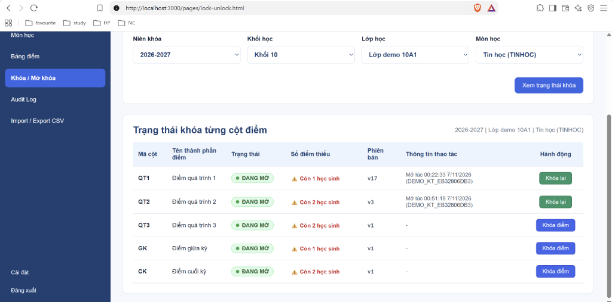
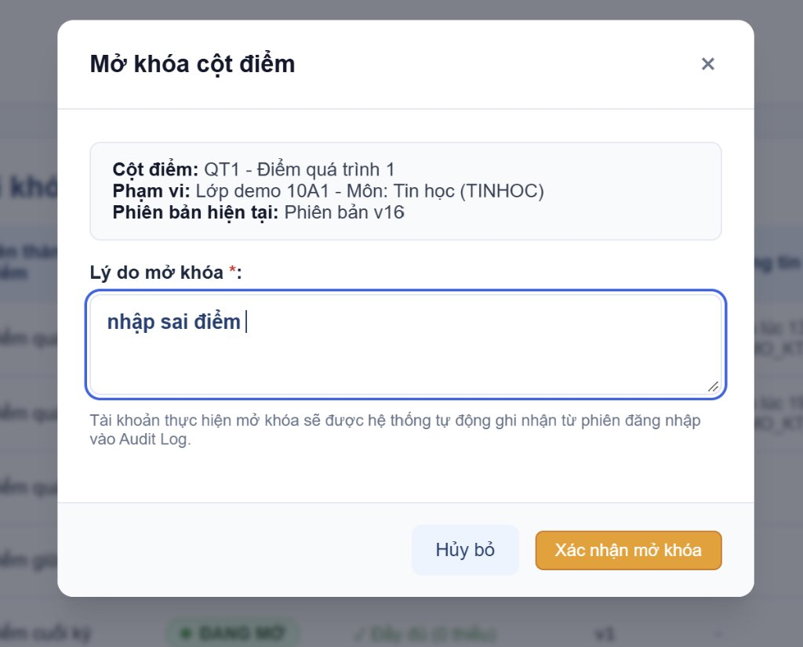
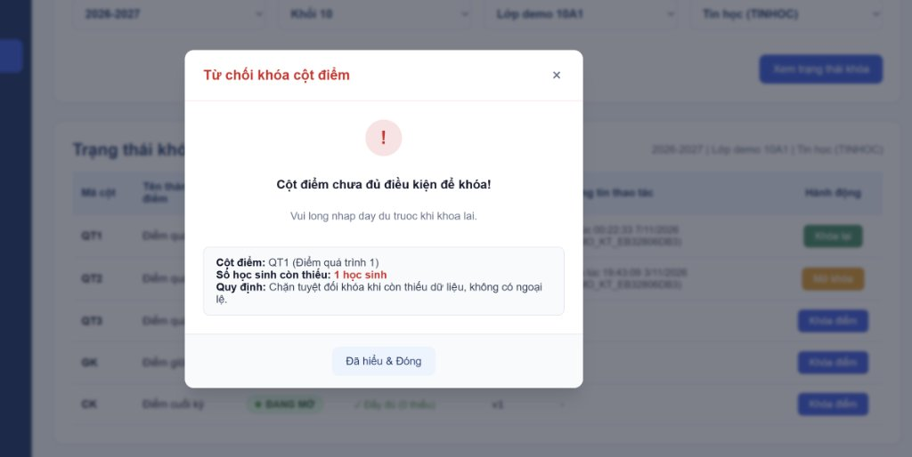
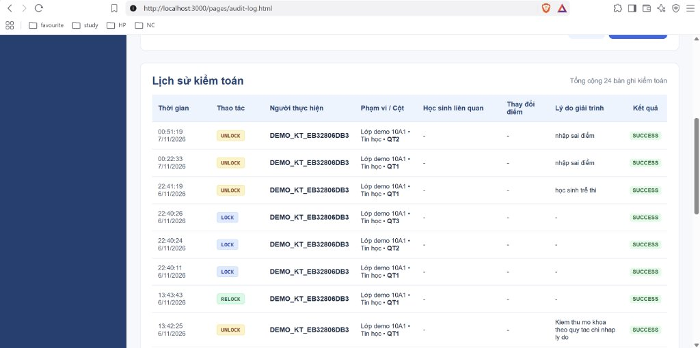

# TÀI LIỆU MINH CHỨNG GIAO DIỆN KHÓA ĐIỂM VÀ AUDIT LOG

## 1. Danh sách màn hình đã hoàn thiện

### 1.1. Màn hình Khóa & Mở khóa điểm (`09_KT_LockUnlock`)
* **Đường dẫn tệp:**
  * HTML: [`frontend/pages/lock-unlock.html`](../frontend/pages/lock-unlock.html)
  * CSS: [`frontend/css/lock-unlock.css`](../frontend/css/lock-unlock.css)
  * JS: [`frontend/js/lock-unlock.js`](../frontend/js/lock-unlock.js)
* **Các thành phần giao diện đạt chuẩn Figma:**
  1. **Bộ lọc phạm vi:** Dropdown liên hoàn chọn Niên khóa, Khối, Lớp, Môn học.
  2. **Bảng trạng thái 5 cột điểm độc lập:**
     * `QT1` (Điểm quá trình 1)
     * `QT2` (Điểm quá trình 2)
     * `QT3` (Điểm quá trình 3)
     * `GK` (Điểm giữa kỳ)
     * `CK` (Điểm cuối kỳ)
  3. **Huy hiệu trạng thái (Status Badge):**
     * Đang mở: Badge nền xanh lá (`status-unlocked`, chữ "ĐANG MỞ").
     * Đã khóa: Badge nền đỏ nhạt (`status-locked`, chữ "ĐÃ KHÓA").
  4. **Chỉ báo số điểm còn thiếu:**
     * Cột còn thiếu điểm: Dòng cảnh báo màu đỏ kèm biểu tượng `⚠️ Còn [X] học sinh`.
     * Cột đủ điểm: Dòng màu xanh `✓ Đầy đủ (0 thiếu)`.
  5. **Các nút thao tác theo trạng thái:**
     * Cột `UNLOCKED` phiên bản ban đầu: Nút xanh `Khóa điểm` (`POST /locks/lock`).
     * Cột `LOCKED`: Nút cam `Mở khóa` (`POST /locks/unlock`).
     * Cột `UNLOCKED` đã từng mở khóa: Nút xanh lá đậm `Khóa lại` (`POST /locks/relock`).
  6. **Modal popup Mở khóa điểm (`#unlockModal`):**
     * Ô nhập Lý do mở khóa giải trình bắt buộc (`unlockReasonInput`).
     * Tài khoản thực hiện mở khóa được hệ thống tự động ghi nhận từ Session đăng nhập vào Audit Log.
     * Nút [Hủy bỏ] và [Xác nhận mở khóa].
  7. **Hộp thoại Từ chối khi khóa do thiếu điểm (`#missingScoreModal`):**
     * Bật lên khi cán bộ bấm Khóa hoặc Khóa lại mà cột còn `missingCount > 0`.
     * Hiển thị rõ số học sinh còn thiếu và lý do từ chối (chặn tuyệt đối, không có ngoại lệ bypass).

#### Minh chứng ảnh thực tế màn hình Khóa/Mở khóa điểm:

---

### 1.2. Màn hình Nhật ký kiểm toán (`10_KT_AuditLog`)
* **Đường dẫn tệp:**
  * HTML: [`frontend/pages/audit-log.html`](../frontend/pages/audit-log.html)
  * CSS: [`frontend/css/audit-log.css`](../frontend/css/audit-log.css)
  * JS: [`frontend/js/audit-log.js`](../frontend/js/audit-log.js)
* **Các thành phần giao diện đạt chuẩn Figma:**
  1. **Bộ lọc đa tiêu chí:**
     * Lọc theo khoảng thời gian: `Từ ngày` - `Đến ngày`.
     * Lọc theo loại thao tác: Tất cả, `LOCK`, `UNLOCK`, `RELOCK`, `SCORE_EDIT`, `SCORE_IMPORT`.
     * Lọc theo cột điểm: Tất cả, `QT1`, `QT2`, `QT3`, `GK`, `CK`.
     * Lọc theo Niên khóa, Lớp, Môn học.
     * **Bộ lọc Người thực hiện:** Hỗ trợ nhập User ID hoặc Tên tài khoản (`username`).
     * Nút [Tìm kiếm] và [Đặt lại].
  2. **Bảng dữ liệu Audit Log (Đã xử lý chống tấn công XSS):**
     * Dữ liệu từ database (tên cán bộ, tên học sinh, lớp, môn, lý do giải trình) được làm sạch qua cơ chế `escapeHtml()` trước khi render.
     * Cột Thời gian: Hiển thị định dạng ngày giờ chuẩn Việt Nam từ `DATETIMEOFFSET(7)`.
     * Cột Loại thao tác: Tag màu riêng biệt cho từng hành động (`LOCK`, `UNLOCK`, `RELOCK`, `SCORE_EDIT`, `SCORE_IMPORT`).
     * Cột Người thực hiện: Tên tài khoản hoặc User ID từ bảng `dbo.app_user`.
     * Cột Phạm vi: Hiển thị Lớp • Môn • Cột điểm.
     * Cột Học sinh liên quan: Mã học sinh và Họ tên (khi sửa điểm hoặc import).
     * Cột Thay đổi điểm: Hiển thị giá trị điểm cũ `→` điểm mới dạng badge code.
     * Cột Lý do giải trình: Lưu trữ minh bạch lý do mở khóa và ghi chú.
     * Cột Kết quả: Badge `SUCCESS` / `FAILED`.
  3. **Điều hướng phân trang (Pagination):**
     * Nút [Trang trước], [Trang sau], chỉ báo số trang hiện tại.

#### Minh chứng ảnh thực tế màn hình Audit Log:

---

## 2. API Backend bổ trợ
* Đã hoàn thiện và tích hợp endpoint đọc Audit Log:
  * `GET /api/v1/locks/audit-logs` (đồng thời ánh xạ tại `/api/v1/audit-logs`).
  * Tham số lọc: `academicYearId`, `classId`, `subjectId`, `component`, `actionType`, `performedBy`, `from`, `to`, `page`, `limit`.
  * Trả về kết quả phân trang kèm thông tin tên người thực hiện, tên lớp, tên môn và tên học sinh.
* Endpoint truy vấn trạng thái khóa:
  * `GET /api/v1/locks`: Tự động tính toán số điểm còn thiếu (`missingCount`) trực tiếp từ bảng `score` cho cả 5 cột, đảm bảo đồng bộ với điều kiện chặn khóa của hệ thống.

---

## 3. Tích hợp thanh điều hướng Navigation (Dùng chung)
* Cập nhật file [`frontend/js/navigation.js`](../frontend/js/navigation.js):
  * `{ label: "Khóa / Mở khóa", url: "lock-unlock.html" }`
  * `{ label: "Audit Log", url: "audit-log.html" }`

---

## 4. Giải trình quy tắc nghiệp vụ theo thống nhất của nhóm

1. **Về người yêu cầu mở khóa (requesterId / requesterName):**
   * Theo nghiệp vụ đã thống nhất của nhóm, hệ thống không phân quyền cho giáo viên bộ môn nhập điểm và không có luồng nộp đơn yêu cầu riêng.
   * Toàn bộ thao tác khóa, mở khóa và nhập điểm do các tài khoản phòng **Khảo thí** trực tiếp thực hiện.
   * Khi cần mở khóa cột điểm (do học sinh thi trễ hoặc cần sửa sai sót), cán bộ khảo thí chỉ cần nhập **Lý do giải trình**. Hệ thống tự động ghi nhận danh tính người thực hiện qua phiên đăng nhập (`req.auth.userId`) và lưu vào Audit Log.
   * Do đó, việc `requesterId` để null và ghi nhận chính xác `performed_by` là hoàn toàn đúng theo thiết kế đã chốt.

2. **Về điều kiện hiển thị nút "Khóa lại" (RELOCK):**
   * Vòng đời trạng thái một cột điểm:
     * Khởi tạo: `is_locked = 0, version = 1` -> Nút hiển thị là **"Khóa điểm"** (LOCK).
     * Sau khi khóa: `is_locked = 1, version = 2` -> Nút hiển thị là **"Mở khóa"** (UNLOCK).
     * Sau khi mở khóa: `is_locked = 0, version = 3` (hoặc lớn hơn) -> Nút hiển thị là **"Khóa lại"** (RELOCK).
   * Do đó điều kiện `!isLocked && version > 1` phản ánh chính xác cột đã trải qua quy trình Mở khóa và đang chờ cán bộ khảo thí hoàn tất việc nhập/sửa điểm để Khóa lại. Khi bấm Khóa lại, hệ thống kiểm tra bắt buộc `missingCount === 0`.
