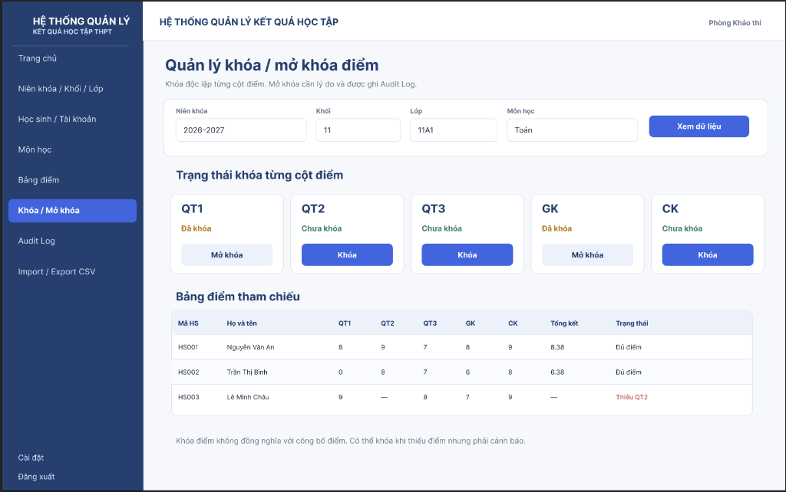
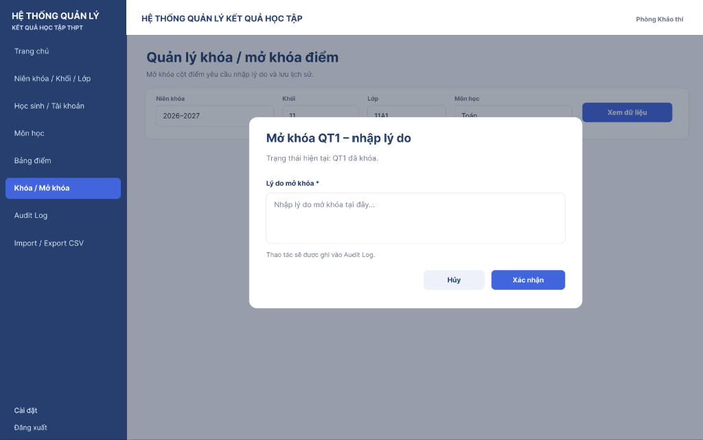
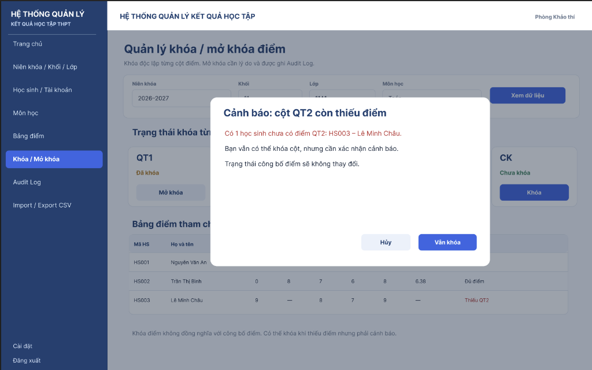
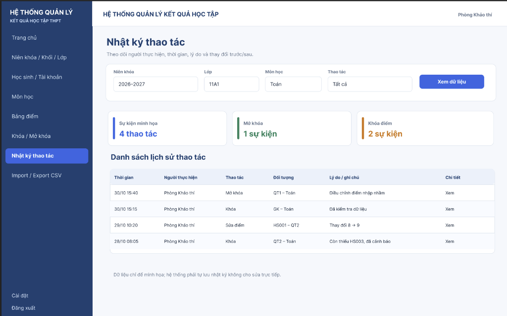
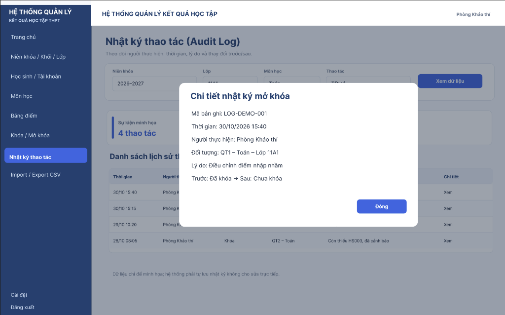

# TÀI LIỆU MINH CHỨNG GIAO DIỆN KHÓA ĐIỂM VÀ NHẬT KÝ THAO TÁC

## 1. Danh sách màn hình đã hoàn thiện

### 1.1. Màn hình Quản lý khóa / mở khóa điểm (`09_KT_LockUnlock`)
* **Đường dẫn tệp:**
  * HTML: [`frontend/pages/lock-unlock.html`](../frontend/pages/lock-unlock.html)
  * CSS: [`frontend/css/lock-unlock.css`](../frontend/css/lock-unlock.css)
  * JS: [`frontend/js/lock-unlock.js`](../frontend/js/lock-unlock.js)
* **Các thành phần giao diện:**
  1. **Bộ lọc phạm vi:**
     * Niên khóa (`2026–2027`), Khối (`11`), Lớp (`11A1`), Môn học (`Toán`).
     * Nút [Xem dữ liệu].
  2. **Thiết lập thời hạn tự động khóa (BR-LP03):**
     * Thanh công cụ gọn gàng: Chọn cột điểm (`QT3`, `QT2`, `QT1`, `GK`, `CK`), chọn ngày giờ kết thúc nhập điểm và nút [Lưu hạn].
     * Giao diện hỗ trợ thiết lập thời hạn khóa điểm. Cơ chế tự động khóa phía backend cần được kiểm thử tích hợp.
  3. **Trạng thái khóa từng cột điểm (5 thẻ độc lập):**
     * 5 khối thẻ tương ứng với 5 cột điểm: `QT1`, `QT2`, `QT3`, `GK`, `CK`.
     * Hiển thị nhãn hạn tự khóa tương ứng trên từng thẻ.
     * Cột đã khóa: chữ màu vàng cam ("Đã khóa"), nút [Mở khóa] nền xám.
     * Cột chưa khóa: chữ màu xanh lá ("Chưa khóa"), nút [Khóa] nền xanh đậm (hoặc [Khóa lại] nếu đã từng mở).
  4. **Bảng điểm tham chiếu:**
     * Bảng hiển thị danh sách học sinh: `Mã HS`, `Họ và tên`, `QT1`, `QT2`, `QT3`, `GK`, `CK`, `Tổng kết`, `Trạng thái`.
     * Điểm thiếu được ký hiệu gạch ngang `—`, trạng thái hiển thị rõ ràng: `Đủ điểm` hoặc màu đỏ `Chưa đủ điểm`.
  5. **Modal popup Mở khóa điểm:**
     * Tiêu đề: *Mở khóa [Cột] – nhập lý do*.
     * Ô nhập lý do giải trình kèm chú thích ghi nhận vào Nhật ký thao tác.
     * Nút [Hủy] và [Xác nhận].
  6. **Modal popup Cảnh báo thiếu điểm:**
     * Tiêu đề: *Cảnh báo: cột [Cột] còn thiếu điểm*.
     * Thông báo đỏ số học sinh chưa có điểm và các xác nhận cảnh báo.
     * Hiển thị cảnh báo và từ chối thao tác khóa khi cột còn thiếu điểm. Không cho phép bỏ qua điều kiện missingCount > 0.

#### Ảnh chụp giao diện thực tế:

---

### 1.2. Màn hình Nhật ký thao tác (`10_KT_AuditLog`)
* **Đường dẫn tệp:**
  * HTML: [`frontend/pages/audit-log.html`](../frontend/pages/audit-log.html)
  * CSS: [`frontend/css/audit-log.css`](../frontend/css/audit-log.css)
  * JS: [`frontend/js/audit-log.js`](../frontend/js/audit-log.js)
  * Tích hợp Menu điều hướng: [`frontend/js/navigation.js`](../frontend/js/navigation.js).
* **Các thành phần giao diện:**
  1. **Bộ lọc nhật ký:**
     * Niên khóa (`2026–2027`), Lớp (`11A1`), Môn học (`Toán`), Thao tác (`Tất cả`), nút [Xem dữ liệu].
     * Hỗ trợ tìm kiếm nâng cao theo người thực hiện và khoảng thời gian.
  2. **3 Thẻ thống kê tổng quan:**
     * Thẻ 1 (Viền xanh dương): *Sự kiện minh họa* - `4 thao tác` (cập nhật theo dữ liệu).
     * Thẻ 2 (Viền xanh lá): *Mở khóa* - `1 sự kiện`.
     * Thẻ 3 (Viền cam): *Khóa điểm* - `2 sự kiện`.
  3. **Bảng Danh sách lịch sử thao tác:**
     * Cột hiển thị: `Thời gian`, `Người thực hiện`, `Thao tác`, `Đối tượng`, `Lý do / ghi chú`, `Chi tiết`.
     * Thao tác chi tiết: Link [Xem] mở popup xem chi tiết bản ghi.
  4. **Modal Chi tiết nhật ký thao tác:**
     * Hiển thị đầy đủ: Mã bản ghi, Thời gian, Người thực hiện, Đối tượng, Lý do, và Trạng thái Trước/Sau.
     * Nút [Đóng].

#### Ảnh chụp giao diện thực tế:

---

## 2. API Backend & Tính toàn vẹn nghiệp vụ
* **Đồng bộ SQL Server:**
  * `GET /api/v1/locks/audit-logs`: Bổ sung `LEFT JOIN dbo.app_user u` cho câu truy vấn đếm và danh sách, hỗ trợ lọc an toàn theo tên và mã người thực hiện.
  * `GET /api/v1/locks`: Tự động tính toán số điểm thiếu từ bảng điểm thực tế.
  * Quy tắc tự động khóa (BR-LP03): Đảm bảo khi đến thời hạn tự động khóa, nếu cột còn thiếu điểm (`missingCount > 0`) thì hệ thống giữ `UNLOCKED` và phát cảnh báo, chỉ tự động khóa khi `missingCount == 0`.
* **Bảo mật và toàn vẹn dữ liệu:**
  * Hàm `escapeHtml()` được áp dụng toàn bộ cho dữ liệu render vào DOM chống tấn công XSS.
  * Ngăn ngừa lệch dữ liệu: Tự động phát hiện và chặn thao tác Khóa/Mở khóa khi người dùng thay đổi bộ lọc dropdown mà chưa bấm *Xem dữ liệu*.
  * Đảm bảo thông báo Alert không bị ghi đè hay xóa mất khi hoàn tất tác vụ hoặc gặp lỗi.
