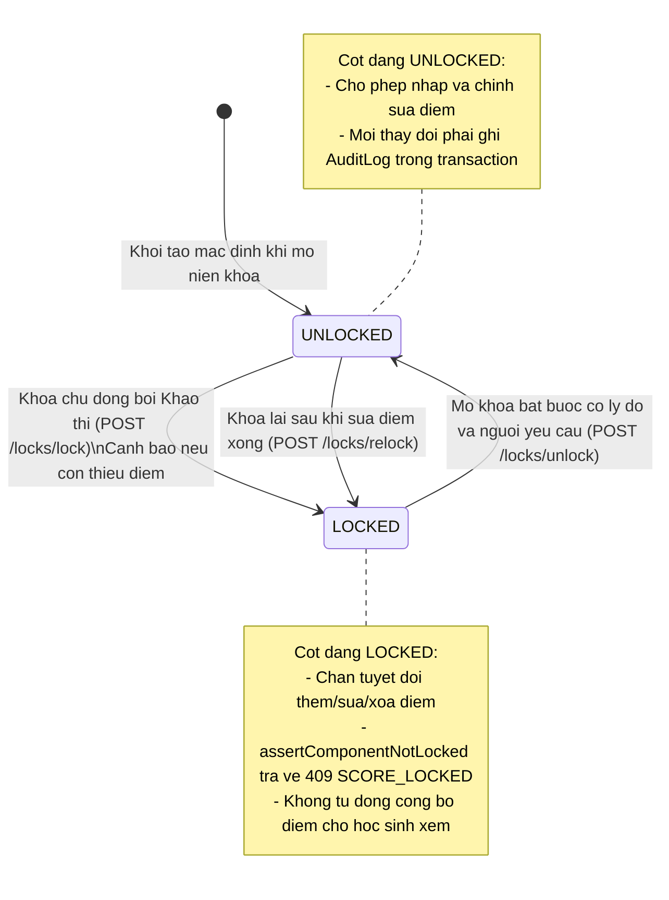
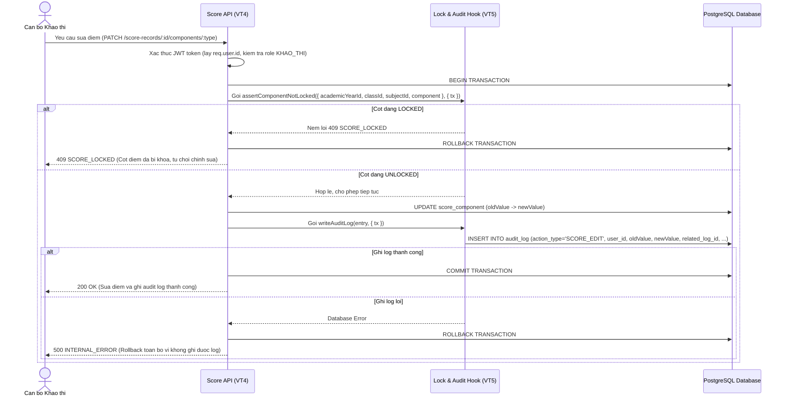

# THIET KE KHOA DIEM VA AUDIT LOG (VT5-01)

## 1. Muc tieu

### 1.1. Muc tieu thiet ke

Thiet ke co che khoa diem va nhat ky kiem toan (Audit Log) cho he thong quan ly ket qua hoc tap THPT:

- Khoa va mo khoa doc lap theo tung thanh phan diem: QT1, QT2, QT3, GK, CK.
- Khoa theo tung nien khoa, lop va mon hoc.
- Cho phep khoa khi con hoc sinh thieu diem nhung bat buoc phai hien thi canh bao so luong hoc sinh chua co diem.
- Chan backend tuyet doi khong cho them, sua, xoa diem khi cot diem dang o trang thai khoa (LOCKED).
- Mo khoa bat buoc nhap nguoi yeu cau (requestedBy) va ly do giai trinh (unlockReason).
- Sau khi sua diem xong thi khao thi phai thuc hien khoa lai (RELOCK) cot diem.
- Ghi nhat ky kiem toan bat bien (Audit Log) cho moi thao tac khoa, mo khoa, khoa lai va sua diem.
- Xac dinh va tham chieu chinh xac tai khoan thuc hien thao tac tu bang User/AppUser thong qua middleware xac thuc (JWT/Session).
- Luu day du gia tri diem cu, diem moi, nguoi sua, ly do sua, thoi diem thuc hien va lien ket voi phien mo khoa tuong ung.
- Tich hop ham kiem tra khoa va ghi log trong cung mot database transaction voi thao tac sua diem de bao dam toan ven du lieu.
- Tach biet ro rang giua trang thai Khoa diem va Cong bo diem; ghi ro quy tac tu dong khoa chua duoc chot.
- Cung cap day du dac ta thuc the, rang buoc, API Contract va so do hoat dong (Activity Diagram) de VT1 tong hop ERD va Data Dictionary.

### 1.2. Cong nghe va quy uoc

- Backend: Node.js, Express.
- Database: PostgreSQL.
- API: REST, JSON.
- Base URL: http://localhost:3000/api/v1
- Ten bang va cot database: snake_case.
- Ten thuoc tinh JSON: camelCase.
- Ten endpoint: chu thuong, kebab-case, danh tu so nhieu.

### 1.3. Tai lieu tham chieu

- Bao cao khao sat va dac ta Use Case cua Nhom 5.
- UC08: Khoa diem.
- UC09: Mo khoa diem va ghi nhan nhat ky.
- UC13: Hoc sinh xem ket qua hoc tap cua chinh minh.
- docs/vt3-data-model.md (module quan ly hoc sinh va lop hoc).
- docs/vt4-score-design.md (module quan ly diem).
- docs/api-conventions.md (quy chuan API va kien truc).
- docs/figma-handoff.md (quy chuan thiet ke giao dien).

---

## 2. Cac thuc the

### 2.1. Danh sach thuc the do VT5 thiet ke

1. **LockStatus**: Quan ly trang thai khoa theo nien khoa, lop, mon va thanh phan diem.
2. **AuditLog**: Nhat ky kiem toan luu vet lich su bat bien ve cac thao tac khoa, mo khoa, sua diem va import diem.

### 2.2. Cac thuc the lien quan trong he thong

Su dung thuc the quan ly tai khoan va phan quyen (do VT1 / Auth quan ly):
- **User** (bang `app_user` hoac `users`): Luu thong tin tai khoan nguoi dung (`user_id`, `username`, `role`, `full_name`, `email`, ...). Day la can cu de xac dinh danh tinh nguoi thuc hien moi thao tac khoa, mo khoa, sua diem va ghi nhan nhat ky kiem toan.

Su dung cac thuc the do VT3-01 thiet ke (module quan ly hoc sinh va lop hoc):
- **AcademicYear**: Nien khoa.
- **Class**: Lop hoc.
- **Subject**: Mon hoc.
- **Student**: Hoc sinh.
- **Enrollment**: Lich su phan lop cua hoc sinh.

Su dung cac thuc the do VT4-01 thiet ke (module quan ly diem):
- **ScoreRecord**: Ban ghi diem theo hoc sinh/enrollment va mon hoc.
- **ScoreComponent**: Thanh phan diem cu the (QT1, QT2, QT3, GK, CK).

### 2.3. Quan he du lieu de xuat

- `AcademicYear`, `Class`, `Subject` lien ket voi `LockStatus` de xac dinh pham vi khoa.
- Moi `LockStatus` dai dien cho 1 thanh phan diem cua 1 mon hoc tai 1 lop trong 1 nien khoa cu the.
- `User` tham chieu den `LockStatus`:
  + `locked_by_user_id` tham chieu `app_user(user_id)`: Nguoi thuc hien khoa / khoa lai.
  + `unlocked_by_user_id` tham chieu `app_user(user_id)`: Nguoi thuc hien mo khoa.
- `User` tham chieu den `AuditLog`:
  + `user_id` tham chieu `app_user(user_id)`: Tai khoan he thong thuc hien thao tac (bat buoc NOT NULL).
- `LockStatus` lien ket voi `AuditLog` de theo doi toan bo lich su thay doi trang thai khoa cua cot diem.
- `ScoreRecord` va `ScoreComponent` lien ket voi `AuditLog` de luu chi tiet diem truoc va sau khi sua.
- `Student` lien ket voi `AuditLog` de biet hoc sinh nao duoc sua diem.
- `AuditLog` co quan he tu tham chieu (`related_log_id` tro ve `audit_log_id` cua ban ghi `UNLOCK`) de lien ket chat che tung lan sua diem voi phien mo khoa co ly do hop le truoc do.

---

## 3. Thiet ke thuoc tinh va rang buoc

### 3.1. LockStatus

Muc dich: Luu trang thai khoa hien tai cua tung thanh phan diem theo nien khoa, lop va mon hoc.

| Thuoc tinh | Kieu PostgreSQL | Rang buoc de xuat | Mo ta |
|---|---|---|---|
| lock_status_id | BIGSERIAL | PRIMARY KEY | Ma trang thai khoa |
| academic_year_id | BIGINT | NOT NULL, FOREIGN KEY | Tham chieu academic_year(academic_year_id) |
| class_id | BIGINT | NOT NULL, FOREIGN KEY | Tham chieu class(class_id) |
| subject_id | BIGINT | NOT NULL, FOREIGN KEY | Tham chieu subject(subject_id) |
| component | VARCHAR(10) | NOT NULL | QT1, QT2, QT3, GK, CK |
| status | VARCHAR(20) | NOT NULL, DEFAULT 'UNLOCKED' | UNLOCKED hoac LOCKED |
| locked_by_user_id | BIGINT | Cho phep NULL, FOREIGN KEY | Tham chieu app_user(user_id) - Nguoi khoa |
| locked_by | VARCHAR(100) | Cho phep NULL | Snapshot username/ho ten nguoi khoa |
| locked_at | TIMESTAMPTZ | Cho phep NULL | Thoi diem thuc hien khoa |
| unlocked_by_user_id | BIGINT | Cho phep NULL, FOREIGN KEY | Tham chieu app_user(user_id) - Nguoi mo khoa |
| unlocked_by | VARCHAR(100) | Cho phep NULL | Snapshot username/ho ten nguoi mo khoa |
| unlocked_at | TIMESTAMPTZ | Cho phep NULL | Thoi diem thuc hien mo khoa |
| requested_by | VARCHAR(150) | Cho phep NULL | Nguoi yeu cau mo khoa de giai trinh |
| unlock_reason | TEXT | Cho phep NULL | Ly do mo khoa bat buoc de giai trinh |
| version | INTEGER | NOT NULL, DEFAULT 1 | Optimistic Locking tranh xung dot dong thoi |
| created_at | TIMESTAMPTZ | NOT NULL, DEFAULT CURRENT_TIMESTAMP | Thoi diem tao ban ghi |
| updated_at | TIMESTAMPTZ | NOT NULL, DEFAULT CURRENT_TIMESTAMP | Thoi diem cap nhat gan nhat |

Rang buoc de xuat cho LockStatus:
- `lock_status_id` la khoa chinh.
- `UNIQUE (academic_year_id, class_id, subject_id, component)`: Moi thanh phan diem cua 1 mon o 1 lop trong 1 nien khoa chi co dung 1 trang thai khoa.
- `component IN ('QT1', 'QT2', 'QT3', 'GK', 'CK')`.
- `status IN ('UNLOCKED', 'LOCKED')`.
- `version >= 1`.
- `academic_year_id` tham chieu `academic_year(academic_year_id)`.
- `class_id` tham chieu `class(class_id)`.
- `subject_id` tham chieu `subject(subject_id)`.
- `locked_by_user_id` tham chieu `app_user(user_id)`.
- `unlocked_by_user_id` tham chieu `app_user(user_id)`.

Luu y ky thuat:
- Mac dinh khi bat dau nhap diem, trang thai cot diem la `UNLOCKED`.
- Truong `version` dung de phat hien xung dot dong thoi (Optimistic Concurrency Control) khi co 2 khao thi cung thao tac khoa/mo khoa cung luc.
- Khi mo khoa (UNLOCK), he thong bat buoc phai co `requested_by` va `unlock_reason`. Khi khoa lai (RELOCK), he thong cap nhat lai `status = 'LOCKED'`, `locked_by_user_id`, `locked_at` va tang `version`.

### 3.2. AuditLog

Muc dich: Luu nhat ky kiem toan bat bien (Append-Only) cho moi thao tac khoa, mo khoa, sua diem va import diem phuc vu cong tac thanh tra, giai trinh.

| Thuoc tinh | Kieu PostgreSQL | Rang buoc de xuat | Mo ta |
|---|---|---|---|
| audit_log_id | BIGSERIAL | PRIMARY KEY | Ma ban ghi nhat ky |
| action_type | VARCHAR(50) | NOT NULL | LOCK, UNLOCK, RELOCK, SCORE_EDIT, SCORE_IMPORT |
| user_id | BIGINT | NOT NULL, FOREIGN KEY | Tham chieu app_user(user_id) - Tai khoan thuc hien |
| performed_by | VARCHAR(100) | NOT NULL | Snapshot username/ho ten nguoi thuc hien |
| lock_status_id | BIGINT | Cho phep NULL, FOREIGN KEY | Tham chieu lock_status(lock_status_id) |
| academic_year_id | BIGINT | NOT NULL, FOREIGN KEY | Tham chieu academic_year(academic_year_id) |
| class_id | BIGINT | NOT NULL, FOREIGN KEY | Tham chieu class(class_id) |
| subject_id | BIGINT | NOT NULL, FOREIGN KEY | Tham chieu subject(subject_id) |
| component | VARCHAR(10) | Cho phep NULL | QT1, QT2, QT3, GK, CK |
| student_id | BIGINT | Cho phep NULL, FOREIGN KEY | Tham chieu student(student_id) |
| score_record_id | BIGINT | Cho phep NULL, FOREIGN KEY | Tham chieu score_record(score_record_id) |
| score_component_id | BIGINT | Cho phep NULL, FOREIGN KEY | Tham chieu score_component(score_component_id) |
| old_value | NUMERIC | Cho phep NULL | Gia tri diem truoc khi sua |
| new_value | NUMERIC | Cho phep NULL | Gia tri diem sau khi sua |
| requested_by | VARCHAR(150) | Cho phep NULL | Nguoi yeu cau thao tac |
| reason | TEXT | Cho phep NULL | Ly do mo khoa hoac ly do sua diem |
| related_log_id | BIGINT | Cho phep NULL, FOREIGN KEY | Tham chieu audit_log(audit_log_id) |
| result | VARCHAR(20) | NOT NULL, DEFAULT 'SUCCESS' | Ket qua: SUCCESS, REJECTED, FAILED |
| created_at | TIMESTAMPTZ | NOT NULL, DEFAULT CURRENT_TIMESTAMP | Thoi diem ghi nhat ky |

Rang buoc de xuat cho AuditLog:
- `audit_log_id` la khoa chinh.
- `action_type IN ('LOCK', 'UNLOCK', 'RELOCK', 'SCORE_EDIT', 'SCORE_IMPORT')`.
- `result IN ('SUCCESS', 'REJECTED', 'FAILED')`.
- `user_id` tham chieu `app_user(user_id)`: Bat buoc phai co tai khoan thuc hien hop le duoc xac thuc boi he thong.
- `related_log_id` tham chieu `audit_log(audit_log_id)`: Dung de lien ket chat che cac thao tac sua diem (`SCORE_EDIT`) voi ban ghi mo khoa (`UNLOCK`) tuong ung.
- Diem 0 la mot gia tri hop le trong co so du lieu, hoan toan khac voi `NULL` (chua nhap diem). Khi luu vao `old_value` va `new_value`, he thong bao toan gia tri goc 0 va khong thay the bang NULL.
- Bang nay la bat bien (Append-Only): Chi cho phep thao tac `INSERT`. Nghieng cam tuyet doi moi thao tac `UPDATE` hoac `DELETE` duoi moi hinh thuc de bao dam tinh toan ven va gia tri phap ly khi thanh tra.

### 3.3. Co che xac dinh va truy vet tai khoan nguoi thuc hien

De bao dam tinh xac thuc va chong gia mao nguoi thao tac:
1. **Xac dinh tai khoan tu Middleware xac thuc**:
   - Backend khong bao gio tin tuong `user_id` hoac `performed_by` do client truyen qua Request Body hoac Query.
   - Khi request di qua Auth Middleware, he thong kiem tra JWT token / Session, giai ma va gan thong tin user vao context: `req.user.id`, `req.user.username`, `req.user.role`.
   - Ham xu ly nghiep vu lay truc tiep `req.user.id` de ghi vao cot `user_id` (khoa ngoai den bang `app_user`) va ghi snapshot username/ho ten vao `performed_by`.
2. **Truy vet day du 4 nhom thao tac cot loi**:
   - **Thao tac Khoa diem (LOCK)**: Luu `locked_by_user_id = req.user.id`, `locked_at = NOW()`, ghi AuditLog voi `action_type = 'LOCK'`, `user_id = req.user.id`, `created_at = NOW()`.
   - **Thao tac Mo khoa (UNLOCK)**: Luu `unlocked_by_user_id = req.user.id`, `unlocked_at = NOW()`, `requested_by` (nguoi de nghi) va `unlock_reason` (ly do giai trinh); ghi AuditLog voi `action_type = 'UNLOCK'`, `user_id = req.user.id`, `requested_by`, `reason`, `created_at = NOW()`.
   - **Thao tac Sua diem (SCORE_EDIT)**: Ghi AuditLog voi `action_type = 'SCORE_EDIT'`, `user_id = req.user.id`, `old_value`, `new_value`, `reason`, `related_log_id` tro ve ban ghi UNLOCK truoc do, `created_at = NOW()`.
   - **Thao tac Khoa lai (RELOCK)**: Luu `locked_by_user_id = req.user.id`, `locked_at = NOW()`, ghi AuditLog voi `action_type = 'RELOCK'`, `user_id = req.user.id`, `created_at = NOW()`.
3. **Snapshot nguoi dung bat bien**:
   - Luu ca `user_id` (khoa ngoai quan he) va snapshot chuoi `performed_by` de dam bao neu tai khoan trong tuong lai co thay doi username, doi ho ten hoac bi khoa thi ban ghi lich su kiem toan van hien thi chinh xac nguoi da thuc hien tai thoi diem do.

### 3.4. Quy tac toan ven giao dich (Transaction Integrity)

- Moi thao tac sua diem (du sua le 1 diem hay import CSV) va thao tac ghi ban ghi AuditLog tuong ung **bat buoc phai thuc thi trong cung mot Database Transaction**.
- Neu ghi log kiem toan gap loi hoac that bai, toan bo transaction phai duoc `ROLLBACK` ngay lap tuc. Diem so khong duoc phep cap nhat neu khong co nhat ky kiem toan di kem.
- Truoc khi sua diem, backend phai thuc hien goi ham hook kiem tra cot diem co dang o trang thai `LOCKED` hay khong. Neu bi khoa, transaction phai lap tuc bi huy va tra ve loi `409 SCORE_LOCKED`.

---

## 4. Quy tac nghiep vu (Business Rules)

### 4.1. Quy tac khoa diem

- **BR-L01**: Moi cot diem co trang thai khoa hoan toan doc lap theo bo 4 thanh phan: Nien khoa (`academic_year_id`), Lop (`class_id`), Mon hoc (`subject_id`) va Thanh phan diem (`component`: QT1, QT2, QT3, GK, CK).
- **BR-L02**: Thao tac khoa hoac mo khoa mot cot diem khong anh huong den bat ky cot diem nao khac trong cung lop hay khac lop.
- **BR-L03**: Chi tai khoan co vai tro `KHAO_THI` moi duoc phep thuc hien cac thao tac khoa, mo khoa va khoa lai cot diem.
- **BR-L04**: Mac dinh khi bat dau mot nien khoa va mo nhap diem, moi cot diem o trang thai `UNLOCKED`.
- **BR-L05**: Khi thuc hien khoa cot diem, he thong **cho phep khoa ca khi con hoc sinh thieu diem**, nhung he thong **bat buoc phai hien thi canh bao** ro rang ve so luong hoc sinh chua co diem de can bo khao thi xac nhan truoc khi hoan tat khoa.

### 4.2. Quy tac mo khoa va sua diem

- **BR-L06**: Khi mo khoa (UNLOCK), bat buoc phai cung cap nguoi yeu cau (`requestedBy`) va ly do giai trinh mo khoa (`reason`).
- **BR-L07**: Ly do mo khoa khong duoc de trong, phai ghi ro rang noi dung de phuc vu giai trinh voi ban giam hieu va doan thanh tra.
- **BR-L08**: Sau khi sua diem hoan tat trong phien mo khoa, can bo khao thi phai chu dong thuc hien thao tac khoa lai (`RELOCK`) de dong bang cot diem tro lai.
- **BR-L09**: Moi lan sua diem trong thoi gian cot diem duoc mo khoa bat buoc phai ghi ro gia tri diem cu (`old_value`), gia tri diem moi (`new_value`), nguoi sua (`user_id`, `performed_by`), ly do sua va lien ket dung voi ma nhat ky cua lan mo khoa truoc do (`related_log_id`).

### 4.3. Quy tac chan sua khi cot da khoa

- **BR-L10**: Backend phai chan tuyet doi moi thao tac them moi, cap nhat hoac xoa diem khi cot diem dang o trang thai `LOCKED`.
- **BR-L11**: Khi bi chan do cot dang khoa, he thong tra ve ma loi nghiep vu `SCORE_LOCKED` kem ma HTTP `409 Conflict`.
- **BR-L12**: Khi import diem tu tap tin CSV, he thong kiem tra trang thai khoa cua tung thanh phan diem tuong ung voi tung dong. Dong nao thuoc cot dang `LOCKED` thi he thong tu choi cap nhat dong do va bao loi chi tiet tren dong, khong ghi de len du lieu da duoc khoa.

### 4.4. Quy tac nhat ky kiem toan (Audit Log)

- **BR-A01**: AuditLog la du lieu bat bien (Append-Only), he thong khong cung cap bat ky API nao cho phep sua, cap nhat hoac xoa ban ghi nhat ky.
- **BR-A02**: Moi thao tac LOCK, UNLOCK, RELOCK, SCORE_EDIT va SCORE_IMPORT deu phai tao dung 1 ban ghi tuong ung vao AuditLog.
- **BR-A03**: Diem 0 va NULL phai duoc luu chinh xac trong log; tuyet doi khong tu dong quy doi NULL thanh 0 hoac nguoc lai.
- **BR-A04**: Chi tai khoan co vai tro `KHAO_THI` moi co quyen xem danh sach, tra cuu va loc du lieu AuditLog.
- **BR-A05**: Nhat ky kiem toan bat buoc phai luu tham chieu den tai khoan thuc hien tu bang User (`user_id`), ten nguoi thuc hien tai thoi diem do (`performed_by`), va thoi diem chinh xac xay ra thao tac (`created_at`).

### 4.5. Quy tac phan quyen

- **BR-P01**: He thong thong nhat 2 vai tro co ban: `KHAO_THI` va `HOC_SINH`.
- **BR-P02**: `HOC_SINH` khong duoc phep goi cac API quan ly khoa diem va khong duoc phep xem AuditLog.
- **BR-P03**: **Hoc sinh chi duoc xem ket qua hoc tap cua chinh minh khi diem da duoc cong bo theo thoi gian quy dinh cua nha truong. Khoa diem khong dong nghia voi cong bo diem.** Cot diem bi khoa (LOCKED) chi mang y nghia dong bang thao tac nhap/sua diem noi bo cua phong Khao thi, khong phai la hanh dong cong bo diem cho hoc sinh xem.

### 4.6. Quy tac giua khoa diem va cong bo diem (Lock vs Publish)

- **BR-LP01**: **Doc lap trang thai**: Trang thai Khoa diem (`LockStatus`: UNLOCKED / LOCKED) va trang thai Cong bo diem (Publish / Public Scores) la hai trang thai hoan toan doc lap ve ca mat nghiep vu va du lieu:
  + *Khoa diem*: Nham kiem soat toan ven du lieu noi bo cua phong Khao thi, ngan chan giao vien hoac can bo tuy y sua doi diem sau han chot nhap diem.
  + *Cong bo diem*: Nham phuc vu hoc sinh va phu huynh xem ket qua hoc tap cua chinh minh theo lich trinh quy dinh cua nha truong.
- **BR-LP02**: **Khong tu dong cong bo khi khoa diem**: He thong TUYET DOI KHONG tu dong cong bo diem khi cot diem duoc khao thi bam khoa (`Lock != Publish`). Diem sau khi khoa van chi nam trong pham vi quan tri noi bo cua phong Khao thi cho den khi den moc thoi gian hoac duoc kich hoat cong bo chinh thuc.
- **BR-LP03**: **Quy tac tu dong khoa (Auto-lock)**:
  + Hien tai quy tac tu dong khoa diem (nhu khoa tu dong theo han chot thoi gian, khoa qua cron job dinh ky) **CHUA DUOC CHOT** trong dac ta nghiep vu cua nhom va can GVHD/Nha truong phe duyet neu muon ap dung.
  + Trong pham vi thiet ke hien tai, he thong **chi ho tro co che khoa chu dong (Manual Lock)** boi can bo co role `KHAO_THI` thong qua API va giao dien.
  + He thong **KHONG tu y bo sung bat ky co che xu ly tu dong khoa ngoai pham vi da thong nhat**.

### 4.7. Xu ly khi hoc sinh chuyen lop

- **BR-T01**: Khi hoc sinh chuyen lop giua nien khoa, diem so va lich su diem tai lop cu duoc bao toan nguyen ven va giu nguyen trang thai khoa cua lop cu.
- **BR-T02**: Thao tac chuyen lop khong duoc phep tu dong mo khoa hoac xoa bo trang thai khoa cua lop cu.
- **BR-T03**: Cac cot diem phat sinh moi cua hoc sinh tai lop moi se hoan toan tuan theo trang thai khoa rieng cua lop moi.

---

## 5. Hop dong API (API Contract)

### 5.1. Quy uoc chung

Base URL:
```
http://localhost:3000/api/v1
```

Quy uoc ky thuat:
- RESTful JSON API.
- Headers bat buoc: `Authorization: Bearer <token>`, `Content-Type: application/json`.
- Tat ca cac API quan ly khoa diem va xem AuditLog yeu cau token hop le cua nguoi dung co vai tro `KHAO_THI`.
- Endpoint danh tu so nhieu, chu thuong kebab-case; JSON property su dung camelCase.

### 5.2. Danh sach API

| Method | Endpoint | Vai tro | Chuc nang |
|---|---|---|---|
| GET | `/locks` | KHAO_THI | Lay ma tran trang thai khoa 5 cot diem theo lop va mon |
| POST | `/locks/lock` | KHAO_THI | Khoa chu dong 1 cot diem (co canh bao neu thieu diem) |
| POST | `/locks/unlock` | KHAO_THI | Mo khoa 1 cot diem (bat buoc nhap nguoi yeu cau va ly do) |
| POST | `/locks/relock` | KHAO_THI | Khoa lai cot diem sau khi sua xong |
| GET | `/audit-logs` | KHAO_THI | Xem va tra cuu, loc danh sach nhat ky kiem toan |

### 5.3. Chi tiet cac API

#### 1. API lay trang thai khoa: `GET /locks`

Query parameters:
- `academicYearId` (BIGINT, bat buoc): Ma nien khoa.
- `classId` (BIGINT, bat buoc): Ma lop hoc.
- `subjectId` (BIGINT, bat buoc): Ma mon hoc.

Phan hoi thanh cong (HTTP 200 OK):
```json
{
  "success": true,
  "data": {
    "academicYearId": 1,
    "classId": 10,
    "subjectId": 2,
    "components": [
      {
        "component": "QT1",
        "status": "LOCKED",
        "lockedBy": "nguyen_van_a",
        "lockedAt": "2026-10-25T08:30:00.000Z",
        "version": 2
      },
      {
        "component": "QT2",
        "status": "UNLOCKED",
        "lockedBy": null,
        "lockedAt": null,
        "version": 1
      },
      {
        "component": "QT3",
        "status": "UNLOCKED",
        "lockedBy": null,
        "lockedAt": null,
        "version": 1
      },
      {
        "component": "GK",
        "status": "UNLOCKED",
        "lockedBy": null,
        "lockedAt": null,
        "version": 1
      },
      {
        "component": "CK",
        "status": "UNLOCKED",
        "lockedBy": null,
        "lockedAt": null,
        "version": 1
      }
    ]
  }
}
```

#### 2. API khoa cot diem: `POST /locks/lock`

Body gui len:
```json
{
  "academicYearId": 1,
  "classId": 10,
  "subjectId": 2,
  "component": "QT1",
  "expectedVersion": 1
}
```

Xu ly nghiep vu tai Backend:
1. Xac thuc `req.user` phai co role `KHAO_THI` (neu sai: tra ve 403 FORBIDDEN).
2. Kiem tra ban ghi `LockStatus` hien tai. Neu `version != expectedVersion` thi tra ve `409 VERSION_CONFLICT`.
3. Neu `status` da la `LOCKED` thi tra ve `409 CONFLICT`.
4. Dem so luong hoc sinh trong lop chua co diem tai cot `component` nay:
   - Neu co hoc sinh chua co diem: van cho phep khoa, dong thoi kem thong tin `warning` trong ket qua phan hoi.
5. Cap nhat `LockStatus`:
   - `status = 'LOCKED'`
   - `locked_by_user_id = req.user.id`
   - `locked_by = req.user.username`
   - `locked_at = CURRENT_TIMESTAMP`
   - `version = version + 1`
6. Ghi 1 ban ghi vao `AuditLog`:
   - `action_type = 'LOCK'`
   - `user_id = req.user.id`
   - `performed_by = req.user.username`
   - `result = 'SUCCESS'`
   - `created_at = CURRENT_TIMESTAMP`

Phan hoi thanh cong (HTTP 200 OK):
```json
{
  "success": true,
  "data": {
    "lockStatusId": 101,
    "status": "LOCKED",
    "component": "QT1",
    "version": 2,
    "lockedBy": "nguyen_van_a",
    "lockedAt": "2026-10-30T10:00:00.000Z",
    "warning": {
      "hasMissingScores": true,
      "missingCount": 3,
      "message": "Cot diem da duoc khoa thanh cong nhung con 3 hoc sinh chua co diem."
    }
  }
}
```

#### 3. API mo khoa cot diem: `POST /locks/unlock`

Body gui len:
```json
{
  "academicYearId": 1,
  "classId": 10,
  "subjectId": 2,
  "component": "QT1",
  "expectedVersion": 2,
  "requestedBy": "Tran Thi B (Giao vien Toan)",
  "reason": "Sua diem bai kiem tra so 1 cua hoc sinh Nguyen Van C do cham sot cau hoi so 4"
}
```

Xu ly nghiep vu tai Backend:
1. Xac thuc `req.user.role == 'KHAO_THI'`.
2. Kiem tra tinh hop le cua `requestedBy` va `reason`: khong duoc de trong hoac chi chua khoang trang (neu thieu: tra ve `400 VALIDATION_ERROR`).
3. Kiem tra `expectedVersion`.
4. Kiem tra trang thai hien tai: bat buoc phai la `LOCKED` moi duoc mo khoa (neu dang `UNLOCKED`: tra ve `409 CONFLICT`).
5. Cap nhat `LockStatus`:
   - `status = 'UNLOCKED'`
   - `unlocked_by_user_id = req.user.id`
   - `unlocked_by = req.user.username`
   - `unlocked_at = CURRENT_TIMESTAMP`
   - `requested_by = body.requestedBy`
   - `unlock_reason = body.reason`
   - `version = version + 1`
6. Ghi ban ghi mo khoa vao `AuditLog`:
   - `action_type = 'UNLOCK'`
   - `user_id = req.user.id`
   - `performed_by = req.user.username`
   - `requested_by = body.requestedBy`
   - `reason = body.reason`
   - `result = 'SUCCESS'`

Phan hoi thanh cong (HTTP 200 OK):
```json
{
  "success": true,
  "data": {
    "lockStatusId": 101,
    "status": "UNLOCKED",
    "component": "QT1",
    "version": 3,
    "unlockedBy": "nguyen_van_a",
    "unlockedAt": "2026-10-30T10:15:00.000Z",
    "requestedBy": "Tran Thi B (Giao vien Toan)",
    "reason": "Sua diem bai kiem tra so 1 cua hoc sinh Nguyen Van C do cham sot cau hoi so 4",
    "auditLogId": 501
  }
}
```

#### 4. API khoa lai cot diem: `POST /locks/relock`

Body gui len:
```json
{
  "academicYearId": 1,
  "classId": 10,
  "subjectId": 2,
  "component": "QT1",
  "expectedVersion": 3
}
```

Xu ly nghiep vu tai Backend:
1. Xac thuc `req.user.role == 'KHAO_THI'`.
2. Kiem tra `expectedVersion`.
3. Kiem tra trang thai hien tai phai la `UNLOCKED` (neu da `LOCKED`: tra ve `409 CONFLICT`).
4. Cap nhat `LockStatus`:
   - `status = 'LOCKED'`
   - `locked_by_user_id = req.user.id`
   - `locked_by = req.user.username`
   - `locked_at = CURRENT_TIMESTAMP`
   - `version = version + 1`
5. Ghi 1 ban ghi `RELOCK` vao `AuditLog`:
   - `action_type = 'RELOCK'`
   - `user_id = req.user.id`
   - `performed_by = req.user.username`
   - `result = 'SUCCESS'`

Phan hoi thanh cong (HTTP 200 OK):
```json
{
  "success": true,
  "data": {
    "lockStatusId": 101,
    "status": "LOCKED",
    "component": "QT1",
    "version": 4,
    "lockedBy": "nguyen_van_a",
    "lockedAt": "2026-10-30T10:30:00.000Z"
  }
}
```

#### 5. API xem danh sach AuditLog: `GET /audit-logs`

Query parameters:
- `page` (INTEGER, mac dinh 1): So trang.
- `limit` (INTEGER, mac dinh 20): So ban ghi moi trang.
- `academicYearId` (BIGINT, tuy chon): Loc theo nien khoa.
- `classId` (BIGINT, tuy chon): Loc theo lop.
- `subjectId` (BIGINT, tuy chon): Loc theo mon hoc.
- `component` (VARCHAR, tuy chon): QT1, QT2, QT3, GK, CK.
- `studentId` (BIGINT, tuy chon): Loc theo hoc sinh.
- `userId` (BIGINT, tuy chon): Loc theo ID tai khoan thuc hien.
- `actionType` (VARCHAR, tuy chon): LOCK, UNLOCK, RELOCK, SCORE_EDIT, SCORE_IMPORT.
- `from`, `to` (ISO8601 TIMESTAMPTZ, tuy chon): Khoang thoi gian thuc hien.

Phan hoi thanh cong (HTTP 200 OK):
```json
{
  "success": true,
  "data": {
    "items": [
      {
        "auditLogId": 502,
        "actionType": "SCORE_EDIT",
        "userId": 1,
        "performedBy": "nguyen_van_a",
        "academicYearId": 1,
        "classId": 10,
        "subjectId": 2,
        "component": "QT1",
        "studentId": 15,
        "scoreRecordId": 305,
        "scoreComponentId": 912,
        "oldValue": 6.0,
        "newValue": 8.0,
        "reason": "Cham bo sung cau 4 theo phieu phuc khao",
        "relatedLogId": 501,
        "result": "SUCCESS",
        "createdAt": "2026-10-30T10:20:00.000Z"
      },
      {
        "auditLogId": 501,
        "actionType": "UNLOCK",
        "userId": 1,
        "performedBy": "nguyen_van_a",
        "academicYearId": 1,
        "classId": 10,
        "subjectId": 2,
        "component": "QT1",
        "requestedBy": "Tran Thi B (Giao vien Toan)",
        "reason": "Sua diem bai kiem tra so 1 cua hoc sinh Nguyen Van C do cham sot cau hoi so 4",
        "relatedLogId": null,
        "result": "SUCCESS",
        "createdAt": "2026-10-30T10:15:00.000Z"
      }
    ],
    "pagination": {
      "page": 1,
      "limit": 20,
      "totalItems": 2,
      "totalPages": 1
    }
  }
}
```

### 5.4. Hook noi bo kiem tra khoa va ghi log cho module quan ly diem (VT4)

Module quan ly diem khi thuc hien cap nhat diem (API PATCH hoac Import CSV) se goi 2 ham hook noi bo:

```javascript
/**
 * 1. Kiem tra xem thanh phan diem co bi khoa hay khong.
 * Nem loi HTTP 409 SCORE_LOCKED neu cot dang o trang thai LOCKED.
 */
await assertComponentNotLocked({
  academicYearId,
  classId,
  subjectId,
  component
}, { tx });

/**
 * 2. Ghi nhat ky AuditLog trong cung Database Transaction voi thao tac cap nhat diem.
 * Neu ghi log loi, transaction se bi rollback toan bo.
 */
await writeAuditLog({
  actionType: 'SCORE_EDIT',
  userId: req.user.id,
  performedBy: req.user.username,
  academicYearId,
  classId,
  subjectId,
  component,
  studentId,
  scoreRecordId,
  scoreComponentId,
  oldValue,
  newValue,
  reason,
  relatedLogId,
  result: 'SUCCESS'
}, { tx });
```

### 5.5. Quy uoc ma loi he thong

| HTTP Code | Error Code | Y nghia nghiep vu |
|---|---|---|
| 400 | VALIDATION_ERROR | Du lieu dau vao sai dinh dang hoac thieu ly do mo khoa / thieu nguoi yeu cau |
| 401 | UNAUTHORIZED | Chua dang nhap hoac token xac thuc khong hop le / het han |
| 403 | FORBIDDEN | Khong co quyen truy cap (khong phai vai tro KHAO_THI) |
| 404 | NOT_FOUND | Khong tim thay thong tin nien khoa, lop, mon hoc hoac cot diem |
| 409 | CONFLICT | Trang thai cot diem khong phu hop voi thao tac (VD: mo khoa cot dang UNLOCKED) |
| 409 | SCORE_LOCKED | Cot diem dang bi khoa (LOCKED), backend chan tuyet doi thao tac sua diem |
| 409 | VERSION_CONFLICT | Xung dot phien ban du lieu do co nguoi khac da thao tac dong thoi |
| 422 | INVALID_SCORE | Gia tri diem khong hop le (ngoai mien 0-10 hoac cot QT co so thap phan) |
| 500 | INTERNAL_ERROR | Loi noi bo he thong hoac loi ghi transaction database |

---

## 6. So do luong (Diagrams)

### 6.1. Vong doi trang thai khoa (State Diagram)



### 6.2. Luong sua diem va ghi log trong Transaction (Sequence Diagram)



### 6.3. So do hoat dong tong the (Activity Diagram)

So do hoat dong the hien day du quy trinh khoa cot diem, thu sua khi dang khoa bi chan, mo khoa co ly do giai trinh, sua diem va ghi log bat bien trong transaction, khoa lai va tat ca cac truong hop tu choi thao tac:

```mermaid
flowchart TD
    Start([Bat dau quy trinh quan ly cot diem]) --> Choose["Can bo Khao thi chon Nien khoa, Lop, Mon va Thanh phan diem"]
    Choose --> ChooseAction{"Chon thao tac nghiep vu"}

    %% --- LUONG KHOA DIEM ---
    ChooseAction -- "1. Khoa cot diem" --> ReqLock["Gui yeu cau khoa cot diem: POST /locks/lock"]
    ReqLock --> CheckAuthLock{"Kiem tra quyen:\nRole KHAO_THI?"}
    CheckAuthLock -- "Khong phai Khao thi" --> RejectLock403["TU CHOI: 403 FORBIDDEN\nNguoi dung khong co quyen"]
    CheckAuthLock -- "Hop le" --> CheckVerLock{"Kiem tra Concurrency:\nexpectedVersion hop le?"}
    CheckVerLock -- "Xung dot version" --> RejectLockVer409["TU CHOI: 409 VERSION_CONFLICT\nDu lieu da bi nguoi khac sua"]
    CheckVerLock -- "Hop le" --> CheckStatusLock{"Trang thai cot diem hien tai?"}
    CheckStatusLock -- "Da la LOCKED" --> RejectLockStatus409["TU CHOI: 409 CONFLICT\nCot diem da o trang thai khoa"]
    CheckStatusLock -- "Dang la UNLOCKED" --> CheckMissing{"Kiem tra hoc sinh trong lop\ncon thieu diem khong?"}
    CheckMissing -- "Con hoc sinh thieu diem" --> ShowWarn["Canh bao so luong hoc sinh thieu diem\n(He thong van cho phep khoa tiep tuc)"]
    CheckMissing -- "Day du diem" --> DoLock["Cap nhat LockStatus sang LOCKED\nLuu locked_by_user_id va locked_at"]
    ShowWarn --> DoLock
    DoLock --> WriteLogLock["Ghi 1 ban ghi vao AuditLog\n(action_type='LOCK', user_id, result='SUCCESS')"]
    WriteLogLock --> LockDone([Hoan tat khoa cot diem: 200 OK])

    %% --- LUONG THU SUA DIEM KHI DANG KHOA (BI CHAN) ---
    ChooseAction -- "2. Thu sua diem khi cot dang khoa" --> TryEdit["Nguoi dung thu gui request sua diem\nhoac import CSV cot dang khoa"]
    TryEdit --> HookCheck{"assertComponentNotLocked:\nKiem tra trang thai cot?"}
    HookCheck -- "Cot dang LOCKED" --> BlockEdit409["TU CHOI: 409 SCORE_LOCKED\nRollback transaction, chan tuyet doi sua diem"]
    BlockEdit409 --> BlockEditEnd([Thao tac sua diem bi tu choi hoan toan])

    %% --- LUONG MO KHOA CO LY DO ---
    ChooseAction -- "3. Mo khoa diem de sua" --> ReqUnlock["Gui yeu cau mo khoa: POST /locks/unlock\n(kem requestedBy va unlockReason)"]
    ReqUnlock --> CheckAuthUnlock{"Kiem tra quyen:\nRole KHAO_THI?"}
    CheckAuthUnlock -- "Khong phai Khao thi" --> RejectUnlock403["TU CHOI: 403 FORBIDDEN"]
    CheckAuthUnlock -- "Hop le" --> CheckReasonValid{"Kiem tra du lieu:\nCo requestedBy va reason khong?"}
    CheckReasonValid -- "Thieu hoac rong" --> RejectUnlock400["TU CHOI: 400 VALIDATION_ERROR\nBat buoc phai nhap nguoi yeu cau va ly do giai trinh"]
    CheckReasonValid -- "Hop le va day du" --> CheckStatusUnlock{"Trang thai hien tai?"}
    CheckStatusUnlock -- "Dang la UNLOCKED" --> RejectUnlock409["TU CHOI: 409 CONFLICT\nCot diem dang mo, khong can mo khoa"]
    CheckStatusUnlock -- "Dang la LOCKED" --> DoUnlock["Cap nhat LockStatus sang UNLOCKED\nLuu unlocked_by_user_id, unlocked_at,\nrequested_by va unlock_reason"]
    DoUnlock --> WriteLogUnlock["Ghi 1 ban ghi vao AuditLog\n(action_type='UNLOCK', user_id, requested_by, reason)"]
    WriteLogUnlock --> UnlockDone["Mo khoa thanh cong: 200 OK\n(Tra ve auditLogId cua phien mo khoa)"]

    %% --- LUONG SUA DIEM VA GHI LOG TRONG TRANSACTION ---
    UnlockDone --> ReqEditScore["Khao thi tien hanh sua diem cho hoc sinh\n(PATCH /score-records/... hoac CSV)"]
    ReqEditScore --> BeginTx["Backend bat dau Database Transaction"]
    BeginTx --> CheckHookTx{"assertComponentNotLocked"}
    CheckHookTx -- "LOCKED" --> RbLock["ROLLBACK Transaction\nTra ve 409 SCORE_LOCKED"]
    CheckHookTx -- "UNLOCKED" --> ValidateScoreVal{"Kiem tra hop le diem so:\n0 <= score <= 10\nQT la so nguyen?"}
    ValidateScoreVal -- "Diem khong hop le" --> RbScore["ROLLBACK Transaction\nTra ve 422 INVALID_SCORE"]
    ValidateScoreVal -- "Diem hop le" --> UpdateScoreDB["Cap nhat gia tri diem moi vao DB\n(score_component)"]
    UpdateScoreDB --> WriteAuditScore["Ghi AuditLog: action_type='SCORE_EDIT'\nuser_id, oldValue, newValue, reason,\nrelated_log_id lien ket voi ban ghi UNLOCK"]
    WriteAuditScore --> CheckAuditOk{"Ghi AuditLog\nthanh cong khong?"}
    CheckAuditOk -- "Gap loi DB" --> RbAudit["ROLLBACK Transaction toan bo\nTra ve 500 INTERNAL_ERROR\n(Bao dam tinh toan ven)"]
    CheckAuditOk -- "Thanh cong" --> CommitTx["COMMIT Database Transaction"]
    CommitTx --> EditScoreDone([Sua diem va ghi nhat ky thanh cong: 200 OK])

    %% --- LUONG KHOA LAI (RELOCK) ---
    EditScoreDone --> ReqRelock["Khao thi gui yeu cau khoa lai cot diem:\nPOST /locks/relock"]
    ReqRelock --> CheckAuthRelock{"Kiem tra quyen:\nRole KHAO_THI?"}
    CheckAuthRelock -- "Khong phai Khao thi" --> RejectRelock403["TU CHOI: 403 FORBIDDEN"]
    CheckAuthRelock -- "Hop le" --> CheckStatusRelock{"Trang thai hien tai?"}
    CheckStatusRelock -- "Da la LOCKED" --> RejectRelock409["TU CHOI: 409 CONFLICT\nCot diem da duoc khoa lai truoc do"]
    CheckStatusRelock -- "Dang la UNLOCKED" --> DoRelock["Cap nhat LockStatus sang LOCKED\nLuu locked_by_user_id va locked_at moi\ntang version"]
    DoRelock --> WriteLogRelock["Ghi 1 ban ghi vao AuditLog\n(action_type='RELOCK', user_id, result='SUCCESS')"]
    WriteLogRelock --> RelockDone([Cot diem duoc khoa lai an toan: 200 OK])
```



---

## 7. Tong hop du lieu ban giao cho VT1 (ERD & Data Dictionary)

Bang duoi day tong hop toan bo cac thuc the, truong du lieu, khoa ngoai va rang buoc de VT1 tong hop vao ERD tong the va tao Migration Database:

### 7.1. Bang `lock_status`

| Cot | Kieu DL | Rang buoc | Tham chieu (FK) | Ghi chu |
|---|---|---|---|---|
| `lock_status_id` | BIGSERIAL | PRIMARY KEY | - | Dinh danh duy nhat |
| `academic_year_id` | BIGINT | NOT NULL | `academic_year(academic_year_id)` | Nien khoa |
| `class_id` | BIGINT | NOT NULL | `class(class_id)` | Lop hoc |
| `subject_id` | BIGINT | NOT NULL | `subject(subject_id)` | Mon hoc |
| `component` | VARCHAR(10) | NOT NULL | CHECK (component IN ('QT1','QT2','QT3','GK','CK')) | Thanh phan diem |
| `status` | VARCHAR(20) | NOT NULL, DEFAULT 'UNLOCKED' | CHECK (status IN ('UNLOCKED','LOCKED')) | Trang thai khoa |
| `locked_by_user_id`| BIGINT | NULL | `app_user(user_id)` | Nguoi khoa |
| `locked_by` | VARCHAR(100) | NULL | - | Snapshot username nguoi khoa |
| `locked_at` | TIMESTAMPTZ | NULL | - | Thoi diem khoa |
| `unlocked_by_user_id` | BIGINT | NULL | `app_user(user_id)` | Nguoi mo khoa |
| `unlocked_by` | VARCHAR(100) | NULL | - | Snapshot username nguoi mo khoa |
| `unlocked_at` | TIMESTAMPTZ | NULL | - | Thoi diem mo khoa |
| `requested_by` | VARCHAR(150) | NULL | - | Nguoi yeu cau mo khoa |
| `unlock_reason` | TEXT | NULL | - | Ly do giai trinh |
| `version` | INTEGER | NOT NULL, DEFAULT 1 | CHECK (version >= 1) | Optimistic lock |
| `created_at` | TIMESTAMPTZ | NOT NULL, DEFAULT CURRENT_TIMESTAMP | - | Thoi diem tao |
| `updated_at` | TIMESTAMPTZ | NOT NULL, DEFAULT CURRENT_TIMESTAMP | - | Thoi diem cap nhat |

*Rang buoc duy nhat*: `UNIQUE (academic_year_id, class_id, subject_id, component)`.

### 7.2. Bang `audit_log`

| Cot | Kieu DL | Rang buoc | Tham chieu (FK) | Ghi chu |
|---|---|---|---|---|
| `audit_log_id` | BIGSERIAL | PRIMARY KEY | - | Dinh danh duy nhat ban ghi |
| `action_type` | VARCHAR(50) | NOT NULL | CHECK (action_type IN ('LOCK','UNLOCK','RELOCK','SCORE_EDIT','SCORE_IMPORT')) | Loai thao tac |
| `user_id` | BIGINT | NOT NULL | `app_user(user_id)` | Tai khoan he thong thuc hien |
| `performed_by` | VARCHAR(100) | NOT NULL | - | Snapshot username tai thoi diem do |
| `lock_status_id` | BIGINT | NULL | `lock_status(lock_status_id)` | Cot diem lien quan |
| `academic_year_id` | BIGINT | NOT NULL | `academic_year(academic_year_id)` | Nien khoa |
| `class_id` | BIGINT | NOT NULL | `class(class_id)` | Lop hoc |
| `subject_id` | BIGINT | NOT NULL | `subject(subject_id)` | Mon hoc |
| `component` | VARCHAR(10) | NULL | CHECK (component IN ('QT1','QT2','QT3','GK','CK')) | Thanh phan diem |
| `student_id` | BIGINT | NULL | `student(student_id)` | Hoc sinh duoc sua diem |
| `score_record_id` | BIGINT | NULL | `score_record(score_record_id)` | Ban ghi diem |
| `score_component_id`| BIGINT | NULL | `score_component(score_component_id)`| Thanh phan diem sua |
| `old_value` | NUMERIC | NULL | - | Diem cu (phan biet 0 va NULL) |
| `new_value` | NUMERIC | NULL | - | Diem moi (phan biet 0 va NULL) |
| `requested_by` | VARCHAR(150) | NULL | - | Nguoi yeu cau |
| `reason` | TEXT | NULL | - | Ly do giai trinh |
| `related_log_id` | BIGINT | NULL | `audit_log(audit_log_id)` | Lien ket ban ghi UNLOCK |
| `result` | VARCHAR(20) | NOT NULL, DEFAULT 'SUCCESS' | CHECK (result IN ('SUCCESS','REJECTED','FAILED')) | Ket qua thao tac |
| `created_at` | TIMESTAMPTZ | NOT NULL, DEFAULT CURRENT_TIMESTAMP | - | Thoi diem ghi nhat ky bat bien |

*Ghi chu dac biet ve bang `audit_log`*:
- Bang bat bien (Append-Only): Chi cho phep quyen `INSERT`, cam tuyet doi `UPDATE` va `DELETE`.

### 7.3. Danh muc trang thai cac quy tac dong bo lien module

| Noi dung | Trang thai | Nguoi chiu trach nhiem |
|---|---|---|
| Khoa doc lap theo nien khoa, lop, mon, thanh phan | DA THONG NHAT | VT5, VT4, VT1 |
| Canh bao khi thieu diem nhung van cho phep khoa | DA THONG NHAT | VT5, VT2, VT1 |
| Mo khoa bat buoc co requestedBy va reason | DA THONG NHAT | VT5, VT2, VT1 |
| Ghi AuditLog bat bien va rollback neu ghi log loi | DA THONG NHAT | VT5, VT4, VT1 |
| Khoa diem doc lap voi Cong bo diem (Lock != Publish) | DA THONG NHAT | VT5, VT1, Nhom |
| Hoc sinh chi xem diem khi da den gio/lich cong bo | DA THONG NHAT | VT5, VT1, Nhom |
| Tham chieu tai khoan nguoi thuc hien qua User ID | DA THONG NHAT | VT5, VT1 |
| Quy tac tu dong khoa diem (Auto-lock / Cronjob) | CHUA CHOT (Khong tu y bo sung) | Can xac nhan GV/Nhom |
| Quy tac cong bo diem chi tiet (Lich / Co che Publish) | CHO VT1 XAC NHAN | VT1 phu trach |
