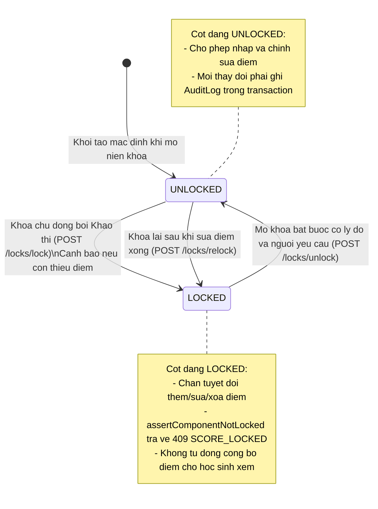
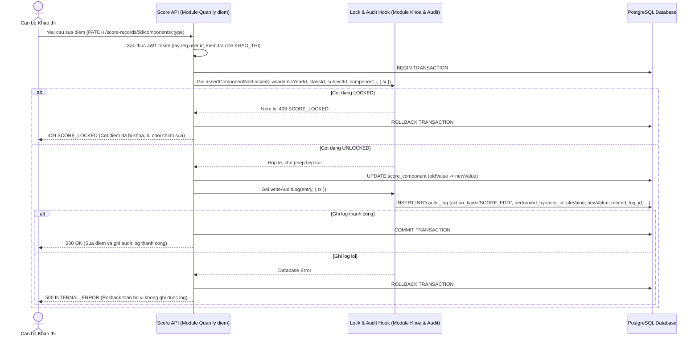

# THIET KE KHOA DIEM, MO KHOA VA AUDIT LOG

## 1. Muc tieu

### 1.1. Muc tieu thiet ke

Thiet ke co che khoa diem va Audit Log cho he thong quan ly ket qua hoc tap THPT:

- Khoa va mo khoa doc lap theo tung thanh phan diem: QT1, QT2, QT3, GK, CK.
- Khoa theo tung nien khoa, lop va mon hoc.
- Cho phep khoa khi con hoc sinh thieu diem nhung bat buoc phai hien thi canh bao so luong hoc sinh chua co diem de can bo khao thi xac nhan truoc khi hoan tat khoa (ho tro nhanh xac nhan khoa tiep tuc hoac huy bo).
- Chan backend tuyet doi khong cho them, sua, xoa diem khi cot diem dang o trang thai khoa (LOCKED).
- Mo khoa bat buoc nhap nguoi yeu cau va ly do giai trinh (unlock_reason); ho tro luu day du nguoi yeu cau ke ca khi nguoi do khong co tai khoan User tren he thong (qua `requested_by_name`).
- Sau khi sua diem xong thi can bo khao thi phai thuc hien khoa lai (RELOCK) cot diem.
- Ghi Audit Log bat bien cho moi thao tac khoa, mo khoa, sua diem va khoa lai.
- Hoan thien bang AuditLog: truong `performed_by` va `requested_by` tham chieu chinh xac den bang `User` (`user_id`) thong qua middleware xac thuc (JWT/Session).
- Bao dam truy vet day du: nguoi khoa, nguoi mo khoa, nguoi sua diem cung thoi diem thuc hien chinh xac (TIMESTAMPTZ).
- Ap dung Database Transaction bat buoc cho ca 4 thao tac LOCK, UNLOCK, RELOCK va SCORE_EDIT: cap nhat LockStatus/Score va ghi AuditLog phai thanh cong cung nhau; neu loi thi rollback toan bo.
- Tach biet ro rang giua trang thai Khoa diem va Cong bo diem: hai trang thai doc lap hoan toan, khong tu dong cong bo khi khoa diem; ghi ro quy tac tu dong khoa chua duoc chot trong pham vi hien tai va khong tu y bo sung co che xu ly khac.
- Bo sung so do Activity Diagram the hien day du luong nghiep vu (gom nhanh xac nhan/huy khi thieu diem, transaction cac thao tac) va cac truong hop tu choi thao tac (403, 400, 409).
- Cung cap day du dac ta thuc the, rang buoc va API Contract de phuc vu tong hop ERD he thong va Data Dictionary.

### 1.2. Cong nghe va quy uoc

- Backend: Node.js, Express.
- Database: PostgreSQL.
- API: REST, JSON.
- Base URL: http://localhost:3000/api/v1
- Ten bang va cot database: snake_case.
- Ten thuoc tinh JSON: camelCase.
- Ten endpoint: chu thuong, kebab-case, danh tu so nhieu.

### 1.3. Tai lieu tham chieu

- Bao cao khao sat va dac ta Use Case cua Nhom 5.
- UC08: Khoa diem.
- UC09: Mo khoa diem va ghi nhan Audit Log.
- UC13: Hoc sinh xem ket qua hoc tap cua chinh minh.
- docs/vt3-data-model.md (module quan ly hoc sinh va lop hoc).
- docs/vt4-score-design.md (module quan ly diem).
- docs/api-conventions.md (quy chuan API va kien truc).
- docs/figma-handoff.md (quy chuan thiet ke giao dien).

---

## 2. Cac thuc the

### 2.1. Danh sach thuc the thiet ke

1. **LockStatus**: Quan ly trang thai khoa theo nien khoa, lop, mon va thanh phan diem.
2. **AuditLog**: Luu vet lich su bat bien ve cac thao tac khoa, mo khoa, sua diem va import diem.

### 2.2. Cac thuc the lien quan trong he thong

Su dung thuc the quan ly tai khoan va nguoi dung (Module Xac thuc va phan quyen):
- **User** (bang `app_user` hoac `users`): Luu thong tin tai khoan nguoi dung (`user_id`, `username`, `role`, `full_name`, `email`, ...). Day la bang nguon de tham chieu khoa ngoai cho `performed_by`, `requested_by`, `locked_by`, `unlocked_by`.

Su dung cac thuc the cua module quan ly hoc sinh va lop hoc:
- **AcademicYear**: Nien khoa.
- **Class**: Lop hoc.
- **Subject**: Mon hoc.
- **Student**: Hoc sinh.
- **Enrollment**: Lich su phan lop cua hoc sinh.

Su dung cac thuc the cua module quan ly diem:
- **ScoreRecord**: Ban ghi diem theo hoc sinh/enrollment va mon hoc.
- **ScoreComponent**: Thanh phan diem cu the (QT1, QT2, QT3, GK, CK).

### 2.3. Quan he du lieu de xuat

- `AcademicYear`, `Class`, `Subject` lien ket voi `LockStatus` de xac dinh pham vi khoa theo bo 4 thanh phan.
- Moi `LockStatus` dai dien cho 1 thanh phan diem cua 1 mon hoc tai 1 lop trong 1 nien khoa.
- `User` lien ket voi `LockStatus`:
  + `locked_by` tham chieu `app_user(user_id)`: Nguoi thuc hien khoa / khoa lai.
  + `unlocked_by` tham chieu `app_user(user_id)`: Nguoi thuc hien mo khoa.
  + `requested_by` tham chieu `app_user(user_id)`: Nguoi yeu cau mo khoa de giai trinh.
- `User` lien ket voi `AuditLog`:
  + `performed_by` tham chieu `app_user(user_id)`: Tai khoan thuc hien thao tac (bat buoc NOT NULL).
  + `requested_by` tham chieu `app_user(user_id)`: Tai khoan nguoi yeu cau thao tac (cho phep NULL).
- `LockStatus` lien ket voi `AuditLog` de theo doi toan bo lich su thay doi trang thai khoa cua cot diem.
- `ScoreRecord` va `ScoreComponent` lien ket voi `AuditLog` de luu chi tiet diem truoc va sau khi sua.
- `Student` lien ket voi `AuditLog` de biet hoc sinh nao duoc sua diem.
- `AuditLog` co quan he tu tham chieu (`related_log_id` tro ve `audit_log_id` cua ban ghi `UNLOCK`) de lien ket chat che tung lan sua diem voi phien mo khoa co ly do hop le truoc do.

---

## 3. Thiet ke thuoc tinh va rang buoc

### 3.1. LockStatus

Muc dich: Luu trang thai khoa hien tai cua tung thanh phan diem theo nien khoa, lop va mon hoc.

| Thuoc tinh | Kieu PostgreSQL | Rang buoc de xuat | Mo ta |
|---|---|---|---|
| lock_status_id | BIGSERIAL | PRIMARY KEY | Ma trang thai khoa |
| academic_year_id | BIGINT | NOT NULL, FOREIGN KEY | Tham chieu academic_year(academic_year_id) |
| class_id | BIGINT | NOT NULL, FOREIGN KEY | Tham chieu class(class_id) |
| subject_id | BIGINT | NOT NULL, FOREIGN KEY | Tham chieu subject(subject_id) |
| component | VARCHAR(10) | NOT NULL | QT1, QT2, QT3, GK, CK |
| status | VARCHAR(20) | NOT NULL, DEFAULT 'UNLOCKED' | UNLOCKED hoac LOCKED |
| locked_by | BIGINT | Cho phep NULL, FOREIGN KEY | Tham chieu app_user(user_id) - Nguoi khoa |
| locked_at | TIMESTAMPTZ | Cho phep NULL | Thoi diem thuc hien khoa |
| unlocked_by | BIGINT | Cho phep NULL, FOREIGN KEY | Tham chieu app_user(user_id) - Nguoi mo khoa |
| unlocked_at | TIMESTAMPTZ | Cho phep NULL | Thoi diem thuc hien mo khoa |
| requested_by | BIGINT | Cho phep NULL, FOREIGN KEY | Tham chieu app_user(user_id) - Nguoi yeu cau mo khoa |
| requested_by_name | VARCHAR(150) | Cho phep NULL | Ho ten/chuc vu nguoi yeu cau de giai trinh |
| unlock_reason | TEXT | Cho phep NULL | Ly do mo khoa bat buoc de giai trinh |
| version | INTEGER | NOT NULL, DEFAULT 1 | Optimistic Locking tranh xung dot dong thoi |
| created_at | TIMESTAMPTZ | NOT NULL, DEFAULT CURRENT_TIMESTAMP | Thoi diem tao ban ghi |
| updated_at | TIMESTAMPTZ | NOT NULL, DEFAULT CURRENT_TIMESTAMP | Thoi diem cap nhat gan nhat |

Rang buoc de xuat cho LockStatus:
- `lock_status_id` la khoa chinh.
- `UNIQUE (academic_year_id, class_id, subject_id, component)`: Moi thanh phan diem cua 1 mon o 1 lop trong 1 nien khoa chi co dung 1 trang thai khoa.
- `component IN ('QT1', 'QT2', 'QT3', 'GK', 'CK')`.
- `status IN ('UNLOCKED', 'LOCKED')`.
- `version >= 1`.
- `academic_year_id` tham chieu `academic_year(academic_year_id)`.
- `class_id` tham chieu `class(class_id)`.
- `subject_id` tham chieu `subject(subject_id)`.
- `locked_by` tham chieu `app_user(user_id)`.
- `unlocked_by` tham chieu `app_user(user_id)`.
- `requested_by` tham chieu `app_user(user_id)` (cho phep NULL).
- `CHECK (status != 'UNLOCKED' OR (unlock_reason IS NOT NULL AND (requested_by IS NOT NULL OR (requested_by_name IS NOT NULL AND length(trim(requested_by_name)) > 0))))`.

Luu y ky thuat:
- Mac dinh khi bat dau nhap diem, trang thai cot diem la `UNLOCKED`.
- Truong `version` dung de phat hien xung dot dong thoi (Optimistic Concurrency Control) khi co 2 khao thi cung thao tac khoa/mo khoa cung luc.
- Khi mo khoa (UNLOCK): Neu nguoi yeu cau co tai khoan User thi luu `user_id` vao `requested_by`; neu nguoi yeu cau khong co tai khoan User (giao vien thinh giang, don de nghi giay) thi `requested_by = NULL` va bat buoc nhap ho ten vao `requested_by_name`. Bat buoc phai co `unlock_reason`.
- Khi khoa lai (RELOCK), he thong cap nhat lai `status = 'LOCKED'`, `locked_by`, `locked_at` va tang `version`.

### 3.2. AuditLog

Muc dich: Luu Audit Log bat bien (Append-Only) cho moi thao tac khoa, mo khoa, sua diem va import diem phuc vu cong tac thanh tra, giai trinh.

| Thuoc tinh | Kieu PostgreSQL | Rang buoc de xuat | Mo ta |
|---|---|---|---|
| audit_log_id | BIGSERIAL | PRIMARY KEY | Ma ban ghi Audit Log |
| action_type | VARCHAR(50) | NOT NULL | LOCK, UNLOCK, RELOCK, SCORE_EDIT, SCORE_IMPORT |
| performed_by | BIGINT | NOT NULL, FOREIGN KEY | Tham chieu app_user(user_id) - Nguoi thuc hien (xac dinh qua JWT/Session middleware) |
| requested_by | BIGINT | Cho phep NULL, FOREIGN KEY | Tham chieu app_user(user_id) - Nguoi yeu cau thao tac |
| requested_by_name | VARCHAR(150) | Cho phep NULL | Ho ten/ghi chu ve nguoi yeu cau |
| lock_status_id | BIGINT | Cho phep NULL, FOREIGN KEY | Tham chieu lock_status(lock_status_id) |
| academic_year_id | BIGINT | NOT NULL, FOREIGN KEY | Tham chieu academic_year(academic_year_id) |
| class_id | BIGINT | NOT NULL, FOREIGN KEY | Tham chieu class(class_id) |
| subject_id | BIGINT | NOT NULL, FOREIGN KEY | Tham chieu subject(subject_id) |
| component | VARCHAR(10) | Cho phep NULL | QT1, QT2, QT3, GK, CK |
| student_id | BIGINT | Cho phep NULL, FOREIGN KEY | Tham chieu student(student_id) |
| score_record_id | BIGINT | Cho phep NULL, FOREIGN KEY | Tham chieu score_record(score_record_id) |
| score_component_id | BIGINT | Cho phep NULL, FOREIGN KEY | Tham chieu score_component(score_component_id) |
| old_value | NUMERIC | Cho phep NULL | Gia tri diem truoc khi sua (phan biet 0 va NULL) |
| new_value | NUMERIC | Cho phep NULL | Gia tri diem sau khi sua (phan biet 0 va NULL) |
| reason | TEXT | Cho phep NULL | Ly do mo khoa hoac ly do sua diem de giai trinh |
| related_log_id | BIGINT | Cho phep NULL, FOREIGN KEY | Tham chieu audit_log(audit_log_id) |
| result | VARCHAR(20) | NOT NULL, DEFAULT 'SUCCESS' | Ket qua: SUCCESS, REJECTED, FAILED |
| created_at | TIMESTAMPTZ | NOT NULL, DEFAULT CURRENT_TIMESTAMP | Thoi diem ghi Audit Log bat bien |

Rang buoc de xuat cho AuditLog:
- `audit_log_id` la khoa chinh.
- `action_type IN ('LOCK', 'UNLOCK', 'RELOCK', 'SCORE_EDIT', 'SCORE_IMPORT')`.
- `result IN ('SUCCESS', 'REJECTED', 'FAILED')`.
- `performed_by` tham chieu `app_user(user_id)`: Bat buoc phai co tai khoan thuc hien hop le duoc he thong xac thuc qua middleware (NOT NULL).
- `requested_by` tham chieu `app_user(user_id)`: Nguoi yeu cau mo khoa hoac de nghi sua diem (cho phep NULL neu khong co tai khoan User).
- `CHECK (action_type != 'UNLOCK' OR (reason IS NOT NULL AND (requested_by IS NOT NULL OR (requested_by_name IS NOT NULL AND length(trim(requested_by_name)) > 0))))`.
- `related_log_id` tham chieu `audit_log(audit_log_id)`: Dung de lien ket chat che cac thao tac sua diem (`SCORE_EDIT`) voi ban ghi mo khoa (`UNLOCK`) tuong ung.
- Diem 0 la mot gia tri hop le trong co so du lieu, hoan toan khac voi `NULL` (chua nhap diem). Khi luu vao `old_value` va `new_value`, he thong bao toan gia tri goc 0 va khong thay the bang NULL.
- Bang nay la bat bien (Append-Only): Chi cho phep thao tac `INSERT`. Nghiem cam tuyet doi moi thao tac `UPDATE` hoac `DELETE` duoi moi hinh thuc de bao dam tinh toan ven va gia tri phap ly khi thanh tra.

### 3.3. Co che xac dinh va truy vet tai khoan qua Middleware (JWT/Session)

De bao dam truy vet day du, chinh xac nguoi thuc hien va thoi diem thao tac:
1. **Xac dinh tai khoan tu Middleware xac thuc**:
   - Backend khong tin tuong bat ky tham so danh tinh nao do client truyen qua Request Body hoac Query.
   - Khi request di qua Auth Middleware, he thong kiem tra JWT token / Session hop le, lay thong tin xac thuc: `req.user.id`, `req.user.username`, `req.user.role`.
   - Backend tu dong gan `performed_by = req.user.id` (khoa ngoai tham chieu `app_user(user_id)`).

2. **Dam bao truy vet day du 4 nhom thao tac va thoi diem (TIMESTAMPTZ)**:
   - **Nguoi khoa diem**: Ghi nhan `locked_by` (User ID) va `locked_at` (TIMESTAMPTZ) trong `LockStatus`; dong thoi tao 1 ban ghi AuditLog voi `action_type = 'LOCK'`, `performed_by = req.user.id`, `created_at = CURRENT_TIMESTAMP`.
   - **Nguoi mo khoa diem**: Ghi nhan `unlocked_by` (User ID), `unlocked_at` (TIMESTAMPTZ), `requested_by` (User ID hoac NULL), `requested_by_name`, va `unlock_reason` trong `LockStatus`; dong thoi tao 1 ban ghi AuditLog voi `action_type = 'UNLOCK'`, `performed_by = req.user.id`, `requested_by`, `requested_by_name`, `reason`, `created_at = CURRENT_TIMESTAMP`.
   - **Nguoi sua diem**: Ghi nhan trong AuditLog voi `action_type = 'SCORE_EDIT'`, `performed_by = req.user.id`, `old_value`, `new_value`, `reason`, `related_log_id` tro ve ban ghi mo khoa, `created_at = CURRENT_TIMESTAMP`. Thao tac nam trong cung database transaction voi cap nhat diem.
   - **Nguoi khoa lai**: Ghi nhan `locked_by` (User ID) va `locked_at` (TIMESTAMPTZ) trong `LockStatus`; dong thoi tao 1 ban ghi AuditLog voi `action_type = 'RELOCK'`, `performed_by = req.user.id`, `created_at = CURRENT_TIMESTAMP`.

#### 3.3.1. Co che luu nguoi yeu cau mo khoa khi co hoac khong co tai khoan User

Trong thuc te quan ly tai truong THPT, nguoi yeu cau mo khoa sua diem co the la giao vien bien che (da co tai khoan User) hoac giao vien thinh giang, can bo chua co tai khoan User trong he thong:
- **Truong hop 1 - Nguoi yeu cau CO tai khoan User**:
  + `requested_by`: Luu `app_user.user_id` (BIGINT).
  + `requested_by_name`: Luu snapshot ho ten/chuc vu tai thoi diem yeu cau de tien tra cuu truc quan.
  + `unlock_reason` (trong LockStatus) va `reason` (trong AuditLog): Luu ly do giai trinh bat buoc.
- **Truong hop 2 - Nguoi yeu cau KHONG CO tai khoan User** (giao vien thinh giang, don de nghi giay tu to bo mon):
  + `requested_by`: Luu gia tri `NULL` (cot da duoc thiet ke cho phep NULL de khong vi pham rang buoc Foreign Key).
  + `requested_by_name`: Bat buoc phai nhap day du ho va ten, chuc vu/don vi cong tac cua nguoi yeu cau (VD: `"Nguyen Thi Lan - GV Thinh giang mon Toan"`). He thong chan khong cho phep de trong.
  + `unlock_reason` / `reason`: Bat buoc ghi ro ly do giai trinh chi tiet.
- **Bao dam truy vet tai khoan thuc hien (Audit Trail Integrity)**:
  + Du nguoi yeu cau co tai khoan hay khong, **tai khoan truc tiep thuc hien thao tac mo khoa** tren he thong (`unlocked_by` trong `LockStatus` va `performed_by` trong `AuditLog`) **LUON LUON LA TAI KHOAN CUA CAN BO KHAO THI DANG DANG NHAP** (`NOT NULL`, trich xuat tu token xac thuc).
  + Thoi diem thuc hien `unlocked_at` va `created_at` luon duoc ghi nhan chinh xac theo chuan `TIMESTAMPTZ`.
  + Nho do, he thong luon bao dam 100% tinh minh bach va gia tri phap ly: biet ro can bo khao thi nao da mo khoa, vao thoi diem nao, va mo khoa theo don yeu cau/ly do cua ai.

### 3.4. Quy tac toan ven giao dich (Transaction Integrity cho LOCK, UNLOCK, RELOCK va SCORE_EDIT)

He thong ap dung quy tac Database Transaction nguyen tu (ACID) bat buoc cho tat ca 4 thao tac thay doi du lieu. Nguyen tac cot loi: **Cap nhat trang thai va ghi Audit Log phai thanh cong cung nhau; neu bat ky thao tac nao bi loi thi phai ROLLBACK toan bo ngay lap tuc**:

1. **Giao dich Khoa diem (LOCK Transaction)**:
   - `BEGIN TRANSACTION;`
   - Kiem tra phien ban (Optimistic lock `expectedVersion`).
   - Cap nhat `lock_status`: `status = 'LOCKED'`, `locked_by = req.user.id`, `locked_at = NOW()`, `version = version + 1`.
   - Ghi `audit_log`: `action_type = 'LOCK'`, `performed_by = req.user.id`, `result = 'SUCCESS'`, `created_at = NOW()`.
   - Neu thanh cong: `COMMIT TRANSACTION;`
   - Neu loi (loi ghi log, loi DB): `ROLLBACK TRANSACTION;` toan bo, cot diem giu nguyen trang thai truoc do, tra ve `500 INTERNAL_ERROR`.

2. **Giao dich Mo khoa (UNLOCK Transaction)**:
   - `BEGIN TRANSACTION;`
   - Kiem tra `expectedVersion` va trang thai cot dang la `LOCKED`.
   - Cap nhat `lock_status`: `status = 'UNLOCKED'`, `unlocked_by = req.user.id`, `unlocked_at = NOW()`, `requested_by`, `requested_by_name`, `unlock_reason`, `version = version + 1`.
   - Ghi `audit_log`: `action_type = 'UNLOCK'`, `performed_by = req.user.id`, `requested_by`, `requested_by_name`, `reason`, `result = 'SUCCESS'`, `created_at = NOW()`.
   - Neu thanh cong: `COMMIT TRANSACTION;`
   - Neu loi: `ROLLBACK TRANSACTION;` toan bo, cot diem van giu nguyen la `LOCKED`.

3. **Giao dich Khoa lai (RELOCK Transaction)**:
   - `BEGIN TRANSACTION;`
   - Kiem tra `expectedVersion` va trang thai cot dang la `UNLOCKED`.
   - Cap nhat `lock_status`: `status = 'LOCKED'`, `locked_by = req.user.id`, `locked_at = NOW()`, `version = version + 1`.
   - Ghi `audit_log`: `action_type = 'RELOCK'`, `performed_by = req.user.id`, `result = 'SUCCESS'`, `created_at = NOW()`.
   - Neu thanh cong: `COMMIT TRANSACTION;`
   - Neu loi: `ROLLBACK TRANSACTION;` toan bo.

4. **Giao dich Sua diem (SCORE_EDIT / SCORE_IMPORT Transaction)**:
   - `BEGIN TRANSACTION;`
   - Kiem tra khoa: goi hook `assertComponentNotLocked`. Neu cot dang LOCKED thi `ROLLBACK TRANSACTION;`, tra ve `409 SCORE_LOCKED`.
   - Kiem tra mien diem hop le (0-10, so nguyen cho QT). Neu sai thi `ROLLBACK TRANSACTION;`, tra ve `422 INVALID_SCORE`.
   - Cap nhat gia tri diem trong bang `score_component`.
   - Ghi `audit_log`: `action_type = 'SCORE_EDIT'`, `performed_by = req.user.id`, `old_value`, `new_value`, `reason`, `related_log_id`, `created_at = NOW()`.
   - Neu loi ghi log hoac loi DB: `ROLLBACK TRANSACTION;` toan bo, diem so tuyet doi khong duoc cap nhat vao DB, tra ve `500 INTERNAL_ERROR`.
   - Neu thanh cong: `COMMIT TRANSACTION;`, tra ve `200 OK`.

---

## 4. Quy tac nghiep vu (Business Rules)

### 4.1. Quy tac khoa diem

- **BR-L01**: Moi cot diem co trang thai khoa hoan toan doc lap theo bo 4 thanh phan: Nien khoa (`academic_year_id`), Lop (`class_id`), Mon hoc (`subject_id`) va Thanh phan diem (`component`: QT1, QT2, QT3, GK, CK).
- **BR-L02**: Thao tac khoa hoac mo khoa mot cot diem khong anh huong den bat ky cot diem nao khac trong cung lop hay khac lop.
- **BR-L03**: Chi tai khoan co vai tro `KHAO_THI` moi duoc phep thuc hien cac thao tac khoa, mo khoa va khoa lai cot diem.
- **BR-L04**: Mac dinh khi bat dau mot nien khoa va mo nhap diem, moi cot diem o trang thai `UNLOCKED`.
- **BR-L05**: Khi thuc hien khoa cot diem, he thong kiem tra du lieu diem cua hoc sinh trong lop:
  + Neu lop con hoc sinh thieu diem (`missingCount > 0`): he thong bat buoc phai hien thi canh bao so luong hoc sinh chua co diem va yeu cau can bo khao thi xac nhan truoc khi hoan tat khoa.
    * **Nhanh Xac nhan**: Neu khao thi xac nhan dong y tiep tuc khoa (gui kem co `confirmed: true`), he thong thuc thi transaction cap nhat `status = 'LOCKED'` va ghi AuditLog.
    * **Nhanh Huy**: Neu khao thi chon huy bo hoac dong hop thoai canh bao, thao tac khoa bi huy bo hoan toan, cot diem giu nguyen trang thai `UNLOCKED`.
  + Neu lop da day du diem (`missingCount == 0`): he thong tien hanh khoa ngay ma khong can hop thoai xac nhan thieu diem.

### 4.2. Quy tac mo khoa va sua diem

- **BR-L06**: Khi mo khoa (UNLOCK), bat buoc phai cung cap thong tin nguoi yeu cau (qua `requested_by` neu co tai khoan User, hoac `requested_by_name` neu khong co tai khoan) va ly do giai trinh mo khoa (`reason`).
- **BR-L07**: Truong hop nguoi yeu cau khong co tai khoan User tren he thong (giao vien thinh giang, can bo ngoai bien che), cot `requested_by` luu gia tri `NULL`, dong thoi bat buoc phai nhap day du ho ten va chuc vu/don vi vao `requested_by_name`. Ly do mo khoa khong duoc de trong, phai ghi ro rang de phuc vu giai trinh.
- **BR-L08**: Sau khi sua diem hoan tat trong phien mo khoa, can bo khao thi phai chu dong thuc hien thao tac khoa lai (`RELOCK`) de dong bang cot diem tro lai.
- **BR-L09**: Moi lan sua diem trong thoi gian cot diem duoc mo khoa bat buoc phai ghi ro gia tri diem cu (`old_value`), gia tri diem moi (`new_value`), nguoi sua (`performed_by`), ly do sua va lien ket dung voi ban ghi Audit Log cua lan mo khoa truoc do (`related_log_id`).

### 4.3. Quy tac chan sua khi cot da khoa

- **BR-L10**: Backend phai chan tuyet doi moi thao tac them moi, cap nhat hoac xoa diem khi cot diem dang o trang thai `LOCKED`.
- **BR-L11**: Khi bi chan do cot dang khoa, he thong tra ve ma loi nghiep vu `SCORE_LOCKED` kem ma HTTP `409 Conflict`.
- **BR-L12**: Khi import diem tu tap tin CSV, he thong kiem tra trang thai khoa cua tung thanh phan diem tuong ung voi tung dong. Dong nao thuoc cot dang `LOCKED` thi he thong tu choi cap nhat dong do va bao loi chi tiet tren dong, khong ghi de len du lieu da duoc khoa.

### 4.4. Quy tac Audit Log

- **BR-A01**: AuditLog la du lieu bat bien (Append-Only), he thong khong cung cap bat ky API nao cho phep sua, cap nhat hoac xoa ban ghi Audit Log.
- **BR-A02**: Moi thao tac LOCK, UNLOCK, RELOCK, SCORE_EDIT va SCORE_IMPORT deu phai tao dung 1 ban ghi tuong ung vao AuditLog.
- **BR-A03**: Diem 0 va NULL phai duoc luu chinh xac trong log; tuyet doi khong tu dong quy doi NULL thanh 0 hoac nguoc lai.
- **BR-A04**: Chi tai khoan co vai tro `KHAO_THI` moi co quyen xem danh sach, tra cuu va loc du lieu AuditLog.
- **BR-A05**: Audit Log bat buoc phai luu tham chieu den tai khoan thuc hien tu bang User (`performed_by`), nguoi yeu cau (`requested_by` hoac `requested_by_name`), va thoi diem chinh xac xay ra thao tac (`created_at` TIMESTAMPTZ).
- **BR-A06**: Cac thao tac LOCK, UNLOCK va RELOCK bat buoc phai thuc thi cung thao tac ghi AuditLog trong mot Database Transaction duy nhat. Neu ghi AuditLog loi hoac gap su co co so du lieu, toan bo transaction phai duoc rollback ngay lap tuc de bao dam LockStatus khong bi thay doi don le.

### 4.5. Quy tac phan quyen

- **BR-P01**: He thong thong nhat 2 vai tro co ban: `KHAO_THI` va `HOC_SINH`.
- **BR-P02**: `HOC_SINH` khong duoc phep goi cac API quan ly khoa diem va khong duoc phep xem AuditLog.
- **BR-P03**: **Hoc sinh chi duoc xem ket qua hoc tap cua chinh minh khi diem da duoc cong bo theo thoi gian quy dinh. Khoa diem khong dong nghia voi cong bo diem.**

### 4.6. Quy tac giua khoa diem va cong bo diem (Lock vs Publish)

- **BR-LP01**: **Doc lap hoan toan giua Khoa diem va Cong bo diem**:
  + Trang thai Khoa diem (`LockStatus`: UNLOCKED / LOCKED) va trang thai Cong bo diem la **hai trang thai doc lap hoan toan**.
  + *Khoa diem*: Nham kiem soat toan ven du lieu noi bo cua phong Khao thi, ngan chan sua doi diem sau han chot nhap diem.
  + *Cong bo diem*: Nham phuc vu hoc sinh va phu huynh xem ket qua hoc tap cua chinh minh theo moc thoi gian quy dinh cua nha truong.
- **BR-LP02**: **Khong tu dong cong bo khi khoa diem**:
  + He thong **khong tu dong cong bo khi khoa diem** (`Lock != Publish`).
  + Khi can bo khao thi thuc hien khoa cot diem, cot diem do chi bi dong bang thao tac nhap/sua noi bo, hoc sinh van chua the xem duoc diem neu chua den thoi diem cong bo chinh thuc.
- **BR-LP03**: **Quy tac tu dong khoa (Auto-lock)**:
  + Ghi ro: **Quy tac tu dong khoa (Auto-lock) nay chua duoc chot trong pham vi hien tai**.
  + He thong **khong tu y bo sung co che xu ly nao khac** ngoai pham vi da thong nhat.
  + Trong pham vi thiet ke hien tai, chi ho tro co che khoa chu dong (Manual Lock) boi can bo co role `KHAO_THI` qua API va giao dien.

### 4.7. Xu ly khi hoc sinh chuyen lop

- **BR-T01**: Khi hoc sinh chuyen lop giua nien khoa, diem so va lich su diem tai lop cu duoc bao toan nguyen ven va giu nguyen trang thai khoa cua lop cu.
- **BR-T02**: Thao tac chuyen lop khong duoc phep tu dong mo khoa hoac xoa bo trang thai khoa cua lop cu.
- **BR-T03**: Cac cot diem phat sinh moi cua hoc sinh tai lop moi se hoan toan tuan theo trang thai khoa rieng cua lop moi.

---

## 5. Hop dong API (API Contract)

### 5.1. Quy uoc chung

Base URL:
```
http://localhost:3000/api/v1
```

Quy uoc ky thuat:
- RESTful JSON API.
- Headers bat buoc: `Authorization: Bearer <token>`, `Content-Type: application/json`.
- Tat ca cac API quan ly khoa diem va xem AuditLog yeu cau token hop le cua nguoi dung co vai tro `KHAO_THI`.
- Endpoint danh tu so nhieu, chu thuong kebab-case; JSON property su dung camelCase.

### 5.2. Danh sach API

| Method | Endpoint | Vai tro | Chuc nang |
|---|---|---|---|
| GET | `/locks` | KHAO_THI | Lay ma tran trang thai khoa 5 cot diem theo lop va mon |
| POST | `/locks/lock` | KHAO_THI | Khoa chu dong 1 cot diem (co canh bao neu thieu diem) |
| POST | `/locks/unlock` | KHAO_THI | Mo khoa 1 cot diem (bat buoc nhap nguoi yeu cau va ly do) |
| POST | `/locks/relock` | KHAO_THI | Khoa lai cot diem sau khi sua xong |
| GET | `/audit-logs` | KHAO_THI | Xem va tra cuu, loc danh sach Audit Log |

### 5.3. Chi tiet cac API

#### 1. API lay trang thai khoa: `GET /locks`

Query parameters:
- `academicYearId` (BIGINT, bat buoc): Ma nien khoa.
- `classId` (BIGINT, bat buoc): Ma lop hoc.
- `subjectId` (BIGINT, bat buoc): Ma mon hoc.

Phan hoi thanh cong (HTTP 200 OK):
```json
{
  "success": true,
  "data": {
    "academicYearId": 1,
    "classId": 10,
    "subjectId": 2,
    "components": [
      {
        "component": "QT1",
        "status": "LOCKED",
        "lockedBy": 1,
        "lockedAt": "2026-10-25T08:30:00.000Z",
        "version": 2
      },
      {
        "component": "QT2",
        "status": "UNLOCKED",
        "lockedBy": null,
        "lockedAt": null,
        "version": 1
      },
      {
        "component": "QT3",
        "status": "UNLOCKED",
        "lockedBy": null,
        "lockedAt": null,
        "version": 1
      },
      {
        "component": "GK",
        "status": "UNLOCKED",
        "lockedBy": null,
        "lockedAt": null,
        "version": 1
      },
      {
        "component": "CK",
        "status": "UNLOCKED",
        "lockedBy": null,
        "lockedAt": null,
        "version": 1
      }
    ]
  }
}
```

#### 2. API khoa cot diem: `POST /locks/lock`

Body gui len:
```json
{
  "academicYearId": 1,
  "classId": 10,
  "subjectId": 2,
  "component": "QT1",
  "expectedVersion": 1,
  "confirmed": false
}
```

Xu ly nghiep vu tai Backend:
1. Xac thuc `req.user` phai co role `KHAO_THI` (neu khong co quyen: tra ve `403 FORBIDDEN`).
2. Kiem tra ban ghi `LockStatus` hien tai. Neu `version != expectedVersion` thi tra ve `409 VERSION_CONFLICT`.
3. Neu `status` da la `LOCKED` thi tra ve `409 CONFLICT`.
4. Dem so luong hoc sinh trong lop chua co diem tai cot `component` nay:
   - Neu con hoc sinh chua co diem (`missingCount > 0`) va client truyen `confirmed !== true`:
     Backend CHUA thuc hien khoa cot diem, tra ve HTTP 200 kem co canh bao yeu cau xac nhan:
     ```json
     {
       "success": false,
       "requiresConfirmation": true,
       "data": {
         "hasMissingScores": true,
         "missingCount": 3,
         "message": "Lop con 3 hoc sinh chua co diem. Canh bao khao thi can xac nhan de tiep tuc khoa."
       }
     }
     ```
     - Neu Khao thi chon "Huy": Client dung thao tac, cot diem giu nguyen trang thai `UNLOCKED`.
     - Neu Khao thi chon "Xac nhan khoa": Client gui lai request kem `confirmed: true`.
5. Khi lop da day du diem (`missingCount == 0`) HOAC khao thi da xac nhan voi `confirmed: true`:
   Thuc thi trong mot **Database Transaction**:
   - `BEGIN TRANSACTION;`
   - Cap nhat `LockStatus`:
     + `status = 'LOCKED'`
     + `locked_by = req.user.id` (User ID tu JWT middleware)
     + `locked_at = CURRENT_TIMESTAMP`
     + `version = version + 1`
   - Ghi 1 ban ghi vao `AuditLog`:
     + `action_type = 'LOCK'`
     + `performed_by = req.user.id`
     + `result = 'SUCCESS'`
     + `created_at = CURRENT_TIMESTAMP`
   - Neu co bat ky loi nao (loi ghi log hoac cap nhat DB): `ROLLBACK TRANSACTION;` toan bo, tra ve `500 INTERNAL_ERROR`.
   - Neu thanh cong: `COMMIT TRANSACTION;`, tra ve HTTP 200 OK.

Phan hoi thanh cong (HTTP 200 OK):
```json
{
  "success": true,
  "data": {
    "lockStatusId": 101,
    "status": "LOCKED",
    "component": "QT1",
    "version": 2,
    "lockedBy": 1,
    "lockedAt": "2026-10-30T10:00:00.000Z",
    "warning": {
      "hasMissingScores": true,
      "missingCount": 3,
      "message": "Cot diem da duoc khoa thanh cong (da xac nhan truong hop con 3 hoc sinh chua co diem)."
    }
  }
}
```

#### 3. API mo khoa cot diem: `POST /locks/unlock`

Body gui len:
```json
{
  "academicYearId": 1,
  "classId": 10,
  "subjectId": 2,
  "component": "QT1",
  "expectedVersion": 2,
  "requestedBy": 5,
  "requestedByName": "Tran Thi B (Giao vien Toan)",
  "reason": "Sua diem bai kiem tra so 1 cua hoc sinh Nguyen Van C do cham sot cau hoi so 4"
}
```
*Ghi chu Body*: Neu nguoi yeu cau khong co tai khoan User, client truyen `requestedBy: null` va bat buoc truyen `requestedByName` khong duoc de trong.

Xu ly nghiep vu tai Backend:
1. Xac thuc `req.user.role == 'KHAO_THI'` (neu khong co quyen: tra ve `403 FORBIDDEN`).
2. Kiem tra tinh hop le cua nguoi yeu cau va ly do mo khoa:
   - Neu `requestedBy` la NULL thi bat buoc `requestedByName` phai co chuoi hop le khong ranh.
   - `reason` bat buoc khong duoc de trong hoac chi chua khoang trang (neu vi pham: tra ve `400 VALIDATION_ERROR`).
3. Kiem tra `expectedVersion` (neu xung dot: tra ve `409 VERSION_CONFLICT`).
4. Kiem tra trang thai hien tai: bat buoc phai la `LOCKED` moi duoc mo khoa (neu dang `UNLOCKED`: tra ve `409 CONFLICT`).
5. Thuc thi trong mot **Database Transaction**:
   - `BEGIN TRANSACTION;`
   - Cap nhat `LockStatus`:
     + `status = 'UNLOCKED'`
     + `unlocked_by = req.user.id`
     + `unlocked_at = CURRENT_TIMESTAMP`
     + `requested_by = body.requestedBy` (User ID hoac NULL)
     + `requested_by_name = body.requestedByName`
     + `unlock_reason = body.reason`
     + `version = version + 1`
   - Ghi ban ghi mo khoa vao `AuditLog`:
     + `action_type = 'UNLOCK'`
     + `performed_by = req.user.id`
     + `requested_by = body.requestedBy`
     + `requested_by_name = body.requestedByName`
     + `reason = body.reason`
     + `result = 'SUCCESS'`
     + `created_at = CURRENT_TIMESTAMP`
   - Neu co bat ky loi nao: `ROLLBACK TRANSACTION;` toan bo, cot diem giu nguyen la `LOCKED`, tra ve `500 INTERNAL_ERROR`.
   - Neu thanh cong: `COMMIT TRANSACTION;`, tra ve HTTP 200 OK.

Phan hoi thanh cong (HTTP 200 OK):
```json
{
  "success": true,
  "data": {
    "lockStatusId": 101,
    "status": "UNLOCKED",
    "component": "QT1",
    "version": 3,
    "unlockedBy": 1,
    "unlockedAt": "2026-10-30T10:15:00.000Z",
    "requestedBy": 5,
    "requestedByName": "Tran Thi B (Giao vien Toan)",
    "reason": "Sua diem bai kiem tra so 1 cua hoc sinh Nguyen Van C do cham sot cau hoi so 4",
    "auditLogId": 501
  }
}
```

#### 4. API khoa lai cot diem: `POST /locks/relock`

Body gui len:
```json
{
  "academicYearId": 1,
  "classId": 10,
  "subjectId": 2,
  "component": "QT1",
  "expectedVersion": 3
}
```

Xu ly nghiep vu tai Backend:
1. Xac thuc `req.user.role == 'KHAO_THI'` (neu sai: tra ve `403 FORBIDDEN`).
2. Kiem tra `expectedVersion` (neu sai: tra ve `409 VERSION_CONFLICT`).
3. Kiem tra trang thai hien tai phai la `UNLOCKED` (neu da `LOCKED`: tra ve `409 CONFLICT`).
4. Thuc thi trong mot **Database Transaction**:
   - `BEGIN TRANSACTION;`
   - Cap nhat `LockStatus`:
     + `status = 'LOCKED'`
     + `locked_by = req.user.id`
     + `locked_at = CURRENT_TIMESTAMP`
     + `version = version + 1`
   - Ghi 1 ban ghi `RELOCK` vao `AuditLog`:
     + `action_type = 'RELOCK'`
     + `performed_by = req.user.id`
     + `result = 'SUCCESS'`
     + `created_at = CURRENT_TIMESTAMP`
   - Neu co loi ghi log hoac cap nhat DB: `ROLLBACK TRANSACTION;` toan bo, tra ve `500 INTERNAL_ERROR`.
   - Neu thanh cong: `COMMIT TRANSACTION;`, tra ve HTTP 200 OK.

Phan hoi thanh cong (HTTP 200 OK):
```json
{
  "success": true,
  "data": {
    "lockStatusId": 101,
    "status": "LOCKED",
    "component": "QT1",
    "version": 4,
    "lockedBy": 1,
    "lockedAt": "2026-10-30T10:30:00.000Z"
  }
}
```

#### 5. API xem danh sach AuditLog: `GET /audit-logs`

Query parameters:
- `page` (INTEGER, mac dinh 1): So trang.
- `limit` (INTEGER, mac dinh 20): So ban ghi moi trang.
- `academicYearId` (BIGINT, tuy chon): Loc theo nien khoa.
- `classId` (BIGINT, tuy chon): Loc theo lop.
- `subjectId` (BIGINT, tuy chon): Loc theo mon hoc.
- `component` (VARCHAR, tuy chon): QT1, QT2, QT3, GK, CK.
- `studentId` (BIGINT, tuy chon): Loc theo hoc sinh.
- `performedBy` (BIGINT, tuy chon): Loc theo ID nguoi thuc hien tu bang User.
- `actionType` (VARCHAR, tuy chon): LOCK, UNLOCK, RELOCK, SCORE_EDIT, SCORE_IMPORT.
- `from`, `to` (ISO8601 TIMESTAMPTZ, tuy chon): Khoang thoi gian thuc hien.

Phan hoi thanh cong (HTTP 200 OK):
```json
{
  "success": true,
  "data": {
    "items": [
      {
        "auditLogId": 502,
        "actionType": "SCORE_EDIT",
        "performedBy": 1,
        "academicYearId": 1,
        "classId": 10,
        "subjectId": 2,
        "component": "QT1",
        "studentId": 15,
        "scoreRecordId": 305,
        "scoreComponentId": 912,
        "oldValue": 6.0,
        "newValue": 8.0,
        "reason": "Cham bo sung cau 4 theo phieu phuc khao",
        "relatedLogId": 501,
        "result": "SUCCESS",
        "createdAt": "2026-10-30T10:20:00.000Z"
      },
      {
        "auditLogId": 501,
        "actionType": "UNLOCK",
        "performedBy": 1,
        "requestedBy": 5,
        "requestedByName": "Tran Thi B (Giao vien Toan)",
        "academicYearId": 1,
        "classId": 10,
        "subjectId": 2,
        "component": "QT1",
        "reason": "Sua diem bai kiem tra so 1 cua hoc sinh Nguyen Van C do cham sot cau hoi so 4",
        "relatedLogId": null,
        "result": "SUCCESS",
        "createdAt": "2026-10-30T10:15:00.000Z"
      }
    ],
    "pagination": {
      "page": 1,
      "limit": 20,
      "totalItems": 2,
      "totalPages": 1
    }
  }
}
```

### 5.4. Hook noi bo kiem tra khoa va ghi log cho module quan ly diem

Module quan ly diem khi thuc hien cap nhat diem (API PATCH hoac Import CSV) se goi 2 ham hook noi bo:

```javascript
/**
 * 1. Kiem tra xem thanh phan diem co bi khoa hay khong.
 * Nem loi HTTP 409 SCORE_LOCKED neu cot dang o trang thai LOCKED.
 */
await assertComponentNotLocked({
  academicYearId,
  classId,
  subjectId,
  component
}, { tx });

/**
 * 2. Ghi Audit Log trong cung Database Transaction voi thao tac cap nhat diem.
 * Neu ghi log loi, transaction se bi rollback toan bo.
 */
await writeAuditLog({
  actionType: 'SCORE_EDIT',
  performedBy: req.user.id, // User ID xac thuc tu JWT Middleware
  requestedBy: null,
  academicYearId,
  classId,
  subjectId,
  component,
  studentId,
  scoreRecordId,
  scoreComponentId,
  oldValue,
  newValue,
  reason,
  relatedLogId,
  result: 'SUCCESS'
}, { tx });
```

### 5.5. Quy uoc ma loi he thong

| HTTP Code | Error Code | Y nghia nghiep vu |
|---|---|---|
| 400 | VALIDATION_ERROR | Du lieu dau vao sai dinh dang hoac thieu ly do mo khoa / thieu nguoi yeu cau |
| 401 | UNAUTHORIZED | Chua dang nhap hoac token xac thuc khong hop le / het han |
| 403 | FORBIDDEN | Khong co quyen truy cap (khong phai vai tro KHAO_THI) |
| 404 | NOT_FOUND | Khong tim thay thong tin nien khoa, lop, mon hoc hoac cot diem |
| 409 | CONFLICT | Trang thai cot diem khong phu hop voi thao tac (VD: mo khoa cot dang UNLOCKED hoac khoa lai cot da LOCKED) |
| 409 | SCORE_LOCKED | Cot diem dang bi khoa (LOCKED), backend chan tuyet doi thao tac sua diem |
| 409 | VERSION_CONFLICT | Xung dot phien ban du lieu do co nguoi khac da thao tac dong thoi |
| 422 | INVALID_SCORE | Gia tri diem khong hop le (ngoai mien 0-10 hoac cot QT co so thap phan) |
| 500 | INTERNAL_ERROR | Loi noi bo he thong hoac loi ghi transaction database |

---

## 6. So do luong (Diagrams)

### 6.1. Vong doi trang thai khoa (State Diagram)



### 6.2. Luong sua diem va ghi log trong Transaction (Sequence Diagram)



### 6.3. So do hoat dong tong the (Activity Diagram)

So do hoat dong the hien day du quy trinh: Khoa diem (kem nhanh canh bao thieu diem va xac nhan/huy), Mo khoa co ly do (ho tro ca nguoi yeu cau khong co tai khoan User), Sua diem trong Database Transaction, Ghi AuditLog bat bien, Khoa lai (RELOCK), quy tac Transaction nguyen tu cho moi thao tac va cac truong hop tu choi (`403 FORBIDDEN`, `400 VALIDATION_ERROR`, `409 SCORE_LOCKED`, `409 CONFLICT`, `409 VERSION_CONFLICT`, `500 INTERNAL_ERROR`):

```mermaid
flowchart TD
    Start([Bat dau quy trinh quan ly cot diem]) --> Choose["Can bo Khao thi chon Nien khoa, Lop, Mon va Cot diem"]
    Choose --> ChooseAction{"Chon thao tac nghiep vu"}

    %% --- LUONG 1: KHOA DIEM ---
    ChooseAction -- "1. Khoa cot diem" --> ReqLock["Gui yeu cau khoa cot diem: POST /locks/lock"]
    ReqLock --> CheckAuthLock{"Kiem tra quyen:\nRole KHAO_THI?"}
    CheckAuthLock -- "Khong phai Khao thi" --> RejectLock403["TU CHOI: 403 FORBIDDEN\nNguoi dung khong co quyen"]
    CheckAuthLock -- "Hop le" --> CheckVerLock{"Kiem tra Concurrency:\nexpectedVersion hop le?"}
    CheckVerLock -- "Xung dot version" --> RejectLockVer409["TU CHOI: 409 VERSION_CONFLICT\nDu lieu da bi nguoi khac sua"]
    CheckVerLock -- "Hop le" --> CheckStatusLock{"Trang thai cot diem hien tai?"}
    CheckStatusLock -- "Da la LOCKED" --> RejectLockStatus409["TU CHOI: 409 CONFLICT\nCot diem da o trang thai khoa"]
    CheckStatusLock -- "Dang la UNLOCKED" --> CheckMissing{"Kiem tra hoc sinh trong lop\ncon thieu diem khong?"}
    CheckMissing -- "Con hoc sinh thieu diem" --> ShowWarnModal["Hien thi canh bao:\nLop con N hoc sinh chua co diem"]
    ShowWarnModal --> UserConfirmChoice{"Khao thi xac nhan\nhay huy thao tac?"}
    UserConfirmChoice -- "Huy thao tac" --> CancelLock["Huy thao tac khoa:\nCot diem giu nguyen UNLOCKED"]
    CancelLock --> CancelLockDone([Ket thuc thao tac bi huy])
    UserConfirmChoice -- "Xac nhan khoa tiep tuc" --> BeginTxLock["Bat dau Database Transaction\n(gui kem confirmed=true)"]
    CheckMissing -- "Day du diem" --> BeginTxLock
    BeginTxLock --> UpdateLockDB["UPDATE lock_status sang LOCKED\nLuu locked_by=user_id, locked_at=NOW, tang version"]
    UpdateLockDB --> WriteLogLock["INSERT INTO audit_log:\naction_type='LOCK', performed_by=user_id, created_at=NOW"]
    WriteLogLock --> CheckTxLockOk{"Ghi log va cap nhat\nthanh cong khong?"}
    CheckTxLockOk -- "Loi DB/Log" --> RbTxLock["ROLLBACK Transaction toan bo\nTra ve 500 INTERNAL_ERROR"]
    CheckTxLockOk -- "Thanh cong" --> CommitTxLock["COMMIT Database Transaction"]
    CommitTxLock --> LockDone([Hoan tat khoa cot diem: 200 OK])

    %% --- LUONG 2: THU SUA DIEM KHI DANG KHOA (BI CHAN) ---
    ChooseAction -- "2. Thu sua diem khi cot dang khoa" --> TryEdit["Nguoi dung thu gui request sua diem\nhoac import CSV cot dang khoa"]
    TryEdit --> HookCheck{"assertComponentNotLocked:\nKiem tra trang thai cot?"}
    HookCheck -- "Cot dang LOCKED" --> BlockEdit409["TU CHOI: 409 SCORE_LOCKED\nRollback transaction, chan tuyet doi sua diem"]
    BlockEdit409 --> BlockEditEnd([Thao tac sua diem bi tu choi hoan toan])

    %% --- LUONG 3: MO KHOA CO LY DO ---
    ChooseAction -- "3. Mo khoa diem de sua" --> ReqUnlock["Gui yeu cau mo khoa: POST /locks/unlock\n(kem requestedBy hoac requestedByName va reason)"]
    ReqUnlock --> CheckAuthUnlock{"Kiem tra quyen:\nRole KHAO_THI?"}
    CheckAuthUnlock -- "Khong phai Khao thi" --> RejectUnlock403["TU CHOI: 403 FORBIDDEN"]
    CheckAuthUnlock -- "Hop le" --> CheckReasonValid{"Kiem tra thong tin:\nCo nguoi yeu cau va ly do khong?"}
    CheckReasonValid -- "Thieu hoac rong" --> RejectUnlock400["TU CHOI: 400 VALIDATION_ERROR\nBat buoc phai co nguoi yeu cau va ly do giai trinh"]
    CheckReasonValid -- "Hop le va day du" --> CheckStatusUnlock{"Trang thai hien tai?"}
    CheckStatusUnlock -- "Dang la UNLOCKED" --> RejectUnlock409["TU CHOI: 409 CONFLICT\nCot diem dang mo, khong can mo khoa"]
    CheckStatusUnlock -- "Dang la LOCKED" --> BeginTxUnlock["Bat dau Database Transaction"]
    BeginTxUnlock --> DoUnlock["UPDATE lock_status sang UNLOCKED\nLuu unlocked_by=user_id, unlocked_at=NOW,\nrequested_by/name, unlock_reason, tang version"]
    DoUnlock --> WriteLogUnlock["INSERT INTO audit_log:\naction_type='UNLOCK', performed_by=user_id,\nrequested_by, requested_by_name, reason, created_at=NOW"]
    WriteLogUnlock --> CheckTxUnlockOk{"Cap nhat va ghi log\nthanh cong khong?"}
    CheckTxUnlockOk -- "Loi DB/Log" --> RbTxUnlock["ROLLBACK Transaction toan bo\nCot diem giu nguyen LOCKED, tra ve 500"]
    CheckTxUnlockOk -- "Thanh cong" --> CommitTxUnlock["COMMIT Database Transaction"]
    CommitTxUnlock --> UnlockDone["Mo khoa thanh cong: 200 OK\n(Tra ve auditLogId cua phien mo khoa)"]

    %% --- LUONG 4: SUA DIEM VA GHI LOG TRONG TRANSACTION ---
    UnlockDone --> ReqEditScore["Khao thi tien hanh sua diem cho hoc sinh\n(PATCH /score-records/... hoac CSV)"]
    ReqEditScore --> BeginTx["Backend bat dau Database Transaction"]
    BeginTx --> CheckHookTx{"assertComponentNotLocked"}
    CheckHookTx -- "LOCKED" --> RbLock["ROLLBACK Transaction\nTra ve 409 SCORE_LOCKED"]
    CheckHookTx -- "UNLOCKED" --> ValidateScoreVal{"Kiem tra hop le diem so:\n0 <= score <= 10\nQT la so nguyen?"}
    ValidateScoreVal -- "Diem khong hop le" --> RbScore["ROLLBACK Transaction\nTra ve 422 INVALID_SCORE"]
    ValidateScoreVal -- "Diem hop le" --> UpdateScoreDB["Cap nhat gia tri diem moi vao DB\n(score_component)"]
    UpdateScoreDB --> WriteAuditScore["Ghi AuditLog trong cung transaction:\naction_type='SCORE_EDIT', performed_by=user_id,\nold_value, new_value, reason, related_log_id, created_at=NOW"]
    WriteAuditScore --> CheckAuditOk{"Ghi AuditLog\nthanh cong khong?"}
    CheckAuditOk -- "Gap loi DB/Log" --> RbAudit["ROLLBACK Transaction toan bo\nTra ve 500 INTERNAL_ERROR\n(Bao dam tinh toan ven du lieu)"]
    CheckAuditOk -- "Thanh cong" --> CommitTx["COMMIT Database Transaction"]
    CommitTx --> EditScoreDone([Sua diem va ghi Audit Log thanh cong: 200 OK])

    %% --- LUONG 5: KHOA LAI (RELOCK) ---
    EditScoreDone --> ReqRelock["Khao thi gui yeu cau khoa lai cot diem:\nPOST /locks/relock"]
    ReqRelock --> CheckAuthRelock{"Kiem tra quyen:\nRole KHAO_THI?"}
    CheckAuthRelock -- "Khong phai Khao thi" --> RejectRelock403["TU CHOI: 403 FORBIDDEN"]
    CheckAuthRelock -- "Hop le" --> CheckStatusRelock{"Trang thai hien tai?"}
    CheckStatusRelock -- "Da la LOCKED" --> RejectRelock409["TU CHOI: 409 CONFLICT\nCot diem da duoc khoa lai truoc do"]
    CheckStatusRelock -- "Dang la UNLOCKED" --> BeginTxRelock["Bat dau Database Transaction"]
    BeginTxRelock --> DoRelock["UPDATE lock_status sang LOCKED\nLuu locked_by=user_id, locked_at=NOW moi, tang version"]
    DoRelock --> WriteLogRelock["INSERT INTO audit_log:\naction_type='RELOCK', performed_by=user_id,\nresult='SUCCESS', created_at=NOW"]
    WriteLogRelock --> CheckTxRelockOk{"Cap nhat va ghi log\nthanh cong khong?"}
    CheckTxRelockOk -- "Loi DB/Log" --> RbTxRelock["ROLLBACK Transaction toan bo\nTra ve 500 INTERNAL_ERROR"]
    CheckTxRelockOk -- "Thanh cong" --> CommitTxRelock["COMMIT Database Transaction"]
    CommitTxRelock --> RelockDone([Cot diem duoc khoa lai an toan: 200 OK])
```



---

## 7. Tong hop du lieu (ERD & Data Dictionary)

Bang duoi day tong hop toan bo cac thuc the, truong du lieu, khoa ngoai va rang buoc de phuc vu tong hop ERD he thong va tao Migration Database:

### 7.1. Bang `lock_status`

| Cot | Kieu DL | Rang buoc | Tham chieu (FK) | Ghi chu |
|---|---|---|---|---|
| `lock_status_id` | BIGSERIAL | PRIMARY KEY | - | Dinh danh duy nhat |
| `academic_year_id` | BIGINT | NOT NULL | `academic_year(academic_year_id)` | Nien khoa |
| `class_id` | BIGINT | NOT NULL | `class(class_id)` | Lop hoc |
| `subject_id` | BIGINT | NOT NULL | `subject(subject_id)` | Mon hoc |
| `component` | VARCHAR(10) | NOT NULL | CHECK (component IN ('QT1','QT2','QT3','GK','CK')) | Thanh phan diem |
| `status` | VARCHAR(20) | NOT NULL, DEFAULT 'UNLOCKED' | CHECK (status IN ('UNLOCKED','LOCKED')) | Trang thai khoa |
| `locked_by` | BIGINT | NULL | `app_user(user_id)` | Nguoi khoa (User ID) |
| `locked_at` | TIMESTAMPTZ | NULL | - | Thoi diem khoa |
| `unlocked_by` | BIGINT | NULL | `app_user(user_id)` | Nguoi mo khoa (User ID) |
| `unlocked_at` | TIMESTAMPTZ | NULL | - | Thoi diem mo khoa |
| `requested_by` | BIGINT | NULL | `app_user(user_id)` | Nguoi yeu cau mo khoa (User ID) |
| `requested_by_name`| VARCHAR(150) | NULL | - | Ho ten nguoi yeu cau de giai trinh |
| `unlock_reason` | TEXT | NULL | - | Ly do giai trinh |
| `version` | INTEGER | NOT NULL, DEFAULT 1 | CHECK (version >= 1) | Optimistic lock |
| `created_at` | TIMESTAMPTZ | NOT NULL, DEFAULT CURRENT_TIMESTAMP | - | Thoi diem tao |
| `updated_at` | TIMESTAMPTZ | NOT NULL, DEFAULT CURRENT_TIMESTAMP | - | Thoi diem cap nhat |

*Rang buoc duy nhat*: `UNIQUE (academic_year_id, class_id, subject_id, component)`.

### 7.2. Bang `audit_log`

| Cot | Kieu DL | Rang buoc | Tham chieu (FK) | Ghi chu |
|---|---|---|---|---|
| `audit_log_id` | BIGSERIAL | PRIMARY KEY | - | Dinh danh duy nhat ban ghi |
| `action_type` | VARCHAR(50) | NOT NULL | CHECK (action_type IN ('LOCK','UNLOCK','RELOCK','SCORE_EDIT','SCORE_IMPORT')) | Loai thao tac |
| `performed_by` | BIGINT | NOT NULL | `app_user(user_id)` | Tai khoan thuc hien (xac dinh tu JWT Middleware) |
| `requested_by` | BIGINT | NULL | `app_user(user_id)` | Tai khoan nguoi yeu cau thao tac |
| `requested_by_name`| VARCHAR(150) | NULL | - | Ho ten nguoi yeu cau de giai trinh |
| `lock_status_id` | BIGINT | NULL | `lock_status(lock_status_id)` | Cot diem lien quan |
| `academic_year_id` | BIGINT | NOT NULL | `academic_year(academic_year_id)` | Nien khoa |
| `class_id` | BIGINT | NOT NULL | `class(class_id)` | Lop hoc |
| `subject_id` | BIGINT | NOT NULL | `subject(subject_id)` | Mon hoc |
| `component` | VARCHAR(10) | NULL | CHECK (component IN ('QT1','QT2','QT3','GK','CK')) | Thanh phan diem |
| `student_id` | BIGINT | NULL | `student(student_id)` | Hoc sinh duoc sua diem |
| `score_record_id` | BIGINT | NULL | `score_record(score_record_id)` | Ban ghi diem |
| `score_component_id`| BIGINT | NULL | `score_component(score_component_id)`| Thanh phan diem sua |
| `old_value` | NUMERIC | NULL | - | Diem cu (phan biet 0 va NULL) |
| `new_value` | NUMERIC | NULL | - | Diem moi (phan biet 0 va NULL) |
| `reason` | TEXT | NULL | - | Ly do giai trinh |
| `related_log_id` | BIGINT | NULL | `audit_log(audit_log_id)` | Lien ket ban ghi UNLOCK |
| `result` | VARCHAR(20) | NOT NULL, DEFAULT 'SUCCESS' | CHECK (result IN ('SUCCESS','REJECTED','FAILED')) | Ket qua thao tac |
| `created_at` | TIMESTAMPTZ | NOT NULL, DEFAULT CURRENT_TIMESTAMP | - | Thoi diem ghi Audit Log bat bien |

*Ghi chu dac biet ve bang `audit_log`*:
- Bang bat bien (Append-Only): Chi cho phep quyen `INSERT`, cam tuyet doi `UPDATE` va `DELETE`.

### 7.3. Danh muc trang thai cac quy tac dong bo lien module

| Noi dung | Trang thai | Module / Pham vi phu trach |
|---|---|---|
| Khoa doc lap theo nien khoa, lop, mon, thanh phan | DA THONG NHAT | Khoa diem, Quan ly diem, Database |
| Canh bao thieu diem de khao thi xac nhan truoc khi khoa (kem nhanh xac nhan / huy) | DA THONG NHAT | Khoa diem, Giao dien UI, Database |
| Mo khoa bat buoc co ly do va nguoi yeu cau (ho tro ca nguoi khong co tai khoan User) | DA THONG NHAT | Khoa diem, Giao dien UI, Database |
| Transaction nguyen tu cho ca LOCK, UNLOCK, RELOCK va SCORE_EDIT (loi thi rollback) | DA THONG NHAT | Khoa diem, Quan ly diem, Database |
| Ghi AuditLog bat bien va rollback neu ghi log loi | DA THONG NHAT | Khoa diem, Quan ly diem, Database |
| Khoa diem doc lap voi Cong bo diem (Lock != Publish) | DA THONG NHAT | Khoa diem, Kien truc he thong |
| Hoc sinh chi xem diem khi da den gio/lich cong bo | DA THONG NHAT | Khoa diem, Kien truc he thong |
| Tham chieu performed_by, requested_by qua User ID va requested_by_name | DA THONG NHAT | Khoa diem, Kien truc Database |
| Truy vet nguoi khoa, nguoi mo khoa, nguoi sua diem cung TIMESTAMPTZ | DA THONG NHAT | Khoa diem, Database |
| Quy tac tu dong khoa diem (Auto-lock / Cronjob) | CHUA CHOT (Khong tu y bo sung) | Cho nha truong / GVHD xac nhan |
| Quy tac cong bo diem chi tiet (Lich / Co che Publish) | CHO XAC NHAN | Kien truc he thong phu trach |
