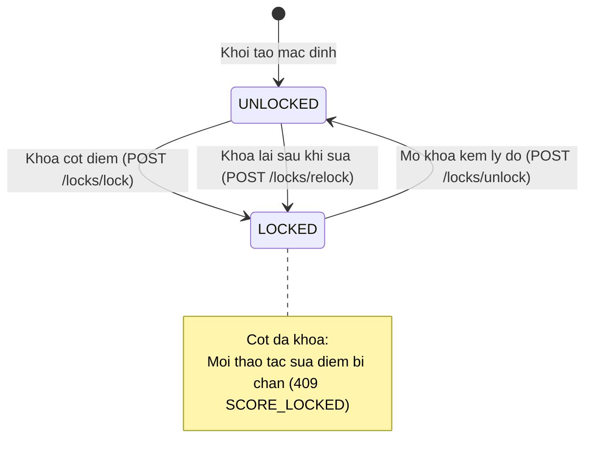
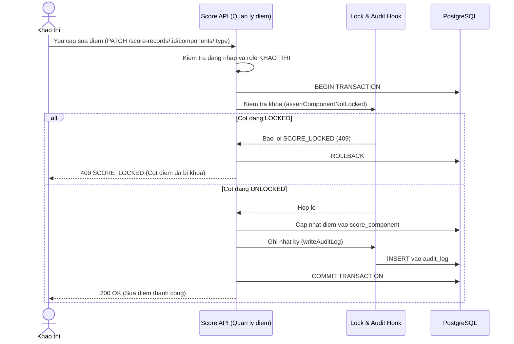

# THIET KE KHOA DIEM VA AUDIT LOG

## 1. Muc tieu

### 1.1. Muc tieu thiet ke

Thiet ke co che khoa diem va nhat ky kiem toan (Audit Log) cho he thong quan ly ket qua hoc tap THPT:

- Khoa va mo khoa doc lap theo tung thanh phan diem: QT1, QT2, QT3, GK, CK.
- Khoa theo tung nien khoa, lop va mon hoc.
- Chan backend khong cho sua diem khi cot diem dang khoa.
- Mo khoa bat buoc nhap nguoi yeu cau va ly do giai trinh.
- Sau khi sua diem xong thi khoa lai cot diem.
- Ghi nhat ky kiem toan bat bien (Audit Log) cho moi thao tac khoa, mo khoa va sua diem.
- Luu day du gia tri diem cu, diem moi, nguoi sua, ly do sua va lien ket voi lan mo khoa.
- Tich hop ham kiem tra khoa va ghi log trong cung mot transaction voi thao tac sua diem.
- Phuc vu tao migration database va thiet ke giao dien.

### 1.2. Cong nghe va quy uoc

- Backend: Node.js, Express.
- Database: PostgreSQL.
- API: REST, JSON.
- Base URL: http://localhost:3000/api/v1
- Ten bang va cot database: snake_case.
- Ten thuoc tinh JSON: camelCase.
- Ten endpoint: chu thuong, kebab-case, danh tu so nhieu.

Tai lieu tuan thu quy chuan chung tai docs/api-conventions.md.

### 1.3. Tai lieu tham chieu

- Bao cao khao sat va dac ta Use Case cua Nhom 5.
- UC08: Khoa diem.
- UC09: Mo khoa diem va ghi nhan nhat ky.
- docs/vt3-data-model.md (module quan ly hoc sinh va lop hoc).
- docs/vt4-score-design.md (module quan ly diem).
- docs/api-conventions.md (quy chuan API va kien truc).
- docs/figma-handoff.md (quy chuan thiet ke giao dien).

Trang thai: Ban thiet ke de xuat, cho Nhom truong review va xac nhan.

---

## 2. Cac thuc the

### 2.1. Danh sach thuc the

1. LockStatus - Quan ly trang thai khoa theo nien khoa, lop, mon va thanh phan diem.
2. AuditLog - Nhat ky kiem toan luu vet lich su khoa, mo khoa va thay doi diem.

### 2.2. Cac thuc the lien quan

Su dung cac thuc the do module quan ly hoc sinh va lop hoc thiet ke:
- AcademicYear: Nien khoa.
- Class: Lop hoc.
- Subject: Mon hoc.
- Student: Hoc sinh.
- Enrollment: Lich su phan lop.

Su dung cac thuc the do module quan ly diem thiet ke:
- ScoreRecord: Ban ghi diem theo hoc sinh va mon.
- ScoreComponent: Thanh phan diem (QT1, QT2, QT3, GK, CK).

### 2.3. Quan he du lieu de xuat

- AcademicYear, Class, Subject lien ket voi LockStatus.
- Moi LockStatus dai dien cho 1 thanh phan diem cua 1 mon tai 1 lop trong nien khoa.
- LockStatus lien ket voi AuditLog de theo doi lich su khoa va mo khoa.
- ScoreRecord va ScoreComponent lien ket voi AuditLog de luu chi tiet diem truoc va sau khi sua.
- Student lien ket voi AuditLog de biet hoc sinh nao duoc sua diem.
- AuditLog co lien ket tu tham chieu (related_log_id) de tro lan sua diem ve dung phien mo khoa.

---

## 3. Thiet ke thuoc tinh va rang buoc

### 3.1. LockStatus

Muc dich: Luu trang thai khoa cua tung thanh phan diem theo nien khoa, lop va mon hoc.

| Thuoc tinh | Kieu PostgreSQL | Rang buoc de xuat | Mo ta |
|---|---|---|---|
| lock_status_id | BIGSERIAL | PRIMARY KEY | Ma trang thai khoa |
| academic_year_id | BIGINT | NOT NULL, FOREIGN KEY | Tham chieu AcademicYear |
| class_id | BIGINT | NOT NULL, FOREIGN KEY | Tham chieu Class |
| subject_id | BIGINT | NOT NULL, FOREIGN KEY | Tham chieu Subject |
| component | VARCHAR(10) | NOT NULL | QT1, QT2, QT3, GK, CK |
| status | VARCHAR(20) | NOT NULL, DEFAULT 'UNLOCKED' | UNLOCKED hoac LOCKED |
| locked_by | VARCHAR(100) | Cho phep NULL | Nguoi khoa |
| locked_at | TIMESTAMPTZ | Cho phep NULL | Thoi diem khoa |
| unlocked_by | VARCHAR(100) | Cho phep NULL | Nguoi mo khoa |
| unlocked_at | TIMESTAMPTZ | Cho phep NULL | Thoi diem mo khoa |
| requested_by | VARCHAR(100) | Cho phep NULL | Nguoi yeu cau mo khoa |
| unlock_reason | TEXT | Cho phep NULL | Ly do mo khoa de giai trinh |
| version | INTEGER | NOT NULL, DEFAULT 1 | Kiem tra xung dot dong thoi |
| created_at | TIMESTAMPTZ | NOT NULL, DEFAULT CURRENT_TIMESTAMP | Thoi diem tao |
| updated_at | TIMESTAMPTZ | NOT NULL, DEFAULT CURRENT_TIMESTAMP | Thoi diem cap nhat |

Rang buoc de xuat:

- lock_status_id la khoa chinh.
- UNIQUE (academic_year_id, class_id, subject_id, component).
- component IN ('QT1', 'QT2', 'QT3', 'GK', 'CK').
- status IN ('UNLOCKED', 'LOCKED').
- version >= 1.
- academic_year_id tham chieu academic_year(academic_year_id).
- class_id tham chieu class(class_id).
- subject_id tham chieu subject(subject_id).

Luu y:
- Mac dinh khi bat dau nhap diem la UNLOCKED.
- Truong version dung de tranh ghi de khi 2 nguoi cung bam khoa/mo khoa cung luc.

### 3.2. AuditLog

Muc dich: Luu nhat ky bat bien ve cac thao tac khoa, mo khoa va thay doi diem so.

| Thuoc tinh | Kieu PostgreSQL | Rang buoc de xuat | Mo ta |
|---|---|---|---|
| audit_log_id | BIGSERIAL | PRIMARY KEY | Ma ban ghi nhat ky |
| action_type | VARCHAR(50) | NOT NULL | LOCK, UNLOCK, RELOCK, SCORE_EDIT, SCORE_IMPORT |
| lock_status_id | BIGINT | Cho phep NULL, FOREIGN KEY | Tham chieu LockStatus |
| academic_year_id | BIGINT | NOT NULL, FOREIGN KEY | Tham chieu AcademicYear |
| class_id | BIGINT | NOT NULL, FOREIGN KEY | Tham chieu Class |
| subject_id | BIGINT | NOT NULL, FOREIGN KEY | Tham chieu Subject |
| component | VARCHAR(10) | Cho phep NULL | QT1, QT2, QT3, GK, CK |
| student_id | BIGINT | Cho phep NULL, FOREIGN KEY | Tham chieu Student |
| score_record_id | BIGINT | Cho phep NULL, FOREIGN KEY | Tham chieu ScoreRecord |
| score_component_id | BIGINT | Cho phep NULL, FOREIGN KEY | Tham chieu ScoreComponent |
| old_value | NUMERIC | Cho phep NULL | Diem truoc khi sua |
| new_value | NUMERIC | Cho phep NULL | Diem sau khi sua |
| requested_by | VARCHAR(100) | Cho phep NULL | Nguoi yeu cau |
| performed_by | VARCHAR(100) | NOT NULL | Tai khoan thuc hien |
| reason | TEXT | Cho phep NULL | Ly do sua hoac mo khoa |
| related_log_id | BIGINT | Cho phep NULL, FOREIGN KEY | Tham chieu audit_log(audit_log_id) |
| result | VARCHAR(20) | NOT NULL, DEFAULT 'SUCCESS' | SUCCESS, REJECTED, FAILED |
| created_at | TIMESTAMPTZ | NOT NULL, DEFAULT CURRENT_TIMESTAMP | Thoi diem ghi log |

Rang buoc de xuat:

- audit_log_id la khoa chinh.
- action_type IN ('LOCK', 'UNLOCK', 'RELOCK', 'SCORE_EDIT', 'SCORE_IMPORT').
- result IN ('SUCCESS', 'REJECTED', 'FAILED').
- related_log_id tham chieu audit_log(audit_log_id) de lien ket cac lan sua diem voi ban ghi UNLOCK truoc do.
- Diem 0 la gia tri hop le, khac voi NULL (NULL la chua co diem).
- Bang nay la bat bien (Append-Only): Chi cho phep INSERT, cam UPDATE va DELETE de dam bao tinh minh bach khi thanh tra.

### 3.3. Quy tac toan ven du lieu

- Cap nhat diem va ghi AuditLog bat buoc phai nam trong cung mot transaction. Neu ghi log loi thi rollback toan bo, khong duoc luu diem.
- Khi sua diem qua API hay import CSV, backend phai kiem tra cot diem co bi LOCKED hay khong truoc khi ghi vao database.
- Dung version de phat hien xung dot khi co nhieu nguoi cung sua trang thai khoa.

---

## 4. Quy tac nghiep vu (Business Rules)

### 4.1. Quy tac khoa diem

- BR-L01: Moi cot diem co trang thai khoa doc lap theo nien khoa, lop, mon va thanh phan (QT1, QT2, QT3, GK, CK).
- BR-L02: Khoa mot cot diem khong anh huong den cac cot diem khac.
- BR-L03: Chi tai khoan co role KHAO_THI moi duoc phep khoa, mo khoa va khoa lai cot diem.
- BR-L04: Mac dinh cot diem o trang thai UNLOCKED de nhap diem.
- BR-L05: Khi khoa cot diem, he thong cho phep khoa ca khi con hoc sinh thieu diem nhung se hien thi canh bao so luong hoc sinh chua co diem.

### 4.2. Quy tac mo khoa va sua diem

- BR-L06: Khi mo khoa (UNLOCK), bat buoc phai nhap nguoi yeu cau (requestedBy) va ly do mo khoa (reason).
- BR-L07: Ly do mo khoa khong duoc de trong, phai ghi ro rang de phuc vu giai trinh thanh tra.
- BR-L08: Sau khi sua diem xong, nguoi dung phai thuc hien khoa lai (RELOCK) cot diem.
- BR-L09: Moi lan sua diem trong thoi gian mo khoa phai ghi ro gia tri cu, gia tri moi va ly do sua vao AuditLog.

### 4.3. Quy tac chan sua khi cot da khoa

- BR-L10: Backend phai chan tuyet doi moi thao tac them, sua, xoa diem khi cot dang o trang thai LOCKED.
- BR-L11: Khi bi chan do cot da khoa, he thong tra ve ma loi SCORE_LOCKED (HTTP 409).
- BR-L12: Khi import diem tu CSV, he thong kiem tra tung dong. Dong nao thuoc cot dang khoa thi bo qua va bao loi dong do, khong ghi de len du lieu da khoa.

### 4.4. Quy tac nhat ky kiem toan (Audit Log)

- BR-A01: AuditLog la du lieu bat bien, he thong khong cung cap API sua hoac xoa nhat ky.
- BR-A02: Moi thao tac LOCK, UNLOCK, RELOCK, SCORE_EDIT va SCORE_IMPORT deu phai ghi 1 ban ghi vao AuditLog.
- BR-A03: Diem 0 va NULL phai duoc luu chinh xac trong log, khong tu dong quy doi NULL thanh 0.
- BR-A04: Chi tai khoan KHAO_THI moi duoc xem danh sach va loc AuditLog.

### 4.5. Quy tac phan quyen

- BR-P01: He thong co 2 vai tro: KHAO_THI va HOC_SINH.
- BR-P02: HOC_SINH khong duoc goi cac API khoa diem va AuditLog.
- BR-P03: HOC_SINH chi duoc xem ket qua hoc tap cua chinh minh khi cot diem da o trang thai LOCKED (da cong bo chinh thuc). Cot diem dang UNLOCKED duoc coi la diem nhap noi bo, chua hien thi cho hoc sinh.

### 4.6. Xu ly khi hoc sinh chuyen lop

- BR-T01: Khi hoc sinh chuyen lop giua nien khoa, diem so tai lop cu duoc giu nguyen va giu nguyen trang thai khoa cua lop cu.
- BR-T02: Thao tac chuyen lop khong duoc tu dong mo khoa hoac xoa khoa cua lop cu.
- BR-T03: Diem moi cua hoc sinh tai lop moi tuan theo trang thai khoa cua lop moi.

---

## 5. Hop dong API (API Contract)

### 5.1. Quy uoc chung

Base URL:

http://localhost:3000/api/v1

Quy uoc:
- GET: Lay du lieu.
- POST: Thuc hien thao tac khoa, mo khoa, khoa lai.
- Endpoint su dung chu thuong va kebab-case.
- JSON su dung camelCase.
- Tat ca cac API ben duoi yeu cau role KHAO_THI.

### 5.2. Danh sach API de xuat

| Method | Endpoint | Chuc nang |
|---|---|---|
| GET | /locks | Lay ma tran trang thai khoa 5 cot diem theo lop va mon |
| POST | /locks/lock | Khoa 1 cot diem |
| POST | /locks/unlock | Mo khoa 1 cot diem (kem nguoi yeu cau va ly do) |
| POST | /locks/relock | Khoa lai cot diem sau khi sua |
| GET | /audit-logs | Xem va loc danh sach nhat ky kiem toan |

### 5.3. Chi tiet cac API

#### API lay trang thai khoa

GET /locks

Query parameters:
- academicYearId: Ma nien khoa.
- classId: Ma lop.
- subjectId: Ma mon.

Tra ve danh sach 5 thanh phan (QT1, QT2, QT3, GK, CK) kem status (UNLOCKED hoac LOCKED) va version.

#### API khoa cot diem

POST /locks/lock

Body gui len:
- academicYearId: Ma nien khoa.
- classId: Ma lop.
- subjectId: Ma mon.
- component: QT1, QT2, QT3, GK hoac CK.
- expectedVersion: Phien ban du lieu hien tai.

Xu ly:
- Kiem tra quyen KHAO_THI.
- Kiem tra version tranh xung dot.
- Chuyen status sang LOCKED.
- Ghi nhat ky LOCK vao AuditLog.
- Canh bao neu con hoc sinh thieu diem.

#### API mo khoa cot diem

POST /locks/unlock

Body gui len:
- academicYearId: Ma nien khoa.
- classId: Ma lop.
- subjectId: Ma mon.
- component: QT1, QT2, QT3, GK hoac CK.
- expectedVersion: Phien ban du lieu.
- requestedBy: Nguoi yeu cau mo khoa.
- reason: Ly do mo khoa de giai trinh.

Xu ly:
- Kiem tra bat buoc co requestedBy va reason.
- Chuyen status sang UNLOCKED.
- Ghi nhat ky UNLOCK vao AuditLog.

#### API khoa lai cot diem

POST /locks/relock

Body gui len:
- academicYearId, classId, subjectId, component, expectedVersion.

Xu ly:
- Chuyen status sang LOCKED.
- Ghi nhat ky RELOCK vao AuditLog.

#### API xem AuditLog

GET /audit-logs

Query parameters:
- page, limit (phan trang).
- academicYearId, classId, subjectId, component.
- studentId.
- performedBy.
- from, to (khoang thoi gian).

Tra ve danh sach nhat ky va tong so dong de phan trang.

### 5.4. Hook noi bo kiem tra khoa va ghi log cho module quan ly diem

Khi thuc hien API sua diem va import CSV, he thong goi 2 ham noi bo nay:

1. Ham kiem tra khoa: `assertComponentNotLocked({ academicYearId, classId, subjectId, component }, { tx })`
- Goi truoc khi sua diem hoac khi doc tung dong CSV.
- Neu cot dang LOCKED: nem loi ma SCORE_LOCKED (HTTP 409).
- Neu UNLOCKED: cho phep di tiep.

2. Ham ghi nhat ky: `writeAuditLog(entry, { tx })`
- Chay trong cung database transaction voi thao tac sua diem.
- Luu old_value, new_value, reason, nguoi sua.
- Neu ghi log bi loi thi rollback transaction, khong luu diem.

### 5.5. Quy uoc ma loi

| HTTP | Error code | Y nghia |
|---|---|---|
| 400 | VALIDATION_ERROR | Du lieu dau vao sai hoac thieu ly do |
| 401 | UNAUTHORIZED | Chua dang nhap |
| 403 | FORBIDDEN | Khong co quyen (khong phai KHAO_THI) |
| 404 | NOT_FOUND | Khong tim thay du lieu |
| 409 | CONFLICT | Trang thai bi trung |
| 409 | SCORE_LOCKED | Cot diem da khoa, chan sua diem |
| 409 | VERSION_CONFLICT | Du lieu da bi nguoi khac thay doi |
| 500 | INTERNAL_ERROR | Loi he thong |

---

## 6. So do luong (Diagrams)

### 6.1. Vong doi trang thai khoa (State Diagram)

### 6.2. Luong sua diem va ghi log (Sequence Diagram)

---

## 7. Noi dung de nghi Nhom truong review

Cac noi dung thiet ke cua phan Khoa diem va Audit Log de nghi Nhom truong review:

1. Thiet ke co so du lieu:
- Schema 2 bang `lock_status` va `audit_log`.
- Rang buoc khoa doc lap theo bo 4: `(academic_year_id, class_id, subject_id, component)`.
- Tinh bat bien cua `audit_log` (chi cho phep INSERT, chan lenh UPDATE va DELETE).
- Rang buoc version kiem soat xung dot dong thoi (Optimistic Locking).

2. Quy tac nghiep vu:
- Khoa doc lap tung cot diem (QT1, QT2, QT3, GK, CK), khoa cot nay khong anh huong cot khac.
- Backend chan tuyet doi thao tac sua diem khi cot dang LOCKED (tra ma loi `SCORE_LOCKED`).
- Mo khoa bat buoc nhap nguoi yeu cau (`requestedBy`) va ly do (`reason`).
- Hoan tat sua diem phai khoa lai (`RELOCK`).
- Cap nhat diem va ghi `AuditLog` bat buoc trong cung mot transaction, loi thi rollback toan bo.
- Bao toan diem cu va trang thai khoa cua lop cu khi hoc sinh chuyen lop.

3. Hop dong API va Hook tich hop:
- Danh sach 5 REST endpoint: `GET /locks`, `POST /locks/lock`, `POST /locks/unlock`, `POST /locks/relock`, `GET /audit-logs`.
- Chu ky 2 ham hook noi bo: `assertComponentNotLocked` (kiem tra khoa) va `writeAuditLog` (ghi nhat ky).
- Quy trinh kiem tra khoa theo tung dong khi import CSV, bo qua dong bi khoa va bao loi chi tiet.
- Danh muc ma loi thong nhat.
